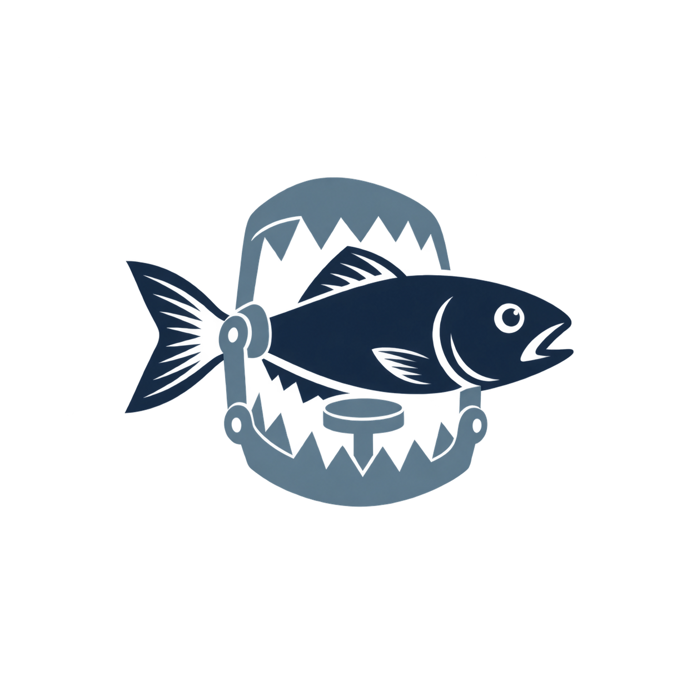

<p align="center">
  
</p>

<h1 align="center">Trickfish</h1>

Trickfish is a chess-engine research project with a Python reference engine and a C++ performance core. Its long-term goal is to select, among objectively acceptable moves, the move whose adequate defense is hardest to find and execute. Candidate verification and practical move selection are planned; they are not part of the current search.

## Current implementation

Python provides the reference rules, positional evaluation, search, and a clock-aware UCI reference interface. C++ provides mutable position state, legal move generation, perft, the current Python reference static evaluation terms, and an initial search implementation with a basic asynchronous UCI frontend. Cross-language fixtures compare the complete static breakdown and terminal-aware scores; search behavior remains separate. No playing-strength or Elo claim has been established.

### Python reference engine

| Area | Current state |
| --- | --- |
| FEN | Parse, validate, render, and serialize |
| Board state | Immutable 64-square tuple |
| Move representation | Immutable UCI-coordinate move value |
| Move application | Immutable successor position with clocks, rights, en passant, promotion, and castling updates |
| Pseudo-legal moves | Knight, bishop, rook, queen, king, and pawn moves |
| Pawn support | Single step, double step, ordinary captures, promotion, and en passant |
| Castling | Rights, piece placement, empty path, and attack checks for the king's route |
| Attack map | Detect attacks by either side without changing side to move |
| Game state | Check, checkmate, stalemate, and ongoing-position status |
| Evaluation | Phase-aware white-positive score with material, activity, pawn structure, bishop pair, rook files, king safety/activity, mate, and dead-position terms |
| Search | Iterative deepening, deadline control, negamax, alpha-beta, capture-first ordering, quiescence, Zobrist transposition table, principal variation, and node count |
| Position key | Deterministic 64-bit Zobrist key for board, side, castling, and legal en passant state |
| Game history | Immutable position sequence with threefold-repetition counting |
| Draw rules | Threefold repetition, 50/75-move thresholds, and insufficient-material detection |
| Perft | Recursive legal-node counter with standard positions through depth 3 and root divide |
| CLI | Position display, status, evaluation, depth-limited search, legal/pseudo-legal move listing, perft, and divide |
| UCI | Handshake, readiness, new game, startpos/FEN with moves, depth/movetime/clock search, stop, bestmove, and quit |
| Tests | FEN, move values, legal filtering, move application, CLI, and perft |

`moves` reports legal moves after applying each candidate and checking the moving side's king. `pseudo-moves` exposes the raw generator for debugging. Castling checks the king's starting, transit, and destination squares against the attack map.

### C++ performance core

| Area | Implemented scope |
| --- | --- |
| Position | Twelve piece bitboards, 64-square mailbox, cached side occupancy, clocks, castling rights, and en passant state |
| Updates | Reversible make/unmake for ordinary moves, captures, promotions, en passant, and castling |
| Move generation | Fixed-capacity move list, all-piece pseudo-legal generation, castling path checks, and legal filtering |
| Attacks | Compile-time pawn/knight/king tables, blocker-aware sliding attacks, aggregate attack maps, and targeted king check detection |
| Position key | Incremental deterministic 64-bit Zobrist key with undo restoration; only legal en passant availability is hashed |
| Game state | Check, checkmate, stalemate, and conservative insufficient-material detection |
| Evaluation | White-positive reference material, piece activity, pawn structure, bishop pair, rook files, and phase-aware king safety/activity, mate/stalemate/insufficient-material handling, and side-to-move score conversion |
| Search | Negamax, alpha-beta, mate-distance scores, capture/promotion ordering, quiescence, bounded TT, and iterative deepening |
| TT | Full-key checks, depth-qualified exact/lower/upper bounds, mate-score normalization, and preferred-move ordering |
| Output | Best root move, legal main-search PV, side-to-move score, completed depth, and accumulated node count |
| Perft | Recursive node count and root divide |
| UCI | Handshake/readiness, startpos/FEN with legal moves and history, asynchronous depth/node/movetime/remaining-clock search, stop, new game, quit, and EOF |

The C++ UCI frontend has a baseline remaining-clock allocator and Move Overhead option; ponder, configurable Hash/Threads, and Chess960 remain unsupported. Additional endgame/drawish scaling, evaluation tuning, and advanced pruning remain pending. Both implementations include en passant in the key only when a legal capture exists. A separate C++ repetition-key history container supports push/pop and current-position occurrence counts; iterative search optionally accepts this history. It validates the root key, uses a local copy, and scores three occurrences as zero under an always-claim policy. Main and quiescence moves update the copy with safe unwind. This mode disables TT because scores depend on the played history. Diagnostic --search calls without a history retain TT/no-repetition behavior. The UCI frontend supplies the complete move list history and therefore uses history-aware search with TT disabled. A standalone FEN cannot reconstruct played-game history. Their deterministic key tables differ, so numeric Python/C++ key equality is not an acceptance criterion.

Quiescence searches captures, en passant, and promotions. In check it searches all legal evasions and disables stand-pat. It is capped at 32 quiescence plies; after checking terminal states, the cap returns static evaluation even if the position is still in check. This is a safety truncation, not a guarantee of tactical completeness. Main search accepts depths 1 through 64. TT entries are used by main search, not quiescence.

`--search` runs depths successively with a shared TT and reports the last completed depth. It stops terminal roots after the first iteration. The reported PV covers selected main-search moves, excludes quiescence continuations, and may truncate at TT cutoffs or terminal/draw states. It is not guaranteed to reach the reported depth. `--search-time` accepts a depth and a non-negative millisecond budget using a steady-clock deadline. Deadline checks occur before main/quiescence node visits; setup and individual node operations can overrun the budget. The iterative-search API also accepts a stop predicate. It runs synchronously before node visits; a true result preserves the same completed-iteration fallback. Callers must synchronize any predicate state changed from another thread. The diagnostic CLI remains a one-shot command; the UCI frontend maps its stop command to the search stop predicate. `--search-nodes` caps main/quiescence node visits across all iterations. On node-budget or deadline exhaustion it restores position state and returns the last completed iteration; before depth one completes it returns a legal fallback with depth 0, an empty PV, and `stopped true`. Root fallback preparation is outside the node budget. `--divide` prints the node count under each legal root move and the total.

### Evaluation detail and parity

`--eval-detail [fen]` reports `phase`, `material`, `piece_activity`, `pawn_structure`, `bishop_pair`, `rook_files`, `king_safety`, `king_activity`, `static_total`, and `evaluation`. Terms and totals are white-positive. Phase is a 0..24 index, not an added score: knights/bishops contribute 1, rooks 2, and queens 4, summed across both sides and capped at 24 for promoted material. Pawn advancement bonuses increase toward the endgame.

The pawn term matches the current Python reference: -15 per extra pawn on a file, -12 per pawn without a friendly pawn on an adjacent file, and a passed-pawn bonus when no enemy pawn lies ahead on the same/adjacent file. The passed bonus is `8 + 8 * advance + floor((24 - phase) * 2 * advance / 24)`. These are reference heuristics, not tuned parameters. C++ tests the enemy-pawn intersection with compile-time forward-file masks; it no longer scans every enemy pawn for each candidate. The same and adjacent files ahead are included, with no a/h-file wraparound. New mask-boundary and expanded cross-language checks await CI; no measured speedup is claimed. `static_total` sums all seven score components; `evaluation` applies mate/stalemate/recognized-insufficient-material precedence, so the two may differ in finished positions. Static evaluation does not apply search move-count/repetition draw policy.

CI is configured to compare the complete C++ evaluation breakdown and terminal-aware score with the public Python evaluator on 886 positions, including color reflections and legal children, promotions, en passant, and systematic piece-square/color coverage. Pawns cover ranks 2..7; knights, bishops, rooks and queens cover all squares, with rook cases both with and without an enemy pawn. These fixtures check reference agreement on selected positions; they do not prove universal equivalence or a playing-strength improvement.

Piece activity rewards pawn advancement/central files, knight/bishop centrality, and rooks on the enemy seventh rank while enemy pawns remain. King safety combines a c/g home-rank square bonus with neighboring home-pawn shields, scaled by material phase. The square bonus does not infer castling history. King centrality is scaled toward the endgame and disabled whenever any queen or rook remains. These formulas preserve the current Python reference and have not been tuned. C++ piece activity traverses pawn/knight/bishop bitboards and counts seventh-rank rooks with a rank mask instead of scanning/decoding all 64 mailbox squares. Scores are intended to remain identical. The expanded parity suite awaits CI for this revision; no measured speedup is claimed.

### Verification coverage

The C++ workflow is configured to build with GCC on Linux and MSVC on Windows. It runs initial-position FEN round-trip, depth-3 perft on four positions, divide fixtures, and CLI material/game-state/evaluation fixtures. CTest adds position-state restoration, incremental-key and occupancy checks, targeted check detection parity, TT storage/score normalization, and search regressions including TT-disabled and iterative comparisons. UCI adds parser/position/lifecycle CTest coverage and a standard-library Python subprocess suite for handshake, completed search, readiness during infinite search, stop, transactional positions, limits, mate reporting, and history transmission.

The configured perft counts are 8,902 for the initial position, 97,862 for Kiwipete, 2,812 for the endgame fixture, and 9,467 for the promotion/check-evasion fixture. These are acceptance targets, not a statement that an uninspected commit has passed CI. Check the Actions result for the exact commit being reviewed. Perft verifies move-generation behavior on those trees; it does not establish search quality or playing strength. Passing search fixtures establishes those regression cases, not general tactical correctness or evaluator parity with Python.

[PROGRESS.md](PROGRESS.md) records a weighted C++ implementation-scope index. Its percentages are planning arithmetic, not measured progress toward world-class playing strength. Implementation and exact-commit CI confirmation are tracked separately.

## Running the prototype

Run from the repository root in PowerShell:

```powershell
$env:PYTHONPATH="src"

python -m trickfish.cli
python -m trickfish.cli moves
python -m trickfish.cli pseudo-moves
python -m trickfish.cli status "7k/6Q1/6K1/8/8/8/8/8 b - - 0 1"
python -m trickfish.cli eval "7k/8/8/8/8/8/8/KQ6 w - - 0 1"
python -m trickfish.cli eval-detail
python -m trickfish.cli search 3
python -m trickfish.cli search-time 1000
python -m trickfish.cli moves "8/7k/8/8/3Q4/8/K7/8 w - - 0 1"
python -m trickfish.cli perft 3
python -m trickfish.cli divide 3
python -m trickfish.uci
python -m unittest discover -s tests -v
```

## C++ UCI frontend

Running `trickfish_cpp` without arguments, or with `--uci`, enters UCI mode. Explicit diagnostic arguments retain their existing behavior, including a quoted FEN argument for FEN round-trip output. Launching without arguments no longer prints the initial FEN and exits.

Supported commands are `uci`, `isready`, `ucinewgame`, `position startpos`, `position fen` with six fields, an optional `moves` list, `go`, `stop`, and `quit`. Moves are resolved against the legal move list so promotions, castling, and en passant keep their internal flags. An invalid position command reports `info string error` and leaves the previously accepted position/history unchanged. Parsing rejects a checked non-moving king, pawns on promotion ranks, and EP ranks inconsistent with the active side; it does not prove that every FEN is historically reachable.

Search runs on a worker thread with independent position/history copies. `isready` responds while search is active. `stop` joins the worker and produces one `bestmove` for that search; replacing a position/search, starting a new game, quitting, or reaching EOF also stops and joins it. Search limits can combine `depth` (1 through 64), `nodes`, and `movetime` in milliseconds. A bare `go` or `go infinite` waits for `stop` before emitting `bestmove`, including when the depth ceiling is reached. Info is emitted when search finishes, not after every iteration. A budget exhausted before depth one yields an unscored depth-zero legal fallback.

`go searchmoves e2e4 d2d4 depth 4` restricts search to those legal root moves, as defined by the [UCI protocol](https://backscattering.de/chess/uci/). Other supported go parameters can precede or follow the move list. Empty, duplicate or illegal lists are rejected. Promotions, castling and en passant are resolved through the legal move list, preserving flags. A restricted search's PV and interrupted fallback stay within the allowed root moves; normal draw adjudication still applies.

The C++ iterative API exposes the same restriction through `SearchOptions::root_moves`; its default empty vector means unrestricted search. Restricted searches disable TT to prevent reuse across different root move sets. Root restrictions do not prune descendants. New C++/process checks for this extension await its completed CI run; no playing-strength claim follows.

The frontend accepts `wtime`/`btime`, `winc`/`binc`, and positive `movestogo`. It selects the clock and increment for the active side. An explicit `movetime` takes precedence over clock allocation; `go infinite` ignores time deadlines. If clock parameters are supplied without the active side's remaining time, the request is rejected unless movetime or infinite mode supplies the applicable policy. The `mate` limit and pondering remain unsupported. The allocator is a baseline heuristic and has not been tuned or validated by controlled matches. Supplying `position ... moves` enables played-game repetition handling; FEN alone supplies no earlier history. This mode currently disables TT and uses the existing always-claim repetition search policy. It does not make the search multithreaded internally.

Clock allocation uses `remaining / movestogo + increment / 2`, with a default horizon of 30 moves. The budget is capped by remaining time after reserving the larger of 5% of the clock or `Move Overhead`. The advertised `Move Overhead` spin option ranges from 0 to 10000 ms, defaults to 10, and applies to subsequent clock-based searches. It persists across `ucinewgame`; invalid option updates preserve the old value. If usable time is exhausted, the budget is zero and search returns its depth-zero fallback. A future increment is never spent when no usable time remains. Overflow-safe allocation does not guarantee avoidance of flag losses: setup and individual node operations can still overrun the deadline.

Example clock commands are `setoption name Move Overhead value 20` and `go wtime 60000 btime 60000 winc 1000 binc 1000 movestogo 30`. Explicit `movetime` is not reduced by Move Overhead. Hash/Threads are not advertised. Experimental search options are described under Controlled UCI profiles.

Example input after launching the binary:

```text
uci
isready
position startpos moves e2e4 e7e5
go depth 4
```

Use `stop` to interrupt an active search and `quit` to exit. Scores are side-to-move positive: ordinary scores use `score cp`, mate scores use `score mate` in full moves. `bestmove 0000` indicates no root move, including already adjudicated automatic draws. Protocol reference: [UCI specification distributed with Stockfish](https://sources.debian.org/src/stockfish/17-1/debian/engine-interface.txt).

## Engine direction

Trickfish is being designed around two separate measurements:

1. **Objective result:** the evaluation after the strongest defense found by search.
2. **Practical result:** the difficulty and consequence of the opponent's plausible responses.

The planned practical measurement is a selection constraint. It will be applied only after candidate moves pass an objective-loss limit and tactical re-search.

For a candidate move `m`, the eventual selection stage will compare:

```text
objective value after best defense
evaluation uncertainty
number and quality of defensive resources
cost of likely defensive mistakes
time required to find adequate defense
game context and configured risk budget
```

The relevant failure case is a trap that works only when the opponent misses one obvious response. Candidate verification must identify and reject that case.

## Planned core

| Layer | Responsibilities |
| --- | --- |
| Position | Piece placement, side to move, castling, en passant, clocks, make/unmake, repetition state, Zobrist key |
| Move generation | Pseudo-legal moves, attack maps, legal filtering, promotions, en passant, castling, perft |
| Search | Iterative deepening, alpha-beta, quiescence, transposition table, move ordering, pruning, extensions, time control |
| Evaluation | Material, pawn structure, mobility, king safety, threats, passed pawns, space, endgame scaling |
| Candidate verification | Re-search of selected candidates, tactical stability checks, uncertainty tracking |
| Practical selection | Candidate eligibility, defensive-resource analysis, opponent-response model, risk-budget policy |
| Interfaces | UCI protocol, command-line analysis, structured analysis output |
| Measurement | Perft suite, tactical regression suite, SPRT engine matches, fixed opening sets, reproducible hardware and time controls |

## Development sequence

### Python reference

- [x] Legal rules, FEN, immutable move application, and multi-position perft
- [x] Legal-en-passant Zobrist keys, repetition history, and draw-rule helpers
- [x] Phase-aware positional evaluation and explainable breakdown
- [x] Alpha-beta, quiescence, TT, iterative deepening, and principal variation
- [x] Deadline-based search and UCI depth/movetime/clock/stop support

### C++ core

- [x] Mutable bitboards, mailbox, occupancy, and reversible updates
- [x] Complete legal move generation, attack detection, perft, and divide
- [x] Incremental Zobrist keys and restoration regression fixtures
- [x] Material evaluation with terminal and insufficient-material handling
- [x] Depth-limited alpha-beta with mate-distance scores
- [x] Capture/promotion ordering and quiescence with check evasions
- [x] Bounded TT with score normalization and depth-qualified bounds
- [x] Iterative deepening with shared TT and completed-depth reporting
- [x] Legal principal variation output with explicit TT truncation
- [x] Node budget with state restoration and completed-iteration fallback
- [x] Steady-clock deadline with completed-iteration fallback
- [x] API stop predicate with completed-iteration fallback and state restoration
- [x] Legal-en-passant repetition-equivalent keys
- [x] Reversible repetition-key history container and three-occurrence threshold
- [x] Optional history-aware iterative search with conservative TT exclusion
- [x] Separate fifty-move claim and seventy-five-move automatic-draw classification
- [x] Automatic seventy-five-move search draws, optional fifty-move claim policy, and clock-aware TT keys
- [x] Reference bishop-pair term in static evaluation and search
- [x] Reference rook-file term in static evaluation and search
- [x] Phase-aware pawn structure and explainable implemented-term breakdown
- [x] Reference piece/king activity and phase-aware king safety
- [ ] Additional position-dependent endgame/drawish scaling
- [x] Basic asynchronous C++ UCI with legal positions, history, depth/node/movetime, and stop lifecycle
- [x] UCI remaining-clock allocation, increments, movestogo, and Move Overhead option
- [x] PVS with selectable full-window alpha-beta reference and parity fixtures
- [x] Iterative aspiration windows with widening and interrupted-retry fixtures
- [x] Quiet killer ordering with per-search lifetime and selectable disabling
- [x] Bounded quiet history with cutoff rewards and prior-quiet penalties
- [x] Legal-recapture material exchange diagnostic with special-move/pin fixtures
- [x] Targeted legal recaptures with full-generator exchange reference
- [x] Bounded exchange search with exhaustive reference parity and work counters
- [x] Optional interruptible exchange ordering with comparative diagnostics
- [x] Bounded one-ply continuation history with context-aware quiet ordering
- [x] Reversible synthetic null-move state with key/undo fixtures
- [x] Optional guarded null probe with full-depth real-position verification
- [x] Optional guarded late move reductions with score-drift diagnostics
- [x] Optional guarded frontier futility with selective-score diagnostics
- [x] Optional guarded frontier razoring with quiescence confirmation
- [x] Optional bounded check extensions with effective-PV validation
- [x] Optional bounded pawn-structure correction history with per-search lifetime
- [ ] Further extension/pruning optimization
- [x] Fixed-suite repeatable diagnostic search benchmark and provenance reports
- [x] Bounded tactical regression objectives with mirrored-color fixtures
- [x] Sequential color-paired UCI match baseline with legal replay and provenance
- [x] Replay-validated PGN mainline export with result/provenance integrity
- [ ] Broader tactical/opening methodology, tuning, and SPRT matches

### Research layers

- [ ] Candidate verification
- [ ] Practical move selection
- [ ] Opponent-specific experiments and published benchmark methodology

Checked items indicate implemented scope. They do not certify the latest commit's CI result or playing strength.

## Language plan

The current Python code exists to establish rules, tests, and the decision model quickly. It is not intended to be the final high-performance search core.

The target architecture is a C++26 engine core for position updates, move generation, search, and evaluation. The actual build baseline is C++23 (`cxx_std_23` in `CMakeLists.txt`), with compiler extensions disabled. C++26 is an architectural target, not the currently required compiler standard. Python remains the behavioral reference and supports tooling, experiments, fixtures, data preparation, and analysis.

The C++ core is under `cpp/`. Local C++ compilation and runtime execution have not been established in the current development environment; GitHub Actions provides the configured GCC/MSVC build and runtime verification. The commands below require an installed CMake and compatible compiler.

Windows with Visual Studio:

```powershell
cmake -S . -B build -A x64
cmake --build build --config Release
ctest --test-dir build -C Release --output-on-failure
.\build\Release\trickfish_cpp.exe --perft 3
.\build\Release\trickfish_cpp.exe --divide 3
.\build\Release\trickfish_cpp.exe --material
.\build\Release\trickfish_cpp.exe --eval
.\build\Release\trickfish_cpp.exe --eval-detail
.\build\Release\trickfish_cpp.exe --status
.\build\Release\trickfish_cpp.exe --search 3
.\build\Release\trickfish_cpp.exe --search-nodes 6 10000
.\build\Release\trickfish_cpp.exe --search-time 6 1000
.\build\Release\trickfish_cpp.exe --uci
```

Linux with a single-configuration generator:

```sh
cmake -S . -B build -DCMAKE_BUILD_TYPE=Release
cmake --build build
ctest --test-dir build --output-on-failure
./build/trickfish_cpp --search 3
```

`--material`, `--eval`, `--eval-detail`, `--eval-stm`, `--status`, and `--insufficient-material` accept an optional quoted FEN. `--perft`, `--divide`, `--search`, and `--search-ab` accept a depth followed by an optional quoted FEN. `--search-nodes` accepts depth, a non-negative node limit, and an optional quoted FEN. `--search-time` accepts depth, a non-negative millisecond budget, and an optional quoted FEN. Without a FEN, commands use the initial position. `--eval` is white-positive; `--eval-stm` and search scores are side-to-move positive. Mate scores use a separate magnitude of 100,000, with search adjusting for distance. Diagnostic search output is separate from UCI mode, which is selected with --uci or by launching with no arguments.

The C++ `move_count_draw_status` API reports claim availability at 100 halfmoves and automatic draw at 150. It returns no additional move-count classification for positions already finished by mate, stalemate, or recognized insufficient material. Search now adjudicates automatic seventy-five-move draws in main and quiescence nodes, with mate checked first. The iterative API optionally always claims an available fifty-move draw; the default CLI policy does not claim it automatically. Intended-move claims and selecting a win instead of an optional claim remain unmodeled. Search TT keys include halfmove clock and draw policy; repetition keys still omit clocks. Static `--eval` does not apply this search draw policy. Its non-terminal score combines material, a one-time 30-point bonus per side with at least two bishops, the Python rook-file term, phase-aware pawn structure, piece activity, king safety, and king activity. Each rook gets 10 points if its file lacks a friendly pawn and another 10 if it lacks an enemy pawn; the entire rook-file term is disabled when no pawns remain. `--material` remains material-only. See [FIDE Laws, articles 9.3 and 9.6.2](https://handbook.fide.com/chapter/E012023).

Main search defaults to principal variation search (PVS): the first move uses the current full window, later moves probe with a null window, and an improvement below beta triggers a full-window re-search. This changes search windows, not nominal depth or legal move coverage. Quiescence keeps its existing alpha-beta behavior. `--search-ab depth [fen]` selects the full-window diagnostic reference with PVS, aspiration, killer, quiet-history and continuation ordering disabled; `SearchOptions::use_pvs` controls iterative search and the positional API remains available. `SearchResult` includes probe/re-search attempt counts, cumulative across iterative and interrupted work. Tied best moves and PVs may differ between algorithms. PVS commit `2106708` passed its configured CI checks; this does not establish a speedup.

Iterative search uses aspiration windows from depth two: an initial 25-point radius around the last completed score doubles after fail-low/high until the result is inside the window, with bounds clamped to the full score range. Mate-band previous scores use a full window. `SearchOptions::aspiration_window` (also available through the positional API) accepts 0 to disable it, or 1..100001 for the starting radius. Failed or interrupted retries never replace the last completed iteration; their work remains in cumulative node and failure counters. Fixed-depth API searches retain a full root window. The default radius is untuned. Aspiration commit `47b3c83` passed its configured CI checks.

Main-search quiet beta cutoffs retain two unique killer moves per ply. A legal TT move sorts first, followed by captures/promotions, the two killer quiets, and remaining quiet moves with deterministic coordinate ties. Captures, en passant, and promotions are never recorded as killers. Quiescence retains its existing ordering. Killer state is shared across depths/retries of one search and reset for each new search. Iterative search uses `SearchOptions::use_killers`; the positional API also retains its switch; result counters report quiet killer cutoffs and killer moves actually searched. This is an untuned ordering heuristic; new C++ parity/lifetime checks await this change's CI.

The structured C++ iterative API accepts `SearchOptions` (TT, PVS, killer ordering, quiet history, aspiration radius, and draw policy), `SearchLimits` (node limit, deadline, and stop callback), and an optional repetition-history pointer. CLI and UCI use this entry point. The legacy positional overload forwards to the same implementation with the same defaults. Existing CTests exercise both forms; the configuration refactor passed CI at `1602584`. The experimental fields listed below are also exposed through UCI; the remaining configuration stays at the C++ API level.

Quiet history uses a side/from/to table within each search, shared across iterative depths and retries. A quiet beta cutoff receives `min(512, depth * depth)` and previously searched quiets on that node receive the negative bonus. Gravity updates keep values within +/-16384. History breaks ties after tactical/killer priority and before coordinate ties; it does not alter quiescence ordering or prune moves. `SearchOptions::use_history` disables it; result counters report rewards, penalties and moves searched with nonzero history. The table resets per search. These are untuned heuristics, with runtime/parity checks pending this change's CI.

One-ply continuation history adds context to quiet ordering: current side, previous moved piece type/destination, and current moving type/destination. It uses a lazily allocated 16,384-entry direct-mapped table with full-key checks; collisions replace entries on update. Scores are bounded to +/-16384 and combine with quiet history after existing tactical/killer priorities. `SearchOptions::use_continuation` controls it. Root and quiescence have no continuation context, and a standalone FEN supplies no previous played-game move. State resets per search; this table is separate from repetition history. New C++ context/reuse/parity checks await this change's CI.

### Transposition replacement policy

For the same full key, deeper entries retain priority. At equal depth, a non-exact bound cannot replace an exact entry; a weaker lower bound or weaker upper bound of the same kind cannot replace its stronger counterpart. Higher lower bounds and lower upper bounds carry more information. Equal scores, exact-to-exact updates and changes between lower/upper kinds retain the existing replacement behavior. Different-key collisions still evict the indexed slot; rejected updates preserve the complete prior payload, including its move.

New CTests cover these bounds and repeated search through a small collision-prone table against a no-TT reference, checking scores, legal PVs and root restoration. Actual C++ verification awaits this revision's CI. This is an information-preservation refinement, with no measured speed or strength claim. History-aware UCI search still disables TT.

### Cached move-ordering keys

Search computes each move's preferred-move flag, tactical status, capture/promotion/killer priority and combined history/continuation value once before sorting. Optional exchange ordering also computes its exchange score once. The comparator reads those keys and retains the existing coordinate/promotion tie-breaks. Values are local to one ordering call; heuristic tables continue to update between searched moves and are read again at the next call.

`SearchOptions::use_cached_ordering` defaults to true. `--search-order-reference depth [fen]` retains the previous comparator-based calculation with the same search policies. Add `--compare-ordering` to the benchmark to require equal score, completed depth, node count, best move and PV, and record reference/cached paired wall-time ratios. CI is configured for that diagnostic comparison and CTests covering exchange/table/history modes and node-limited interruption. New C++ parity/timing results await this revision's CI; no measured speedup or strength change is claimed.

## Search benchmark

Run from the repository root after a Release build:

```powershell
python cpp/bench/search_benchmark.py .\build\Release\trickfish_cpp.exe --depth 3 --repeats 4 --output build/search-benchmark.json
```

On Linux, use `./build/trickfish_cpp` as the binary path. The versioned nine-position suite covers opening/castling, captures/recaptures, en passant, promotion, a pawn ending, mate, and stalemate. Each repeat launches a fresh diagnostic iterative PVS search with aspiration windows, killer and quiet-history ordering, a fresh transposition table, automatic move-count draw policy, and no played-game repetition history. This differs from history-aware UCI search, which currently disables TT.

The runner rejects interrupted searches, unexpected output, illegal principal variations, and differences in score, move, PV, depth, or node count between repeats. The Python legal-move reference checks PV legality; it does not independently certify search scores. JSON records binary/suite SHA-256, checkout state, platform, parameters, results, node counts, and wall-time samples/medians. Checkout metadata identifies the working checkout, not the source provenance of an arbitrary supplied binary. Timing includes process startup and initialization; compare the same suite/depth/build settings on the same machine. These are diagnostic measurements, not Elo or controlled match results.

Add `--compare-alphabeta` to repeat each fixture through `--search-ab` as well. The reference disables PVS, aspiration, killer, quiet-history and continuation ordering. Report schema 3 records aspiration, killer, quiet-history and continuation policies and includes the reference run and PVS-minus-reference node delta, requiring equal scores and completed depths while allowing tied move/PV differences. Both runs are independently checked for legal PVs and deterministic repetition.

CI is configured to run depth-two PVS and full-window searches twice for every fixture on both OS runners and print the JSON report in the job log. It checks repeatability within each job; it imposes no timing threshold or cross-machine performance comparison. New benchmark runtime results require the next commit's completed CI run.

Comparative runs alternate forward/reverse mode order on each repetition within a fixture. Even repeat counts balance the order; the default is four. An odd count has one extra forward round. Each mode retains independent determinism checks, raw wall-time samples and min/max/median values. Schema 3 also records actual execution order and the schedule. `median_paired_wall_ratio` is the median of within-round duration ratios: default/alpha-beta for the alpha-beta comparison, and optional/default for exchange or verified-null comparisons. Values below one mean the numerator took less process-inclusive time in those samples; they are not statistical confidence or isolated search throughput. A nonpositive denominator produces JSON null.

The separate `cpp/bench/tactical_suite.json` contains ten shallow regression cases: queen capture, queen promotion, en passant, mate in one, and forced check evasion, each for both colors. Run it with:

```powershell
python cpp/bench/search_benchmark.py .\build\Release\trickfish_cpp.exe --suite cpp/bench/tactical_suite.json --depth 1 --repeats 2 --compare-alphabeta --output build/tactical-regression.json
```

Optional `expect.bestmoves` lists accepted legal root moves. `expect.mate_in_one` requires a checkmating root move, independently verified by the Python rules reference, and the C++ one-ply mate score of 99999. Fixtures are validated before search, and every repeat in both algorithms must satisfy its objective. Objective failures abort report generation. The JSON report retains the objectives alongside results and provenance. CI is configured to execute this suite on both runners; the new process results await this package's completed CI. This is a bounded correctness smoke suite, not a tactical rating or playing-strength benchmark.

The diagnostic `--see move [fen]` reports material exchange gain from the initial mover's perspective. The initial move must be a legal capture or promotion. `static_exchange` then exhaustively considers legal recaptures on the same target square, with either side allowed to stop. It includes promotion material gain and initial en passant; legal move generation excludes pinned recaptures and unsafe king captures. The caller's position is preserved.

The default evaluator generates only attackers of the target using current occupancy and filters them for king safety, including all four recapture promotions. `static_exchange_reference` and `--see-reference move [fen]` retain the full legal-move generator for comparison. Both paths solve the same restricted exchange model. The targeted path uses alpha-beta windows translated by each capture gain, the optional-stop lower bound of zero, and immediate-gain upper bounds. The full-generator reference remains exhaustive. It ignores off-target tactics, mate values, and forced-check continuations, and can branch substantially. It is not used by default search or any pruning; optional main-search ordering is described below. For example:

```powershell
.\build\Release\trickfish_cpp.exe --see a1a2 "4k3/8/8/8/8/8/q7/R3K3 w - - 0 1"
```

The expected exchange gain is 900. The original exchange baseline passed CI at `30bda03`. Targeted recapture generation passed CI at `1cd22a5`. Bounded exchange parity and work-counter checks passed CI at `9305ef3`.

`--see-detail move [fen]` reports `score`, `nodes` (visited recapture states, including entries pruned before move generation), and `cutoffs` (bound/branch pruning events). The `analyze_exchange` API returns the same fields; its reference flag selects exhaustive evaluation. These counters measure exchange work, not main-search nodes or elapsed speed. No runtime improvement is established by their presence.

`SearchOptions::use_exchange_ordering` is experimental and defaults to false. `--search-see depth [fen]` enables it for diagnostic iterative search. Each legal capture/promotion receives one cached exchange score before main-search sorting. The TT move remains first; tactical moves remain ahead of quiet moves and sort by exchange gain before existing tie-breaks. Quiescence and legal move coverage are unchanged.

Exchange checkpoints check search deadlines, exhausted node budgets and stop requests. Exchange states are not main-search nodes; `SearchResult` separately reports completed exchange evaluations and their state/cutoff totals. Partially interrupted exchange work is excluded from these completed-work counters. The standalone `analyze_exchange` API also accepts an optional checkpoint callback; exceptions propagate while preserving the caller's position.

Add `--compare-exchange` to the benchmark command to repeat each fixture using `--search-see` and compare score/depth with normal search. Each mode has its own deterministic repeat/PV checks and wall-time samples; node delta is relative to default search. The tactical CI suite is configured to include this comparison. Optional exchange ordering/cancellation passed CI at `e574793`. This legal exchange calculation may cost more than the ordering saves; enabling it by default requires performance evidence.

The C++ position API provides `make_null_move` / `unmake_null_move` for a synthetic search pass. It rejects an in-check side or overflowing counters before mutation, clears en passant, advances the synthetic turn counters, and flips side with an incremental Zobrist update. Undo restores side, EP, clocks and key; board state and castling rights are unchanged. This state is not a legal game move and must not enter played-game repetition history. UCI continues to reject null moves in position/searchmoves input. Default search does not call the API. The synthetic-state baseline passed CI at `5b967ab`; optional verified-null search is described below.

`SearchOptions::use_null_move` defaults to false; `--search-null depth [fen]` enables a conservative verified mode. It probes only non-root null-window nodes at depth >=3, outside check and the mate score band, with non-pawn material, static score >= beta, and safe move counters. The probe searches depth-3 after a synthetic pass, with further null probes disabled. A fail-high must be confirmed by searching the real position at the original depth/window with null probes disabled throughout that verification subtree. Only the confirmed bound permits a cutoff.

Synthetic subtrees do not use TT, played-game repetition, synthetic move-count draws or killer/history learning. Real-position verification retains normal rule/history handling. Null state unwinds on interruption, and synthetic PVs are discarded. `SearchResult` reports null probe/verification/cutoff counts. `--compare-null` adds paired diagnostic process results to the benchmark report; the shallow tactical CI smoke run checks the CLI mode while dedicated CTests exercise deeper probe paths. Verified-null commit `0513b7c` passed its configured C++ checks. Full-depth verification can add work; this is an untuned safety baseline with no measured speedup or strength benefit.

`SearchOptions::use_lmr` defaults to false; `--search-lmr depth [fen]` enables experimental late move reductions. At non-root null-window nodes with depth >=3, the fourth and later moves may be searched one ply shallower if quiet, non-checking, outside check/mate windows, not a killer, and without positive quiet/continuation history. Synthetic null branches and full-depth null verifications do not use LMR. A reduced result above alpha is re-searched at the original depth; a reduced fail-low can stand.

LMR is selective: it can change score or miss a deeper tactical improvement. `--compare-lmr` records `score_equal` and `score_delta` against default search without treating a score difference alone as runner failure. Completed depth, legal PV, deterministic repeats and explicit tactical objectives remain checked. `SearchResult` counts reductions/re-searches. The default UCI/search behavior is unchanged. LMR commit `73c3793` passed its configured C++ checks; the one-ply policy is untuned and has no established speed or strength benefit.

`SearchOptions::use_futility` defaults to false; `--search-futility depth [fen]` enables an experimental depth-one frontier policy. At non-root null-window nodes, a later quiet move can be skipped if static score plus `futility_margin` does not reach alpha. Margin accepts 0..10000, default 150. The first move, checked/mate-window nodes, captures/promotions, checking moves, killers, positive history/continuations and pawn pushes to the sixth rank or beyond are protected. Synthetic null branches and full-depth verifications do not use it.

Child-state checks also protect repetition/move-count draws, insufficient material and terminal positions; near move-count thresholds the policy is disabled. These checks have computational cost. `SearchResult::futility_pruned` counts skipped moves. `--compare-futility` records score equality/delta instead of demanding exact parity, while legal PVs, deterministic repeats, completed depth and tactical objectives remain checked. Default search/UCI behavior is unchanged. Futility commit `bb16e3a` passed its configured C++ checks; the margin is untuned and no speed or strength gain is established.

`SearchOptions::use_razoring` defaults to false; `--search-razor depth [fen]` enables an experimental depth-one policy. A non-root null-window node can switch to a quiescence confirmation when static score plus `razor_margin` does not reach alpha. Margin accepts 0..10000, default 200. A cutoff requires the quiescence score <= alpha; otherwise normal search continues.

Checked/mate-window nodes, synthetic null branches, full-depth verifications and near-draw clocks are excluded. A pawn on the sixth rank or beyond, for either color, protects the node. Quiet checking moves and quiet moves producing recognized draw/terminal outcomes also protect it, using child-state checks. These scans have computational cost. Razoring remains selective and can miss a non-forcing improvement; `--compare-razor` records score equality/delta rather than assuming parity. `SearchResult` counts probes/cutoffs. Default search/UCI behavior is unchanged. Razoring commit `3423759` passed its configured C++ checks; no measured speedup or strength gain is established.

`SearchOptions::use_check_extensions` defaults to false; `--search-check depth [fen]` enables checked-node extensions. A nonterminal checked main-search node with remaining depth gains one ply and consumes one unit of a per-line budget. `check_extension_limit` accepts 0..4, default 1; zero disables extensions. The main-search ceiling remains 64 plies, and depth-zero quiescence is unchanged. Synthetic null branches do not extend; real-position null verification receives the same remaining extension context.

TT is disabled while a positive extension budget is active because the effective horizon depends on that budget. Reported completed depth remains nominal; PV length can exceed it by the allowed per-line budget. The diagnostic CLI uses one extra ply, and benchmark PV validation accounts for it only in `--search-check` mode. `--compare-check` records score equality/delta with the different horizon and TT policy explicitly identified. `SearchResult::check_extensions` counts applied extensions. Check-extension commit `2342522` passed its configured C++ checks; default search/UCI behavior is unchanged and no strength or speed benefit is established.

`SearchOptions::use_correction` defaults to false; `--search-correction depth [fen]` enables an experimental adaptive correction to search-local static scores. A lazy 1,024-slot table uses full pawn/side keys with collision replacement and adjustments bounded to +/-256. Quiet best moves at non-checked exact-window main nodes supply ordinary score-error samples; mate-band samples are ignored. The update blends the existing value and clamped error with a depth weight capped at 16 out of 32. This coarse pawn context intentionally shares information across different piece placements.

The table resets per search. Public `evaluate_static`, `--eval-detail`, and the Python reference are unchanged. Terminal/draw handling runs before search correction, and adjusted scores are clamped outside the mate band. Synthetic null branches and real-position null verifications do not train it. TT is disabled in correction mode because the evaluator changes during search. `SearchResult` counts accepted updates and nonzero correction applications. `--compare-correction` records score drift and the different TT policy. Correction-history commit `9f1e451` passed its configured C++ checks; no evaluation-accuracy, speed or strength improvement is established.

## UCI match baseline

The stdlib match runner accepts two UCI executable paths, launches them without extra arguments, and plays each opening with engine A and engine B assigned to White in turn. Games run sequentially with fresh processes. For example, after building both versions:

```powershell
python cpp/bench/uci_matches.py .\build\Release\trickfish_cpp.exe C:\path\to\baseline.exe --depth 2 --max-plies 200 --output build/matches.json
```

Use `--movetime` in milliseconds or `--nodes` for a requested per-move node limit instead of `--depth`. These three budgets are mutually exclusive. Node limits accept 1..18446744073709551615 and generate `go nodes N` without an additional depth limit. JSON policy records the budget kind/value and exact go command. The runner relies on the engine to honor the command; raw UCI info remains diagnostic evidence rather than independent verification of every engine's node accounting. Equal node limits do not imply equal elapsed time or playing strength. The default is depth 2; a finite `--timeout` is a process watchdog, not a chess-clock loss policy. Without a profile the runner uses each binary's default UCI options; with a profile it sends the validated options before ucinewgame, then sends the complete opening/game history, and verifies every returned move against the Python rules reference. Three supplied opening prefixes are a smoke set, not a representative strength suite. Each round plays both color assignments per opening.

The arbiter checks mate before draw conditions. It recognizes reference insufficient-material/stalemate, automatic seventy-five-move/fivefold draws, and an explicit always-claim fifty-move/threefold policy. Intended-move claims and choosing a win instead of a claim are not modeled. The searched-ply cap excludes the opening prefix and produces an unfinished `*` result, not a draw. Illegal moves, protocol errors, engine exits or watchdog failures abort the run without awarding a forfeit or producing a complete report.

JSON records engine/opening SHA-256, environment/policies, UCI names, all moves, opening-ply counts, per-search timing/info, final FENs and separate win/loss/draw/unfinished totals. These hashes identify inputs, not their source commits. There is no evaluation-based adjudication, Elo estimate or SPRT. Replay-validated PGN export is described below. CI is configured to run six same-binary games capped at two searched plies; this validates process plumbing and unfinished-game accounting. The match-runner baseline passed CI at `f2d7a9f`. No playing-strength conclusion follows.

## PGN export

```powershell
python cpp/bench/export_matches.py build/matches.json --output build/matches.pgn
```

The exporter validates the complete schema-1 JSON replay, decision records, final FEN, result/reason and W/L/D/unfinished summary before writing UTF-8 PGN mainlines. It uses [SAN/PGN notation](https://www.saremba.de/chessgml/standards/pgn/pgn-complete.htm), including legal-piece disambiguation, castling, en passant, promotion and check/mate suffixes. Nonstandard starting positions receive SetUp/FEN tags and correct move numbering, including Black-to-move starts. Unfinished games retain `*` in both header and movetext.

Headers preserve engine names, binary hashes, opening ID/prefix length and termination reason. New match JSON records game start/end UTC timestamps; PGN dates use the UTC start date. Older reports without a game start date export an unknown date instead of inferring one from report creation. The JSON remains the complete diagnostic record. This is a mainline exporter, not a PGN importer or variation/annotation editor; external reader compatibility has not been independently tested. CI is configured to export and print the depth-limited and node-limited paired process smoke games. The PGN pipeline passed CI at `4a04b95`; no playing-strength inference follows.

### Incremental pawn-structure key

`Position::pawn_key()` is the XOR of the existing Zobrist piece-square keys for white and black pawns only. It excludes side to move, castling, en passant and clocks, and is zero without pawns. Piece insertion/removal maintains it during FEN construction, ordinary moves, captures, en passant, promotions and their undo operations. Castling and null moves leave it unchanged. The full repetition key and FEN serialization retain their existing semantics.

Correction history combines this cached pawn key with the existing side key, preserving its previous context-key values without rescanning pawns on each lookup/update. Position now maintains an additional 64-bit field; no general speedup is asserted. New CTests compare the cached key with an independent mailbox reconstruction through legal move trees and undo, including both colors' promotions/underpromotions, en passant, castling and null state. Actual C++ verification awaits this revision's CI.

### Incremental material phase

`Position::phase_units()` maintains the uncapped sum of knight/bishop=1, rook=2 and queen=4 weights during piece insertion/removal. FEN construction, captures, promotions and undo therefore maintain the value; quiet moves, castling, pawn-only changes and null moves preserve the material total. `game_phase()` caps this stored value at 24 when evaluation reads it, avoiding repeated piece-bitboard counts.

The stored value is deliberately not capped: a promoted-material position with raw phase 30 can lose a queen and remain above the evaluation cap at 26. Subtracting from an already capped 24 would produce the wrong phase. New mailbox-reference legal-tree checks and an explicit 30-to-26 capture/undo regression await CI. Public phase weights and evaluation formulas remain unchanged.

## Experimental pawn-evaluation cache

`SearchOptions::use_pawn_cache` defaults to false. UCI `Experimental Pawn Cache` or `--search-pawn-cache depth [fen]` enables a search-local, lazily allocated 4096-entry direct-mapped cache. Every lookup checks the full pawn key and incrementally maintained material phase; zero pawn keys are valid entries. Phase is required because the reference passed-pawn term changes when nonpawn material changes. Slot collisions replace entries and key/phase mismatches recompute the pawn score.

Only the pawn-structure component is stored. Material, piece activity, bishop pair, rook files and king terms are recomputed from the current position. Endgame scaling is applied after static evaluation, and correction-history training reads the same cached baseline as main/quiescence evaluation and interrupted fallback. The cache is shared across iterative depths/retries of one search and discarded before the next search. It does not replace repetition state or the transposition table; public/default/Python evaluation remains unchanged.

`SearchResult` reports pawn_cache_hits/pawn_cache_misses. The cache diagnostic adds those two fields to the usual CLI output; other diagnostic modes retain their existing format. `--compare-pawn-cache` accepts both formats, requires cache work counters and identical score, completed depth, nodes, best move and PV, and records paired wall-time ratios. Counters measure lookups, not distinct positions or nodes, and timing includes process/initialization cost. No performance threshold or strength claim is made.

New CTests compare cached/uncached static values on legal move trees, force slot collisions, check phase changes with identical pawns, ensure nonpawn scores are not reused, exercise zero-key/clear/capacity boundaries, and compare search with TT/history, correction/scaling, exchange/MDP and node-limited interruption. UCI tests toggle the option and compare depth-search output. CI is configured for diagnostic comparisons and node-limited paired games using `cpp/bench/pawn_cache_profiles.example.json`, followed by replay-validated PGN export. New C++ runtime and timing results await this revision's pushed CI; the profile is a wiring comparison, not a stronger configuration recommendation.

## Experimental mate-distance pruning

`SearchOptions::use_mate_distance` defaults to false. `--search-mdp depth [fen]` or UCI `Experimental Mate Distance Pruning` enables main-search mate-score window bounds after legal-move and draw handling. At search ply p, alpha is bounded below by `-mate_score + p` and beta above by `mate_score - p - 1`; a collapsed window returns its lower bound. Synthetic null branches and quiescence do not apply the new bounds. Terminal scores and TT mate-distance normalization are unchanged.

`SearchResult::mate_distance_cutoffs` counts collapsed-window returns, not all nodes saved by a narrower window. `--compare-mate-distance` records paired diagnostic runs and requires equal score/completed depth while allowing node counts and tied legal PVs to differ. New CTests cover winning/losing mate positions, TT/history modes, zero-node fallback, terminal/draw precedence and a bounded mate-in-one work regression. CI is configured to exercise default and bounded search; runtime and timing results for this change remain pending. This is an optional exact-bound technique, with no measured strength benefit established.

## Experimental endgame scaling

`SearchOptions::use_endgame_scaling` defaults to false. `--search-scale depth [fen]` or UCI `Experimental Endgame Scaling` enables a fixed 128/256 multiplier only when both sides have exactly one bishop on opposite square colors, at least one pawn remains, and neither side has a knight, rook or queen. Positions outside this and the corner pattern below use 256/256. This is an untuned drawishness heuristic, not a theoretical-draw detector; winning positions can meet the material condition.

The same optional mode uses scale 0/256 for a narrower corner pattern: an attacking side has exactly one bishop and one or more pawns all on file a or all on file h, neither side has knights/rooks/queens, the defender has only a king exactly on the attacking pawns' promotion corner, and the bishop is on the opposite square color. Correct-colored or additional bishops, pawns on multiple files, defending material, or a king outside the corner exclude it. This modifies static evaluation without adjudicating a draw or suppressing a legal move. Leaving the pattern can restore a nonzero evaluation at deeper horizons, and optional correction history can adjust the scaled baseline. The rule is not a tablebase result. New corner-pattern boundary/search/undo checks await CI.

Scaling applies to the complete static score before conversion to side-to-move perspective, with integer division toward zero. Main/quiescence evaluation, interrupted depth-zero fallback and correction-history training use the same baseline. Search TT keys distinguish the scaling policy. Mate/stalemate, insufficient material and move-count/repetition adjudication retain precedence. Public `--eval`, `--eval-detail`, Python reference evaluation and default search remain unchanged. Material-boundary, capture/undo, legal-PV, TT/reference, interruption and terminal checks passed CI at `c2f40d1`; no strength benefit is established.

### Endgame comparison suite

Run `python cpp/bench/search_benchmark.py .\build\Release\trickfish_cpp.exe --suite cpp/bench/endgame_suite.json --depth 2 --repeats 4 --compare-scale --output build/endgame-comparison.json` after a Release build. Linux uses `./build/trickfish_cpp`. The 30-position suite includes both colors, opposite/same-colored bishops, additional material, bishop capture, promotion, automatic move-count draw, mate/stalemate and bare kings.

Eight additional cases exercise all four promotion corners and excluded near-patterns. The report records a `scale_comparison` with the alternative run under `scaled`, score equality/delta, node delta and median paired wall-time ratio. Scoring policy identifies the opposite-bishop 128/256 factor, corner-pattern 0/256 factor, integer rounding and lack of draw adjudication. Score differences are expected and do not themselves fail the comparison; both modes still require deterministic repeats, completed depth, legal PVs and declared objectives. Exact integer `expect.score` objectives check terminal/move-count results; selected move objectives cover capture and promotion. These shallow cases are regression diagnostics, not a representative strength suite or tuning evidence. CI is configured to run both modes twice at depth two; this new comparison awaits its pushed CI run.

## Controlled UCI profiles

UCI advertises these `check` options, all defaulting to false: `Experimental Exchange Ordering`, `Experimental Null Move`, `Experimental LMR`, `Experimental Futility`, `Experimental Razoring`, `Experimental Check Extensions`, `Experimental Correction History`, `Experimental Endgame Scaling`, `Experimental Mate Distance Pruning`, and `Experimental Pawn Cache`. Boolean values and option names are case-insensitive. Spin parameters are `Futility Margin` (150, range 0..10000), `Razor Margin` (200, range 0..10000), and `Check Extension Limit` (1, range 0..4). Existing `Move Overhead` behavior is unchanged. Hash/Threads/ponder remain unsupported.

Each `go` takes a private settings snapshot. Later setoption commands affect subsequent searches, and ucinewgame preserves settings. Invalid values leave the previous setting intact. Defaults still leave all experimental techniques disabled; exposing an option does not establish a strength benefit.

The match runner accepts `--profiles cpp/bench/match_profiles.example.json`. The version-1 file maps `engines.a` and `engines.b` to option-name/value objects; check values must be JSON booleans and spin values integers. Only advertised check/spin options are supported. Unknown/duplicate names, wrong types and out-of-range values fail before any profile option is sent. The supplied LMR on/off pair is a wiring example, not a validated stronger profile.

Reports preserve requested profiles, their source-file hash and per-game canonical accepted option messages. PGN includes color-specific UCIProfile tags. Export validates every game's applied profile against the requested profile, comparing option names case-insensitively and preserving boolean/integer types. Missing, extra or changed options and engine labels are rejected. Legacy reports without requested profiles remain supported; any supplied applied profiles must still contain exactly engines a/b. Profile option names reject control characters and leading/trailing whitespace before UCI commands are constructed. These records describe requested/accepted UCI configuration, not an independent query of every engine setting. CI is configured to test snapshot persistence and profiled same-binary games at shallow depth. New C++ process results await this change's completed CI.

## Reproducible match schedules

The UCI runner accepts `--seed` (unsigned 64-bit integer, default 0). A local seeded generator shuffles the opening IDs separately for each round without changing the input list. Both color assignments remain adjacent; the first White engine alternates a/b across pairs, so its imbalance over any prefix is at most one pair. Each round still covers every supplied opening exactly once.

JSON policy preserves the seed and complete ordered pair schedule; games record pair ID, game-in-pair and round. The same ordered opening input, seed and compatible Python runtime reproduce the plan. The recorded plan remains authoritative across environments: export validates plan/game consistency rather than reconstructing the random shuffle from the seed. This is scheduling provenance, not independent authentication of the seed or source-file content.

PGN export checks complete pair counts, order/color/round/opening identities, equal round coverage and matching root FEN/opening history within each pair. It records TrickfishPair/PairGame tags. Older reports without a pair schedule remain supported. CI is configured for seeded depth- and node-limited process smoke games and PGN replay; new runtime results await this revision's pushed CI. Seeded ordering balances one scheduling asymmetry; it does not remove hardware/timing bias or establish statistical strength.

## Match checkpoints and resume

For a longer run, add `--checkpoint build/match-checkpoint.json` to the UCI runner command. The parent directory must exist. The runner writes an initial empty checkpoint and replaces it after each completed two-game pair, using a same-directory temporary file, flush/fsync and replace. A failed pair leaves earlier pairs available; its unfinished work is replayed when continuing. A pre-existing checkpoint requires explicit `--resume` and is not silently replaced by a fresh run.

To continue, repeat the same engine/opening/profile paths and match controls, adding `--resume`. Configuration comparison includes source hashes, requested profiles, budget, watchdog, rounds, seed, complete schedule and recorded runtime environment. Completed games are replay-validated for legal moves, decisions, final FEN/result, profile and schedule identity, and the source opening's root/prefix before any new engine is started. Changed configuration or damaged records abort. The final output path can change, but cannot alias the checkpoint or any input file.

Only complete pairs form a resumable prefix; scores are derived again from their results. Resuming a completed checkpoint starts no engines and reproduces games/results in a new final report. A checkpoint is a separate format, not a finished match report for PGN export. Use one runner per checkpoint; this is local interruption recovery rather than concurrent coordination or authentication that recorded games were actually played. Standard reports without checkpoints retain their existing behavior.

CI is configured to test simulated mid-pair interruption, corrupted/config-mismatched records, failed atomic replacement and standalone CLI continuation, then run real node-limited process matches with checkpoint/completed-resume/PGN verification. The new C++ process smoke awaits this revision's pushed CI; no strength inference follows from resumability.

## Tool output protection

The search benchmark, UCI match runner and PGN exporter reject output paths that refer to their input files. Checks resolve path aliases and compare existing file identity to catch hard links. Protected inputs are the benchmark binary/suite, match binaries/openings/profile file, and PGN source report. Validation runs before starting benchmark/match searches or rendering PGN. Separate output files and stdout remain supported; invalid output arguments leave inputs unchanged.

## Verification standard

Rule and state changes require focused behavioral checks and established perft baselines. Search changes require regression cases and comparison with a reference path where applicable. Report local checks separately from the Actions result for the exact pushed commit. Playing-strength changes require controlled matches with reproducible hardware, openings, and time controls. Practical-selection work requires its own evaluation methodology.

## License

No license has been selected.
