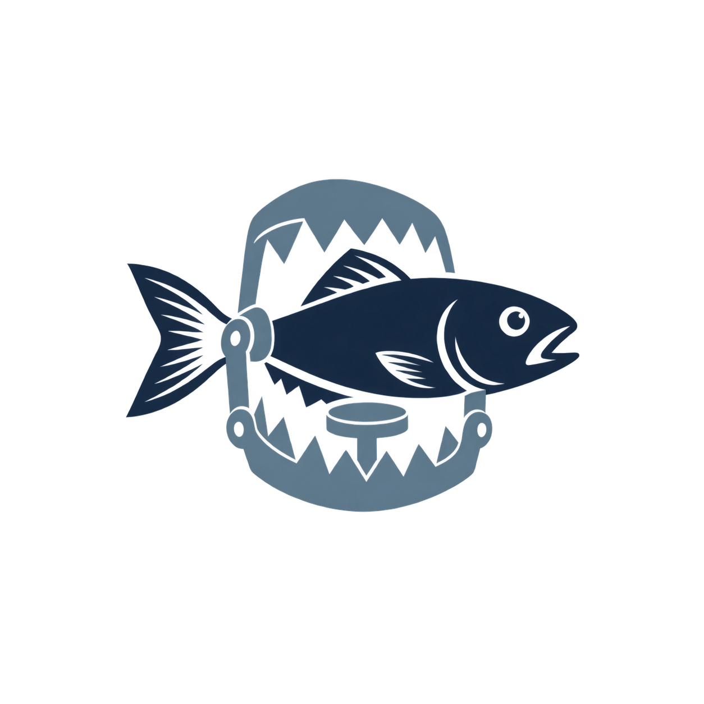

<p align="center">
  
</p>

<h1 align="center">Trickfish</h1>

Trickfish is a chess-engine research project with a Python reference engine and a C++ performance core. Its long-term goal is to select, among objectively acceptable moves, the move whose adequate defense is hardest to find and execute. An offline Python practical-selection prototype filters candidates by objective loss and ranks them by expected score over opponent replies. A separate-process UCI evaluator, optional pinned Maia-2 adapter, JSON evidence export and Markdown review report are available. Human-policy calibration and practical usefulness remain unverified; see [the contract and limitations](docs/practical-selection.md).


The bounded C++ roadmap is accepted at **100.000%**; see [the acceptance record](#bounded-roadmap-acceptance). This is an implementation index, and playing strength remains unmeasured.

Practical analysis JSON v2 keeps mate results separate from centipawns. Mixed reply outcomes expose mate probability mass and fall back to objective selection instead of inventing an expected cp score. The local five-position Stockfish/Maia depth-four review completes; this is integration evidence, not a playing-strength result.

Multi-depth review and stored-report comparison expose changes in selections, candidate sets and score kinds under matching recorded engine/model/rating settings. The local depth-four/depth-six comparison changed selections in three of five review positions; recommendation stability and practical usefulness remain unestablished.

Practical reports include legal-replayed UCI continuations after candidates and opponent replies. The external-component CI passed at `af9aea2`; the continuation follow-up has separate local verification. Depth-six/depth-eight review still changed two of five selections, so these examples do not establish recommendation quality.

## Current implementation

Python provides the reference rules, positional evaluation, search, and a clock-aware UCI reference interface. C++ provides mutable position state, legal move generation, perft, the current Python reference static evaluation terms, and an initial search implementation with a basic asynchronous UCI frontend. Cross-language fixtures compare the complete static breakdown and terminal-aware scores; search behavior remains separate. No playing-strength or Elo claim has been established.

### Python reference engine

| Area | Current state |
| --- | --- |
| FEN | Parse, validate, render, and serialize |
| Board state | Immutable 64-square tuple |
| Move representation | Immutable UCI-coordinate move value |
| Move application | Immutable successor position with clocks, rights, en passant, promotion, and castling updates |
| Pseudo-legal moves | Knight, bishop, rook, queen, king, and pawn moves |
| Pawn support | Single step, double step, ordinary captures, promotion, and en passant |
| Castling | Rights, piece placement, empty path, and attack checks for the king's route |
| Attack map | Detect attacks by either side without changing side to move |
| Game state | Check, checkmate, stalemate, and ongoing-position status |
| Evaluation | Phase-aware white-positive score with material, activity, pawn structure, bishop pair, rook files, king safety/activity, mate, and dead-position terms |
| Search | Iterative deepening, deadline control, negamax, alpha-beta, capture-first ordering, quiescence, Zobrist transposition table, principal variation, and node count |
| Position key | Deterministic 64-bit Zobrist key for board, side, castling, and legal en passant state |
| Game history | Immutable position sequence with threefold-repetition counting |
| Draw rules | Threefold repetition, 50/75-move thresholds, and insufficient-material detection |
| Perft | Recursive legal-node counter with standard positions through depth 3 and root divide |
| CLI | Position display, status, evaluation, depth-limited search, legal/pseudo-legal move listing, perft, and divide |
| UCI | Handshake, readiness, new game, startpos/FEN with moves, depth/movetime/clock search, stop, bestmove, and quit |
| Tests | FEN, move values, legal filtering, move application, CLI, and perft |

`moves` reports legal moves after applying each candidate and checking the moving side's king. `pseudo-moves` exposes the raw generator for debugging. Castling checks the king's starting, transit, and destination squares against the attack map.

### C++ performance core

| Area | Implemented scope |
| --- | --- |
| Position | Twelve piece bitboards, 64-square mailbox, cached side occupancy, clocks, castling rights, and en passant state |
| Updates | Reversible make/unmake for ordinary moves, captures, promotions, en passant, and castling |
| Move generation | Fixed-capacity move list, all-piece pseudo-legal generation, castling path checks, and legal filtering |
| Attacks | Compile-time pawn/knight/king tables, blocker-aware sliding attacks, aggregate attack maps, and targeted king check detection |
| Position key | Incremental deterministic 64-bit Zobrist key with undo restoration; only legal en passant availability is hashed |
| Game state | Check, checkmate, stalemate, and conservative insufficient-material detection |
| Evaluation | White-positive reference material, piece activity, pawn structure, bishop pair, rook files, and phase-aware king safety/activity, mate/stalemate/insufficient-material handling, and side-to-move score conversion |
| Search | Negamax, alpha-beta, mate-distance scores, capture/promotion ordering, quiescence, bounded TT, and iterative deepening |
| TT | Full-key checks, depth-qualified exact/lower/upper bounds, mate-score normalization, and preferred-move ordering |
| Output | Best root move, legal main-search PV, side-to-move score, completed depth, and accumulated node count |
| Perft | Recursive node count and root divide |
| UCI | Handshake/readiness, startpos/FEN with legal moves and history, asynchronous depth/node/movetime/remaining-clock search, stop, new game, quit, and EOF |

The C++ UCI frontend has a baseline remaining-clock allocator and Move Overhead option, with explicit go ponder/ponderhit lifecycle support and an optional predicted reply. Configurable Hash/Threads and Chess960 remain unsupported. Additional endgame/drawish scaling, evaluation tuning, and advanced pruning remain pending. Both implementations include en passant in the key only when a legal capture exists. A separate C++ repetition-key history container supports push/pop and current-position occurrence counts; iterative search optionally accepts this history. It validates the root key, uses a local copy, and scores three occurrences as zero under an always-claim policy. Main and quiescence moves update the copy with safe unwind. This mode disables TT because scores depend on the played history. Diagnostic --search calls without a history retain TT/no-repetition behavior. The UCI frontend supplies the complete move list history and therefore uses history-aware search with TT disabled. A standalone FEN cannot reconstruct played-game history. Their deterministic key tables differ, so numeric Python/C++ key equality is not an acceptance criterion.

Quiescence searches captures, en passant, and promotions. In check it searches all legal evasions and disables stand-pat. It is capped at 32 quiescence plies; after checking terminal states, the cap returns static evaluation even if the position is still in check. This is a safety truncation, not a guarantee of tactical completeness. Main search accepts depths 1 through 64. TT entries are used by main search, not quiescence.

`--search` runs depths successively with a shared TT and reports the last completed depth. It stops terminal roots after the first iteration. The reported PV covers selected main-search moves, excludes quiescence continuations, and may truncate at TT cutoffs or terminal/draw states. It is not guaranteed to reach the reported depth. `--search-time` accepts a depth and a non-negative millisecond budget using a steady-clock deadline. Deadline checks occur before main/quiescence node visits; setup and individual node operations can overrun the budget. The iterative-search API also accepts a stop predicate. It runs synchronously before node visits; a true result preserves the same completed-iteration fallback. Callers must synchronize any predicate state changed from another thread. The diagnostic CLI remains a one-shot command; the UCI frontend maps its stop command to the search stop predicate. `--search-nodes` caps main/quiescence node visits across all iterations. On node-budget or deadline exhaustion it restores position state and returns the last completed iteration; before depth one completes it returns a legal fallback with depth 0, an empty PV, and `stopped true`. Root fallback preparation is outside the node budget. `--divide` prints the node count under each legal root move and the total.

### Evaluation detail and parity

`--eval-detail [fen]` reports `phase`, `material`, `piece_activity`, `pawn_structure`, `bishop_pair`, `rook_files`, `king_safety`, `king_activity`, `static_total`, and `evaluation`. Terms and totals are white-positive. Phase is a 0..24 index, not an added score: knights/bishops contribute 1, rooks 2, and queens 4, summed across both sides and capped at 24 for promoted material. Pawn advancement bonuses increase toward the endgame.

The pawn term matches the current Python reference: -15 per extra pawn on a file, -12 per pawn without a friendly pawn on an adjacent file, and a passed-pawn bonus when no enemy pawn lies ahead on the same/adjacent file. The passed bonus is `8 + 8 * advance + floor((24 - phase) * 2 * advance / 24)`. These are reference heuristics, not tuned parameters. C++ tests the enemy-pawn intersection with compile-time forward-file masks; it no longer scans every enemy pawn for each candidate. The same and adjacent files ahead are included, with no a/h-file wraparound. New mask-boundary and expanded cross-language checks await CI; no measured speedup is claimed. `static_total` sums all seven score components; `evaluation` applies mate/stalemate/recognized-insufficient-material precedence, so the two may differ in finished positions. Static evaluation does not apply search move-count/repetition draw policy.

CI is configured to compare the complete C++ evaluation breakdown and terminal-aware score with the public Python evaluator on 893 positions, including color reflections and legal children, promotions, en passant, and systematic piece-square/color coverage. Pawns cover ranks 2..7; knights, bishops, rooks and queens cover all squares, with rook cases both with and without an enemy pawn. These fixtures check reference agreement on selected positions; they do not prove universal equivalence or a playing-strength improvement.

Piece activity rewards pawn advancement/central files, knight/bishop centrality, and rooks on the enemy seventh rank while enemy pawns remain. King safety combines a c/g home-rank square bonus with neighboring home-pawn shields, scaled by material phase. The square bonus does not infer castling history. King centrality is scaled toward the endgame and disabled whenever any queen or rook remains. These formulas preserve the current Python reference and have not been tuned. C++ computes pawn/knight/bishop activity and the conditional seventh-rank rook bonus from current bitboards; the incremental material/activity experiment was rolled back after the measured workload slowdown. Scores are intended to remain identical. The expanded parity suite awaits CI for this revision; no measured speedup is claimed.

### Verification coverage

The C++ workflow is configured to build with GCC on Linux and MSVC on Windows. It runs initial-position FEN round-trip, depth-3 perft on four positions, divide fixtures, and CLI material/game-state/evaluation fixtures. CTest adds position-state restoration, incremental-key and occupancy checks, targeted check detection parity, TT storage/score normalization, and search regressions including TT-disabled and iterative comparisons. UCI adds parser/position/lifecycle CTest coverage and a standard-library Python subprocess suite for handshake, completed search, readiness during infinite search, stop, transactional positions, limits, mate reporting, and history transmission.

The configured perft counts are 8,902 for the initial position, 97,862 for Kiwipete, 2,812 for the endgame fixture, and 9,467 for the promotion/check-evasion fixture. These are acceptance targets, not a statement that an uninspected commit has passed CI. Check the Actions result for the exact commit being reviewed. Perft verifies move-generation behavior on those trees; it does not establish search quality or playing strength. Passing search fixtures establishes those regression cases, not general tactical correctness or evaluator parity with Python.

[PROGRESS.md](PROGRESS.md) records a weighted C++ implementation-scope index. Its percentages are planning arithmetic, not measured progress toward world-class playing strength. Implementation and exact-commit CI confirmation are tracked separately.

## Running the prototype

Run from the repository root in PowerShell:

```powershell
$env:PYTHONPATH="src"

python -m trickfish.cli
python -m trickfish.cli moves
python -m trickfish.cli pseudo-moves
python -m trickfish.cli status "7k/6Q1/6K1/8/8/8/8/8 b - - 0 1"
python -m trickfish.cli eval "7k/8/8/8/8/8/8/KQ6 w - - 0 1"
python -m trickfish.cli eval-detail
python -m trickfish.cli search 3
python -m trickfish.cli search-time 1000
python -m trickfish.cli moves "8/7k/8/8/3Q4/8/K7/8 w - - 0 1"
python -m trickfish.cli perft 3
python -m trickfish.cli divide 3
python -m trickfish.uci
python -m unittest discover -s tests -v
```

## C++ UCI frontend

Running `trickfish_cpp` without arguments, or with `--uci`, enters UCI mode. Explicit diagnostic arguments retain their existing behavior, including a quoted FEN argument for FEN round-trip output. Launching without arguments no longer prints the initial FEN and exits.

Supported commands are `uci`, `isready`, `ucinewgame`, `position startpos`, `position fen` with six fields, an optional `moves` list, `go`, `setoption`, `ponderhit`, `stop`, and `quit`. Moves are resolved against the legal move list so promotions, castling, and en passant keep their internal flags. An invalid position command reports `info string error` and leaves the previously accepted position/history unchanged. Parsing rejects a checked non-moving king, pawns on promotion ranks, and EP ranks inconsistent with the active side; it does not prove that every FEN is historically reachable.

Search runs on a worker thread with independent position/history copies. `isready` responds while search is active. `stop` joins the worker and produces one `bestmove` for that search; replacing a position/search, starting a new game, quitting, or reaching EOF also stops and joins it. Search limits can combine `depth` (1 through 64), `nodes`, and `movetime` in milliseconds. A bare `go` or `go infinite` waits for `stop` before emitting `bestmove`, including when the depth ceiling is reached. Info is emitted when search finishes, not after every iteration. A budget exhausted before depth one yields an unscored depth-zero legal fallback.

`go searchmoves e2e4 d2d4 depth 4` restricts search to those legal root moves, as defined by the [UCI protocol](https://backscattering.de/chess/uci/). Other supported go parameters can precede or follow the move list. Empty, duplicate or illegal lists are rejected. Promotions, castling and en passant are resolved through the legal move list, preserving flags. A restricted search's PV and interrupted fallback stay within the allowed root moves; normal draw adjudication still applies.

The C++ iterative API exposes the same restriction through `SearchOptions::root_moves`; its default empty vector means unrestricted search. Restricted searches disable TT to prevent reuse across different root move sets. Root restrictions do not prune descendants. New C++/process checks for this extension await its completed CI run; no playing-strength claim follows.

The frontend accepts `wtime`/`btime`, `winc`/`binc`, and positive `movestogo`. It selects the clock and increment for the active side. An explicit `movetime` takes precedence over clock allocation; `go infinite` ignores time deadlines. If clock parameters are supplied without the active side's remaining time, the request is rejected unless movetime or infinite mode supplies the applicable policy. The `mate` limit remains unsupported. Ponder mode defers its captured time allocation until ponderhit; see the lifecycle details below. The allocator is a baseline heuristic and has not been tuned or validated by controlled matches. Supplying `position ... moves` enables played-game repetition handling; FEN alone supplies no earlier history. This mode currently disables TT and uses the existing always-claim repetition search policy. It does not make the search multithreaded internally.

Clock allocation uses `remaining / movestogo + increment / 2`, with a default horizon of 30 moves. The budget is capped by remaining time after reserving the larger of 5% of the clock or `Move Overhead`. The advertised `Move Overhead` spin option ranges from 0 to 10000 ms, defaults to 10, and applies to subsequent clock-based searches. It persists across `ucinewgame`; invalid option updates preserve the old value. If usable time is exhausted, the budget is zero and search returns its depth-zero fallback. A future increment is never spent when no usable time remains. Overflow-safe allocation does not guarantee avoidance of flag losses: setup and individual node operations can still overrun the deadline.

Example clock commands are `setoption name Move Overhead value 20` and `go wtime 60000 btime 60000 winc 1000 binc 1000 movestogo 30`. Explicit `movetime` is not reduced by Move Overhead. Hash/Threads are not advertised. Experimental search options are described under Controlled UCI profiles.

Example input after launching the binary:

```text
uci
isready
position startpos moves e2e4 e7e5
go depth 4
```

Use `stop` to interrupt an active search and `quit` to exit. Scores are side-to-move positive: ordinary scores use `score cp`, mate scores use `score mate` in full moves. `bestmove 0000` indicates no root move, including already adjudicated automatic draws. Protocol reference: [UCI specification distributed with Stockfish](https://sources.debian.org/src/stockfish/17-1/debian/engine-interface.txt).

## Engine direction

Trickfish is being designed around two separate measurements:

1. **Objective result:** the evaluation after the strongest defense found by search.
2. **Practical result:** the difficulty and consequence of the opponent's plausible responses.

The planned practical measurement is a selection constraint. It will be applied only after candidate moves pass an objective-loss limit and tactical re-search.

For a candidate move `m`, the eventual selection stage will compare:

```text
objective value after best defense
evaluation uncertainty
number and quality of defensive resources
cost of likely defensive mistakes
time required to find adequate defense
game context and configured risk budget
```

The relevant failure case is a trap that works only when the opponent misses one obvious response. Candidate verification must identify and reject that case.

## Planned core

| Layer | Responsibilities |
| --- | --- |
| Position | Piece placement, side to move, castling, en passant, clocks, make/unmake, repetition state, Zobrist key |
| Move generation | Pseudo-legal moves, attack maps, legal filtering, promotions, en passant, castling, perft |
| Search | Iterative deepening, alpha-beta, quiescence, transposition table, move ordering, pruning, extensions, time control |
| Evaluation | Material, pawn structure, mobility, king safety, threats, passed pawns, space, endgame scaling |
| Candidate verification | Re-search of selected candidates, tactical stability checks, uncertainty tracking |
| Practical selection | Candidate eligibility, defensive-resource analysis, opponent-response model, risk-budget policy |
| Interfaces | UCI protocol, command-line analysis, structured analysis output |
| Measurement | Perft suite, tactical regression suite, SPRT engine matches, fixed opening sets, reproducible hardware and time controls |

## Development sequence

### Python reference

- [x] Legal rules, FEN, immutable move application, and multi-position perft
- [x] Legal-en-passant Zobrist keys, repetition history, and draw-rule helpers
- [x] Phase-aware positional evaluation and explainable breakdown
- [x] Alpha-beta, quiescence, TT, iterative deepening, and principal variation
- [x] Deadline-based search and UCI depth/movetime/clock/stop support

### C++ core

- [x] Mutable bitboards, mailbox, occupancy, and reversible updates
- [x] Complete legal move generation, attack detection, perft, and divide
- [x] Incremental Zobrist keys and restoration regression fixtures
- [x] Material evaluation with terminal and insufficient-material handling
- [x] Depth-limited alpha-beta with mate-distance scores
- [x] Capture/promotion ordering and quiescence with check evasions
- [x] Bounded TT with score normalization and depth-qualified bounds
- [x] Iterative deepening with shared TT and completed-depth reporting
- [x] Legal principal variation output with explicit TT truncation
- [x] Node budget with state restoration and completed-iteration fallback
- [x] Steady-clock deadline with completed-iteration fallback
- [x] API stop predicate with completed-iteration fallback and state restoration
- [x] Legal-en-passant repetition-equivalent keys
- [x] Reversible repetition-key history container and three-occurrence threshold
- [x] Optional history-aware iterative search with conservative TT exclusion
- [x] Separate fifty-move claim and seventy-five-move automatic-draw classification
- [x] Automatic seventy-five-move search draws, optional fifty-move claim policy, and clock-aware TT keys
- [x] Reference bishop-pair term in static evaluation and search
- [x] Reference rook-file term in static evaluation and search
- [x] Phase-aware pawn structure and explainable implemented-term breakdown
- [x] Reference piece/king activity and phase-aware king safety
- [ ] Additional position-dependent endgame/drawish scaling
- [x] Basic asynchronous C++ UCI with legal positions, history, depth/node/movetime, and stop lifecycle
- [x] UCI remaining-clock allocation, increments, movestogo, and Move Overhead option
- [x] PVS with selectable full-window alpha-beta reference and parity fixtures
- [x] Iterative aspiration windows with widening and interrupted-retry fixtures
- [x] Quiet killer ordering with per-search lifetime and selectable disabling
- [x] Bounded quiet history with cutoff rewards and prior-quiet penalties
- [x] Legal-recapture material exchange diagnostic with special-move/pin fixtures
- [x] Targeted legal recaptures with full-generator exchange reference
- [x] Bounded exchange search with exhaustive reference parity and work counters
- [x] Optional interruptible exchange ordering with comparative diagnostics
- [x] Bounded one-ply continuation history with context-aware quiet ordering
- [x] Reversible synthetic null-move state with key/undo fixtures
- [x] Optional guarded null probe with full-depth real-position verification
- [x] Optional guarded late move reductions with score-drift diagnostics
- [x] Optional guarded frontier futility with selective-score diagnostics
- [x] Optional guarded frontier razoring with quiescence confirmation
- [x] Optional bounded check extensions with effective-PV validation
- [x] Optional bounded pawn-structure correction history with per-search lifetime
- [ ] Further extension/pruning optimization
- [x] Fixed-suite repeatable diagnostic search benchmark and provenance reports
- [x] Bounded tactical regression objectives with mirrored-color fixtures
- [x] Sequential color-paired UCI match baseline with legal replay and provenance
- [x] Replay-validated PGN mainline export with result/provenance integrity
- [x] Bounded evaluation-grid self-play tuning and disjoint paired-sign SPRT confirmation
- [ ] Broader opening methodology and adequately powered playing-strength experiments

### Research layers

- [ ] Candidate verification
- [ ] Practical move selection
- [ ] Opponent-specific experiments and published benchmark methodology

Checked items indicate implemented scope. They do not certify the latest commit's CI result or playing strength.

## Language plan

The current Python code exists to establish rules, tests, and the decision model quickly. It is not intended to be the final high-performance search core.

The target architecture is a C++26 engine core for position updates, move generation, search, and evaluation. The actual build baseline is C++23 (`cxx_std_23` in `CMakeLists.txt`), with compiler extensions disabled. C++26 is an architectural target, not the currently required compiler standard. Python remains the behavioral reference and supports tooling, experiments, fixtures, data preparation, and analysis.

The C++ core is under `cpp/`. Local C++ compilation and runtime execution have not been established in the current development environment; GitHub Actions provides the configured GCC/MSVC build and runtime verification. The commands below require an installed CMake and compatible compiler.

Windows with Visual Studio:

```powershell
cmake -S . -B build -A x64
cmake --build build --config Release
ctest --test-dir build -C Release --output-on-failure
.\build\Release\trickfish_cpp.exe --perft 3
.\build\Release\trickfish_cpp.exe --divide 3
.\build\Release\trickfish_cpp.exe --material
.\build\Release\trickfish_cpp.exe --eval
.\build\Release\trickfish_cpp.exe --eval-detail
.\build\Release\trickfish_cpp.exe --status
.\build\Release\trickfish_cpp.exe --search 3
.\build\Release\trickfish_cpp.exe --search-nodes 6 10000
.\build\Release\trickfish_cpp.exe --search-time 6 1000
.\build\Release\trickfish_cpp.exe --uci
```

Linux with a single-configuration generator:

```sh
cmake -S . -B build -DCMAKE_BUILD_TYPE=Release
cmake --build build
ctest --test-dir build --output-on-failure
./build/trickfish_cpp --search 3
```

`--material`, `--eval`, `--eval-detail`, `--eval-stm`, `--status`, and `--insufficient-material` accept an optional quoted FEN. `--perft`, `--divide`, `--search`, and `--search-ab` accept a depth followed by an optional quoted FEN. `--search-nodes` accepts depth, a non-negative node limit, and an optional quoted FEN. `--search-time` accepts depth, a non-negative millisecond budget, and an optional quoted FEN. Without a FEN, commands use the initial position. `--eval` is white-positive; `--eval-stm` and search scores are side-to-move positive. Mate scores use a separate magnitude of 100,000, with search adjusting for distance. Diagnostic search output is separate from UCI mode, which is selected with --uci or by launching with no arguments.

The C++ `move_count_draw_status` API reports claim availability at 100 halfmoves and automatic draw at 150. It returns no additional move-count classification for positions already finished by mate, stalemate, or recognized insufficient material. Search now adjudicates automatic seventy-five-move draws in main and quiescence nodes, with mate checked first. The iterative API optionally always claims an available fifty-move draw; the default CLI policy does not claim it automatically. Intended-move claims and selecting a win instead of an optional claim remain unmodeled. Search TT keys include halfmove clock and draw policy; repetition keys still omit clocks. Static `--eval` does not apply this search draw policy. Its non-terminal score combines material, a one-time 30-point bonus per side with at least two bishops, the Python rook-file term, phase-aware pawn structure, piece activity, king safety, and king activity. Each rook gets 10 points if its file lacks a friendly pawn and another 10 if it lacks an enemy pawn; the entire rook-file term is disabled when no pawns remain. `--material` remains material-only. See [FIDE Laws, articles 9.3 and 9.6.2](https://handbook.fide.com/chapter/E012023).

Main search defaults to principal variation search (PVS): the first move uses the current full window, later moves probe with a null window, and an improvement below beta triggers a full-window re-search. This changes search windows, not nominal depth or legal move coverage. Quiescence keeps its existing alpha-beta behavior. `--search-ab depth [fen]` selects the full-window diagnostic reference with PVS, aspiration, killer, quiet-history and continuation ordering disabled; `SearchOptions::use_pvs` controls iterative search and the positional API remains available. `SearchResult` includes probe/re-search attempt counts, cumulative across iterative and interrupted work. Tied best moves and PVs may differ between algorithms. PVS commit `2106708` passed its configured CI checks; this does not establish a speedup.

Iterative search uses aspiration windows from depth two: an initial 25-point radius around the last completed score doubles after fail-low/high until the result is inside the window, with bounds clamped to the full score range. Mate-band previous scores use a full window. `SearchOptions::aspiration_window` (also available through the positional API) accepts 0 to disable it, or 1..100001 for the starting radius. Failed or interrupted retries never replace the last completed iteration; their work remains in cumulative node and failure counters. Fixed-depth API searches retain a full root window. The default radius is untuned. Aspiration commit `47b3c83` passed its configured CI checks.

Main-search quiet beta cutoffs retain two unique killer moves per ply. A legal TT move sorts first, followed by captures/promotions, the two killer quiets, and remaining quiet moves with deterministic coordinate ties. Captures, en passant, and promotions are never recorded as killers. Quiescence retains its existing ordering. Killer state is shared across depths/retries of one search and reset for each new search. Iterative search uses `SearchOptions::use_killers`; the positional API also retains its switch; result counters report quiet killer cutoffs and killer moves actually searched. This is an untuned ordering heuristic; new C++ parity/lifetime checks await this change's CI.

The structured C++ iterative API accepts `SearchOptions` (TT, PVS, killer ordering, quiet history, aspiration radius, and draw policy), `SearchLimits` (node limit, deadline, and stop callback), and an optional repetition-history pointer. CLI and UCI use this entry point. The legacy positional overload forwards to the same implementation with the same defaults. Existing CTests exercise both forms; the configuration refactor passed CI at `1602584`. The experimental fields listed below are also exposed through UCI; the remaining configuration stays at the C++ API level.

Quiet history uses a side/from/to table within each search, shared across iterative depths and retries. A quiet beta cutoff receives `min(512, depth * depth)` and previously searched quiets on that node receive the negative bonus. Gravity updates keep values within +/-16384. History breaks ties after tactical/killer priority and before coordinate ties; it does not alter quiescence ordering or prune moves. `SearchOptions::use_history` disables it; result counters report rewards, penalties and moves searched with nonzero history. The table resets per search. These are untuned heuristics, with runtime/parity checks pending this change's CI.

One-ply continuation history adds context to quiet ordering: current side, previous moved piece type/destination, and current moving type/destination. It uses a lazily allocated 16,384-entry direct-mapped table with full-key checks; collisions replace entries on update. Scores are bounded to +/-16384 and combine with quiet history after existing tactical/killer priorities. `SearchOptions::use_continuation` controls it. Root and quiescence have no continuation context, and a standalone FEN supplies no previous played-game move. State resets per search; this table is separate from repetition history. New C++ context/reuse/parity checks await this change's CI.

### Repetition index and move-only transposition ordering

`RepetitionHistory` keeps its reversible key stack and an occurrence index keyed by the complete repetition key. Push increments the count, pop decrements it and removes zero-count entries, and copies own independent indexes. Current-count queries use expected constant-time hash lookup instead of rescanning the stack. An allocation failure during push rolls back the new stack entry. Keys and repetition thresholds are unchanged; no irreversible-boundary truncation or new draw adjudication is introduced. Hash lookup/update costs and allocation overhead still need end-to-end measurement.

`SearchOptions::use_repetition_ordering` and UCI `Experimental Repetition Ordering` default false. With supplied repetition history and `use_table=true`, this enables a separate 65,536-slot, search-local move table. Each entry stores a full position key and a move, with no score, depth or bound payload. A hit is used only if the move remains in the current legal/allowed list. Root restrictions cannot be bypassed. The most recently stored hint replaces its slot; collisions require full-key agreement. The ordinary score table remains disabled whenever repetition history is supplied.

Only real-position main-search nodes read/write these hints; synthetic null branches and quiescence do not. Repetition/draw/terminal checks run before lookup. Hints are shared across depths/retries of one iterative search and discarded at its end, including cancellation. MultiPV keeps its existing separate inner-search lifetimes. `transposition_hits` counts accepted legal move-hint hits in this mode; it does not imply score reuse or a cutoff. Without history the option has no effect, and `use_table=false` disables it.

Ordering may change tied moves, PVs and node counts. Fixed-depth score parity is checked with nonselective search settings; enabling order-sensitive experimental pruning or correction history is not a promise of identical scores. UCI settings remain private per-go snapshots and persist across newgame.

Run `python cpp/bench/repetition_validation.py .\build\Release\trickfish_cpp.exe --output build/repetition-validation.json` for ten real-process on/off comparisons: twofold history, a third repetition at a child, root repetition, a pawn move after a cycle, castling, en passant, promotion, a move-count boundary and mate precedence. It replays PVs, enforces completed score/depth agreement and records node/tie changes descriptively. Native tests compare indexed counts against a linear stack over legal trees and long cycles and cover copies, rollback, collisions, master disabling, interruption and MultiPV. New C++ runtime checks await this commit's CI. This package adds no roadmap points or measured speed/strength credit.

### Transposition replacement policy

For the same full key, deeper entries retain priority. At equal depth, a non-exact bound cannot replace an exact entry; a weaker lower bound or weaker upper bound of the same kind cannot replace its stronger counterpart. Higher lower bounds and lower upper bounds carry more information. Equal scores, exact-to-exact updates and changes between lower/upper kinds retain the existing replacement behavior. Different-key collisions still evict the indexed slot; rejected updates preserve the complete prior payload, including its move.

New CTests cover these bounds and repeated search through a small collision-prone table against a no-TT reference, checking scores, legal PVs and root restoration. Actual C++ verification awaits this revision's CI. This is an information-preservation refinement, with no measured speed or strength claim. History-aware search disables score-bearing TT entries; the optional move-only cache below preserves that restriction.

### Cached move-ordering keys

Search computes each move's preferred-move flag, tactical status, capture/promotion/killer priority and combined history/continuation value once before sorting. Optional exchange ordering also computes its exchange score once. The comparator reads those keys and retains the existing coordinate/promotion tie-breaks. Values are local to one ordering call; heuristic tables continue to update between searched moves and are read again at the next call.

`SearchOptions::use_cached_ordering` defaults to true. `--search-order-reference depth [fen]` retains the previous comparator-based calculation with the same search policies. Add `--compare-ordering` to the benchmark to require equal score, completed depth, node count, best move and PV, and record reference/cached paired wall-time ratios. CI is configured for that diagnostic comparison and CTests covering exchange/table/history modes and node-limited interruption. New C++ parity/timing results await this revision's CI; no measured speedup or strength change is claimed.

## Search benchmark

Run from the repository root after a Release build:

```powershell
python cpp/bench/search_benchmark.py .\build\Release\trickfish_cpp.exe --depth 3 --repeats 4 --output build/search-benchmark.json
```

On Linux, use `./build/trickfish_cpp` as the binary path. The versioned nine-position suite covers opening/castling, captures/recaptures, en passant, promotion, a pawn ending, mate, and stalemate. Each repeat launches a fresh diagnostic iterative PVS search with aspiration windows, killer and quiet-history ordering, a fresh transposition table, automatic move-count draw policy, and no played-game repetition history. This differs from history-aware UCI search, which currently disables TT.

The runner rejects interrupted searches, unexpected output, illegal principal variations, and differences in score, move, PV, depth, or node count between repeats. The Python legal-move reference checks PV legality; ordinary static search scores are not independently certified. Explicit bounded mate objectives additionally prove the selected move and reported mate-distance bound. JSON records binary/suite SHA-256, checkout state, platform, parameters, results, node counts, and wall-time samples/medians. Checkout metadata identifies the working checkout, not the source provenance of an arbitrary supplied binary. Timing includes process startup and initialization; compare the same suite/depth/build settings on the same machine. These are diagnostic measurements, not Elo or controlled match results.

Add `--compare-alphabeta` to repeat each fixture through `--search-ab` as well. The reference disables PVS, aspiration, killer, quiet-history and continuation ordering. Report schema 3 records aspiration, killer, quiet-history and continuation policies and includes the reference run and PVS-minus-reference node delta, requiring equal scores and completed depths while allowing tied move/PV differences. Both runs are independently checked for legal PVs and deterministic repetition.

CI is configured to run depth-two PVS and full-window searches twice for every fixture on both OS runners and print the JSON report in the job log. It checks repeatability within each job; it imposes no timing threshold or cross-machine performance comparison. New benchmark runtime results require the next commit's completed CI run.

Comparative runs alternate forward/reverse mode order on each repetition within a fixture. Even repeat counts balance the order; the default is four. An odd count has one extra forward round. Each mode retains independent determinism checks, raw wall-time samples and min/max/median values. Schema 3 also records actual execution order and the schedule. `median_paired_wall_ratio` is the median of within-round duration ratios: default/alpha-beta for the alpha-beta comparison, and optional/default for exchange or verified-null comparisons. Values below one mean the numerator took less process-inclusive time in those samples; they are not statistical confidence or isolated search throughput. A nonpositive denominator produces JSON null.

The separate `cpp/bench/tactical_suite.json` contains ten shallow regression cases: queen capture, queen promotion, en passant, mate in one, and forced check evasion, each for both colors. Run it with:

```powershell
python cpp/bench/search_benchmark.py .\build\Release\trickfish_cpp.exe --suite cpp/bench/tactical_suite.json --depth 1 --repeats 2 --compare-alphabeta --output build/tactical-regression.json
```

Optional `expect.bestmoves` lists accepted legal root moves. `expect.mate_in_one` requires a checkmating root move, independently verified by the Python rules reference, and the C++ one-ply mate score of 99999. Fixtures are validated before search, and every repeat in both algorithms must satisfy its objective. Objective failures abort report generation. The JSON report retains the objectives alongside results and provenance. CI is configured to execute this suite on both runners; the new process results await this package's completed CI. This is a bounded correctness smoke suite, not a tactical rating or playing-strength benchmark.

### Forced mate within two moves

`cpp/bench/tactical_extended_suite.json` contains sixteen mirrored queen/rook endings with a forced mate in two and no mate in one. The original ten shallow objectives remain separately in `tactical_suite.json` at depth one. Run `d678f1a` failed because copying its depth-one EP best-move target into the depth-three suite was unjustified: both OS jobs selected `e1d2`. The suites are now separated by their validated horizons; a depth-specific best-move target is not assumed to hold at other depths. `expect.mate_in` accepts integer 1 or 2 and means mate within that many attacking moves. The independent Python legal-tree oracle treats attacker moves existentially and every legal defender reply universally. It checks mate before stalemate/dead-material/automatic 75-move termination, uses fresh-root automatic-only draw policy, and stops after at most three plies. No played-game history is supplied; threefold repetition cannot be reached from a fresh history within this horizon.

A selected root move must be proved winning within the declared horizon. Scores must report a positive root mate at an odd distance of one or three plies, and that move must independently support the reported distance. A finite score, an even distance or an unsupported mate-in-one claim fails. Optional `bestmoves` must be a subset of proved moves. Each proof has a 100,000-state work limit; proofs exceeding it abort rather than silently accepting the objective. Cached proof results do not enter measured engine process times.

Run `python cpp/bench/search_benchmark.py .\build\Release\trickfish_cpp.exe --suite cpp/bench/tactical_extended_suite.json --depth 3 --repeats 2 --compare-alphabeta --compare-mate-distance --compare-pawn-cache --output build/tactical-extended.json`. CI will exercise all four modes at depth three. The oracle is a bounded rules-based mate proof, not a general tactical evaluator, tablebase or strength rating. New C++ executions await this revision's push/CI.

The diagnostic `--see move [fen]` reports material exchange gain from the initial mover's perspective. The initial move must be a legal capture or promotion. `static_exchange` then exhaustively considers legal recaptures on the same target square, with either side allowed to stop. It includes promotion material gain and initial en passant; legal move generation excludes pinned recaptures and unsafe king captures. The caller's position is preserved.

The default evaluator generates only attackers of the target using current occupancy and filters them for king safety, including all four recapture promotions. `static_exchange_reference` and `--see-reference move [fen]` retain the full legal-move generator for comparison. Both paths solve the same restricted exchange model. The targeted path uses alpha-beta windows translated by each capture gain, the optional-stop lower bound of zero, and immediate-gain upper bounds. The full-generator reference remains exhaustive. It ignores off-target tactics, mate values, and forced-check continuations, and can branch substantially. It is not used by default search or any pruning; optional main-search ordering is described below. For example:

```powershell
.\build\Release\trickfish_cpp.exe --see a1a2 "4k3/8/8/8/8/8/q7/R3K3 w - - 0 1"
```

The expected exchange gain is 900. The original exchange baseline passed CI at `30bda03`. Targeted recapture generation passed CI at `1cd22a5`. Bounded exchange parity and work-counter checks passed CI at `9305ef3`.

`--see-detail move [fen]` reports `score`, `nodes` (visited recapture states, including entries pruned before move generation), and `cutoffs` (bound/branch pruning events). The `analyze_exchange` API returns the same fields; its reference flag selects exhaustive evaluation. These counters measure exchange work, not main-search nodes or elapsed speed. No runtime improvement is established by their presence.

`SearchOptions::use_exchange_ordering` is experimental and defaults to false. `--search-see depth [fen]` enables it for diagnostic iterative search. Each legal capture/promotion receives one cached exchange score before main-search sorting. The TT move remains first; tactical moves remain ahead of quiet moves and sort by exchange gain before existing tie-breaks. Quiescence and legal move coverage are unchanged.

Exchange checkpoints check search deadlines, exhausted node budgets and stop requests. Exchange states are not main-search nodes; `SearchResult` separately reports completed exchange evaluations and their state/cutoff totals. Partially interrupted exchange work is excluded from these completed-work counters. The standalone `analyze_exchange` API also accepts an optional checkpoint callback; exceptions propagate while preserving the caller's position.

Add `--compare-exchange` to the benchmark command to repeat each fixture using `--search-see` and compare score/depth with normal search. Each mode has its own deterministic repeat/PV checks and wall-time samples; node delta is relative to default search. The tactical CI suite is configured to include this comparison. Optional exchange ordering/cancellation passed CI at `e574793`. This legal exchange calculation may cost more than the ordering saves; enabling it by default requires performance evidence.

The C++ position API provides `make_null_move` / `unmake_null_move` for a synthetic search pass. It rejects an in-check side or overflowing counters before mutation, clears en passant, advances the synthetic turn counters, and flips side with an incremental Zobrist update. Undo restores side, EP, clocks and key; board state and castling rights are unchanged. This state is not a legal game move and must not enter played-game repetition history. UCI continues to reject null moves in position/searchmoves input. Default search does not call the API. The synthetic-state baseline passed CI at `5b967ab`; optional verified-null search is described below.

`SearchOptions::use_null_move` defaults to false; `--search-null depth [fen]` enables a conservative verified mode. It probes only non-root null-window nodes at depth >=3, outside check and the mate score band, with non-pawn material, static score >= beta, and safe move counters. The probe searches depth-3 after a synthetic pass, with further null probes disabled. A fail-high must be confirmed by searching the real position at the original depth/window with null probes disabled throughout that verification subtree. Only the confirmed bound permits a cutoff.

Synthetic subtrees do not use TT, played-game repetition, synthetic move-count draws or killer/history learning. Real-position verification retains normal rule/history handling. Null state unwinds on interruption, and synthetic PVs are discarded. `SearchResult` reports null probe/verification/cutoff counts. `--compare-null` adds paired diagnostic process results to the benchmark report; the shallow tactical CI smoke run checks the CLI mode while dedicated CTests exercise deeper probe paths. Verified-null commit `0513b7c` passed its configured C++ checks. Full-depth verification can add work; this is an untuned safety baseline with no measured speedup or strength benefit.

`SearchOptions::use_lmr` defaults to false; `--search-lmr depth [fen]` enables experimental late move reductions. At non-root null-window nodes with depth >=3, the fourth and later moves may be searched one ply shallower if quiet, non-checking, outside check/mate windows, not a killer, and without positive quiet/continuation history. Synthetic null branches and full-depth null verifications do not use LMR. A reduced result above alpha is re-searched at the original depth; a reduced fail-low can stand.

LMR is selective: it can change score or miss a deeper tactical improvement. `--compare-lmr` records `score_equal` and `score_delta` against default search without treating a score difference alone as runner failure. Completed depth, legal PV, deterministic repeats and explicit tactical objectives remain checked. `SearchResult` counts reductions/re-searches. The default UCI/search behavior is unchanged. LMR commit `73c3793` passed its configured C++ checks; the one-ply policy is untuned and has no established speed or strength benefit.

`SearchOptions::use_futility` defaults to false; `--search-futility depth [fen]` enables an experimental depth-one frontier policy. At non-root null-window nodes, a later quiet move can be skipped if static score plus `futility_margin` does not reach alpha. Margin accepts 0..10000, default 150. The first move, checked/mate-window nodes, captures/promotions, checking moves, killers, positive history/continuations and pawn pushes to the sixth rank or beyond are protected. Synthetic null branches and full-depth verifications do not use it.

Child-state checks also protect repetition/move-count draws, insufficient material and terminal positions; near move-count thresholds the policy is disabled. These checks have computational cost. `SearchResult::futility_pruned` counts skipped moves. `--compare-futility` records score equality/delta instead of demanding exact parity, while legal PVs, deterministic repeats, completed depth and tactical objectives remain checked. Default search/UCI behavior is unchanged. Futility commit `bb16e3a` passed its configured C++ checks; the margin is untuned and no speed or strength gain is established.

`SearchOptions::use_razoring` defaults to false; `--search-razor depth [fen]` enables an experimental depth-one policy. A non-root null-window node can switch to a quiescence confirmation when static score plus `razor_margin` does not reach alpha. Margin accepts 0..10000, default 200. A cutoff requires the quiescence score <= alpha; otherwise normal search continues.

Checked/mate-window nodes, synthetic null branches, full-depth verifications and near-draw clocks are excluded. A pawn on the sixth rank or beyond, for either color, protects the node. Quiet checking moves and quiet moves producing recognized draw/terminal outcomes also protect it, using child-state checks. These scans have computational cost. Razoring remains selective and can miss a non-forcing improvement; `--compare-razor` records score equality/delta rather than assuming parity. `SearchResult` counts probes/cutoffs. Default search/UCI behavior is unchanged. Razoring commit `3423759` passed its configured C++ checks; no measured speedup or strength gain is established.

`SearchOptions::use_check_extensions` defaults to false; `--search-check depth [fen]` enables checked-node extensions. A nonterminal checked main-search node with remaining depth gains one ply and consumes one unit of a per-line budget. `check_extension_limit` accepts 0..4, default 1; zero disables extensions. The main-search ceiling remains 64 plies, and depth-zero quiescence is unchanged. Synthetic null branches do not extend; real-position null verification receives the same remaining extension context.

TT is disabled while a positive extension budget is active because the effective horizon depends on that budget. Reported completed depth remains nominal; PV length can exceed it by the allowed per-line budget. The diagnostic CLI uses one extra ply, and benchmark PV validation accounts for it only in `--search-check` mode. `--compare-check` records score equality/delta with the different horizon and TT policy explicitly identified. `SearchResult::check_extensions` counts applied extensions. Check-extension commit `2342522` passed its configured C++ checks; default search/UCI behavior is unchanged and no strength or speed benefit is established.

`SearchOptions::use_correction` defaults to false; `--search-correction depth [fen]` enables an experimental adaptive correction to search-local static scores. A lazy 1,024-slot table uses full pawn/side keys with collision replacement and adjustments bounded to +/-256. Quiet best moves at non-checked exact-window main nodes supply ordinary score-error samples; mate-band samples are ignored. The update blends the existing value and clamped error with a depth weight capped at 16 out of 32. This coarse pawn context intentionally shares information across different piece placements.

The table resets per search. Public `evaluate_static`, `--eval-detail`, and the Python reference are unchanged. Terminal/draw handling runs before search correction, and adjusted scores are clamped outside the mate band. Synthetic null branches and real-position null verifications do not train it. TT is disabled in correction mode because the evaluator changes during search. `SearchResult` counts accepted updates and nonzero correction applications. `--compare-correction` records score drift and the different TT policy. Correction-history commit `9f1e451` passed its configured C++ checks; no evaluation-accuracy, speed or strength improvement is established.

### Comparing separate engine binaries

After building both revisions in Release mode, run `python cpp/bench/search_benchmark.py .\build\Release\trickfish_cpp.exe --reference-binary .\baseline-build\Release\trickfish_cpp.exe --reference-trace --depth 6 --repeats 6 --warmups 2 --output build/binary-comparison.json`. Both must support the diagnostic `--search depth [fen]` protocol; Linux uses the corresponding executable paths without `.exe`.

Each fixture alternates candidate/reference execution order between repeat rounds. Optional `--warmups N` (0..20, default 0) runs N alternating-order rounds per fixture/mode before the measured rounds. Warmup output must match subsequent output for that mode, but its timings are discarded. Measured order restarts forward independently of the warmup count. All invocations are fresh processes: this can exercise executable/filesystem startup paths but retains no engine TT or search state and does not remove startup cost or runner noise. Reports record both schedules and the warmup count; summaries validate them, treating older missing metadata as zero warmups. Both runs require deterministic output, legal PVs/objectives and equal score/completed depth. `--reference-trace` additionally requires identical nodes, best move and PV; omit it to allow tied legal traces and different search work. Reports preserve both binary paths/hashes, byte-identity status, all samples, execution order, trace equality and candidate-minus-reference node delta. `binary_comparison.median_paired_wall_ratio` is candidate/reference process wall time: below one means less observed candidate time in those samples, not a significance or strength result. Both binaries and the suite are checked for changes before output, and either binary is protected from output aliases.

The `C++ Binary Comparison` workflow in `.github/workflows/cpp-benchmark.yml` checks out the candidate and requested baseline, builds both with Release settings on each OS runner, runs the paired comparison and adds actual Git revisions/build provenance to the logged JSON. It now defaults to ray-enabled baseline `9cceed7`, depth 6 and six measured repeats plus two unmeasured warmup rounds, checking default diagnostic search compatibility after UCI ponder integration. Build provenance labels the comparison `ponder-default-search-compatibility`, with identical trace required. Timing readiness is descriptive here and does not award an optimization milestone for this analysis feature. It can be dispatched manually and also runs automatically on a main-branch push that changes `.github/workflows/cpp-benchmark.yml`; ordinary engine pushes do not trigger it. The candidate explicitly enables `TRICKFISH_RAY_SLIDERS`. The `baseline_kernel` input selects ray (default) or reference, sets the baseline CMake flag and assessment policy, and records the requested kernel in build provenance. Candidate selection and ray-baseline selection are checked through `--slider-kernel`; older reference baselines may still use the compatible diagnostic search protocol. For a pre-ray reference comparison, select `d678f1a` and reference explicitly; that comparison also includes subsequent candidate changes. Full and summary search/kernel JSON reports are uploaded separately for each OS with 30-day retention, including any reports produced before a later step fails. A failed comparison may produce no report; the job log remains the failure diagnostic. Standard C++ CI only exercises the two-binary protocol using the same executable on both sides; that smoke test is not optimization evidence.

These end-to-end CLI measurements include process startup, search, evaluation and move-update work. Runner load, shallow/terminal fixtures and compiler/environment differences still affect interpretation. No timing threshold, cross-machine speed claim, statistical decision or playing-strength estimate is made. Standalone CLI checkout metadata does not authenticate the source revision of an arbitrary supplied binary; workflow build provenance is recorded separately.

The first [cross-revision run](https://github.com/ceemv22/trickfish/actions/runs/41160032644) compared candidate `87e5aa4` against `989a4c7` at depth 3 with six repeats on 2026-10-31. Both OS jobs passed score/depth/node/bestmove/PV parity across all nine fixtures, with 4,006 nodes per suite repeat. Median paired candidate/reference suite wall ratios were 1.017715 on Ubuntu and 1.009603 on Windows. Candidate suite samples ranged from 34.580 to 35.722 ms on Ubuntu and 65.296 to 204.735 ms on Windows. These short workloads and the Windows outlier do not establish an optimization benefit or a statistically supported regression. The default depth was then raised to 6 to collect more search work. Terminal fixtures still mainly measure startup at any requested depth.

### Validating and summarizing binary measurements

Run `python cpp/bench/summarize_binary_benchmark.py build/binary-comparison.json --output build/binary-comparison-summary.json`. The input must be a schema-3 two-binary report. Validation checks hashes/byte-identity claims, fixture identity and goals, legal PVs, score/depth/trace policy, execution order, raw sample counts, finite positive timings, stored min/max/medians, paired ratios and node totals. Statistics are recomputed from raw values within floating-point roundoff; a stale or inconsistent saved statistic is rejected. Input/output aliases are protected and the summary records its source report hash.

Suite timing totals sum corresponding repeat-index times across all fixtures before dividing candidate/reference and taking the median of those paired ratios. This measures the configured suite workload; it is not an unweighted average of fixture ratios or a single chronological suite run. Per-fixture ratios and changed-trace counts remain visible. Same-byte binaries are explicitly labeled as a control, not optimization evidence; optional trace differences mean the timing ratio can also reflect different search work.

The summary provides descriptive timings, not confidence, significance or playing strength. Source/build provenance is reported, not independently authenticated. Standard CI validates a same-binary smoke summary; the comparison workflow logs full and summarized cross-revision data. Automatic triggering and summary integration passed in run `41160032644`; depth 6 and artifact upload passed in run `41160361591`. Warmups and comparison against `02c3416` passed in [run 41160777519](https://github.com/ceemv22/trickfish/actions/runs/41160777519): median paired candidate/reference ratios were 0.957907 on Ubuntu and 0.941414 on Windows, with identical 175,164-node traces. These are descriptive results from that workload, without statistical or strength inference.

## Declared match campaigns

`--campaign` selects a version-1 JSON configuration with a fixed depth/node/movetime budget, rounds, seed, searched-ply cap, watchdog, ordered opening IDs and optional per-engine profiles. Opening/profile paths resolve relative to the campaign file, and their expected SHA-256 hashes bind their bytes. The runner rejects simultaneous CLI overrides of these controls. Reports and checkpoints preserve the complete specification and campaign path/hash; source changes abort the run. Existing commands without `--campaign` retain their defaults. Repository `cpp/bench/*.json` inputs use explicit LF checkout through `.gitattributes`, and the versioned campaign hashes bind those LF bytes. The digest function still hashes raw bytes; arbitrary external files are not silently normalized.

`match_openings_extended.json` supplies twelve distinct legal prefixes: open game, Sicilian, French, Caro-Kann, Scandinavian, Pirc, Queen's Gambit, Slav, King's Indian, Nimzo-Indian, English and Reti. Campaign validation rejects repeated final repetition identities, ignoring clocks/history for that duplicate check. This avoids duplicate board weighting within the supplied sample; it does not make the sample representative or remove opening bias. The runner retains full histories and uses adjacent color swaps with alternating pair starts and seeded opening order.

```powershell
python cpp/bench/uci_matches.py .\build\Release\trickfish_cpp.exe C:\path\to\reference.exe --campaign cpp/bench/campaign_fixed_nodes.json --checkpoint build/campaign-checkpoint.json --output build/campaign.json
python cpp/bench/match_campaign.py build/campaign.json --campaign cpp/bench/campaign_fixed_nodes.json --output build/campaign-audit.json
python cpp/bench/export_matches.py build/campaign.json --output build/campaign.pgn
```

The fixed-node configuration requests 10,000 nodes per move, one round, seed 20261031, a 200-searched-ply cap and 30-second watchdog. Twelve prefixes produce 12 color pairs/24 games. This campaign has not been run as a strength experiment. `campaign_smoke.json` instead uses 64 nodes and a two-searched-ply cap for protocol verification. Unfinished games remain unfinished, and engine errors abort without assigning forfeits. Resume with the same command plus `--resume`; changed configuration/source provenance is rejected.

The standalone audit fully replays the report, reconstructs the declared schedule, compares typed controls/source hashes/profiles and verifies every original opening prefix before producing descriptive analysis. It protects input files from output aliases. It checks recorded execution claims and source identity, not independently measured engine budget consumption. Neither the campaign nor its audit provides significance, Elo, SPRT or strength conclusions. The 24-game same-binary smoke, completed resume, audit and PGN export passed on Windows at `fedd420`. Linux stopped earlier because the versioned campaign hash had been generated from CRLF checkout bytes while its committed opening source used LF. Explicit LF checkout and corrected campaign hashes address that platform difference; the corrected [Core run 41207574445](https://github.com/ceemv22/trickfish/actions/runs/41207574445) passed fully on both systems at `9cd4e2b`.

## UCI match baseline

The stdlib match runner accepts two UCI executable paths, launches them without extra arguments, and plays each opening with engine A and engine B assigned to White in turn. Games run sequentially with fresh processes. For example, after building both versions:

```powershell
python cpp/bench/uci_matches.py .\build\Release\trickfish_cpp.exe C:\path\to\baseline.exe --depth 2 --max-plies 200 --output build/matches.json
```

Use `--movetime` in milliseconds or `--nodes` for a requested per-move node limit instead of `--depth`. These three budgets are mutually exclusive. Node limits accept 1..18446744073709551615 and generate `go nodes N` without an additional depth limit. JSON policy records the budget kind/value and exact go command. The runner relies on the engine to honor the command; raw UCI info remains diagnostic evidence rather than independent verification of every engine's node accounting. Equal node limits do not imply equal elapsed time or playing strength. The default is depth 2; a finite `--timeout` is a process watchdog, not a chess-clock loss policy. Without a profile the runner uses each binary's default UCI options; with a profile it sends the validated options before ucinewgame, then sends the complete opening/game history, and verifies every returned move against the Python rules reference. Three supplied opening prefixes are a smoke set, not a representative strength suite. Each round plays both color assignments per opening.

The arbiter checks mate before draw conditions. It recognizes reference insufficient-material/stalemate, automatic seventy-five-move/fivefold draws, and an explicit always-claim fifty-move/threefold policy. Intended-move claims and choosing a win instead of a claim are not modeled. The searched-ply cap excludes the opening prefix and produces an unfinished `*` result, not a draw. Illegal moves, protocol errors, engine exits or watchdog failures abort the run without awarding a forfeit or producing a complete report.

JSON records engine/opening SHA-256, environment/policies, UCI names, all moves, opening-ply counts, per-search timing/info, final FENs and separate win/loss/draw/unfinished totals. These hashes identify inputs, not their source commits. There is no evaluation-based adjudication, Elo estimate or SPRT. Replay-validated PGN export is described below. CI is configured to run six same-binary games capped at two searched plies; this validates process plumbing and unfinished-game accounting. The match-runner baseline passed CI at `f2d7a9f`. No playing-strength conclusion follows.

## PGN export

```powershell
python cpp/bench/export_matches.py build/matches.json --output build/matches.pgn
```

The exporter validates the complete schema-1 JSON replay, decision records, final FEN, result/reason and W/L/D/unfinished summary before writing UTF-8 PGN mainlines. It uses [SAN/PGN notation](https://www.saremba.de/chessgml/standards/pgn/pgn-complete.htm), including legal-piece disambiguation, castling, en passant, promotion and check/mate suffixes. Nonstandard starting positions receive SetUp/FEN tags and correct move numbering, including Black-to-move starts. Unfinished games retain `*` in both header and movetext.

Headers preserve engine names, binary hashes, opening ID/prefix length and termination reason. New match JSON records game start/end UTC timestamps; PGN dates use the UTC start date. Older reports without a game start date export an unknown date instead of inferring one from report creation. The JSON remains the complete diagnostic record. This is a mainline exporter, not a PGN importer or variation/annotation editor; external reader compatibility has not been independently tested. CI is configured to export and print the depth-limited and node-limited paired process smoke games. The PGN pipeline passed CI at `4a04b95`; no playing-strength inference follows.

### Incremental pawn-structure key

`Position::pawn_key()` is the XOR of the existing Zobrist piece-square keys for white and black pawns only. It excludes side to move, castling, en passant and clocks, and is zero without pawns. Piece insertion/removal maintains it during FEN construction, ordinary moves, captures, en passant, promotions and their undo operations. Castling and null moves leave it unchanged. The full repetition key and FEN serialization retain their existing semantics.

Correction history combines this cached pawn key with the existing side key, preserving its previous context-key values without rescanning pawns on each lookup/update. Position now maintains an additional 64-bit field; no general speedup is asserted. New CTests compare the cached key with an independent mailbox reconstruction through legal move trees and undo, including both colors' promotions/underpromotions, en passant, castling and null state. Actual C++ verification awaits this revision's CI.

### Incremental material phase

`Position::phase_units()` maintains the uncapped sum of knight/bishop=1, rook=2 and queen=4 weights during piece insertion/removal. FEN construction, captures, promotions and undo therefore maintain the value; quiet moves, castling, pawn-only changes and null moves preserve the material total. `game_phase()` caps this stored value at 24 when evaluation reads it, avoiding repeated piece-bitboard counts.

The stored value is deliberately not capped: a promoted-material position with raw phase 30 can lose a queen and remain above the evaluation cap at 26. Subtracting from an already capped 24 would produce the wrong phase. Mailbox-reference legal-tree checks and the explicit 30-to-26 capture/undo regression passed CI at `24df66d`. Public phase weights and evaluation formulas remain unchanged.

### Material/activity measurement and rollback

[Depth-6 comparison run 41160361591](https://github.com/ceemv22/trickfish/actions/runs/41160361591) compared `02c3416` against `989a4c7` in Release with six paired repeats and nine fixtures. Both OS jobs passed identical score/depth/node/bestmove/PV checks, with 175,164 nodes per suite repeat. Median paired candidate/reference suite wall ratios were 1.069577 on Ubuntu and 1.064850 on Windows. Every suite ratio in that run exceeded one: Ubuntu 1.052773..1.072024, Windows 1.013615..1.099053. This is an observed slowdown in that CI workload, without a statistical significance or strength claim.

The incremental material/activity fields introduced in `fa634bd` have therefore been removed. Material uses piece-bitboard popcounts again; pawn/knight/bishop activity is computed from their bitboards during evaluation. Position insertion/removal no longer maintains these two scores. Incremental Zobrist/pawn keys and uncapped material phase remain. Evaluation formulas and Python reference behavior are unchanged. Native search parity and timing after this rollback await CI against the observed slower `02c3416` baseline.

The seventh-rank rook bonus remains conditional on enemy pawns. Independent mailbox/tree tests retain both-color special-move, null-state and last-pawn-capture coverage, including activity changing from 36 to 4 (opposite signs for Black). The 893-position Python/C++ parity suite remains configured. The obsolete isolated incremental-read microbenchmark and its CI step were removed; its historical results excluded move-update costs and did not establish net engine speed.

## Quiescence ordering compaction candidate

`SearchOptions::use_compact_quiescence` defaults true and controls an ordering-work optimization. Quiescence still generates all legal moves and checks terminal states, draw/repetition policy, depth cap and stand-pat before filtering. Outside check, it stably removes ordinary quiet moves from the local list before ordering, retaining captures, en passant and all promotions. In check it retains every legal evasion, including quiet blocks and king moves. Zero/one-move lists skip ordering. This does not add selective pruning: the prior quiescence loop already skipped those ordinary quiet moves after sorting.

Setting the API option false retains the old all-legal-moves ordering/skip path. The switch is independent of the CMake sliding-kernel selection. SearchResult records cumulative `quiescence_ordering_calls`, `quiescence_ordered_moves` and `quiescence_filtered_quiet_moves`, including work before interruption. Ordinary search/UCI output keeps its format. Diagnostic `--search-q-compact depth [fen]` and `--search-q-reference depth [fen]` append `q_ordering_calls`, `q_ordered_moves` and `q_filtered_quiet_moves` to the six standard fields.

Run `python cpp/bench/search_benchmark.py .\build\Release\trickfish_cpp.exe --depth 2 --repeats 2 --compare-quiescence --output build/quiescence-comparison.json`. The runner alternates default/compact/reference modes, requires identical score/depth/node/bestmove/PV traces, validates complete nonnegative work counters and rejects increased ordering calls/moves. JSON records both profiles, work deltas and the compact/reference paired timing ratio. Work counters measure items passed to ordering, not comparisons or CPU cycles; fewer items alone does not establish net speed.

Configured native checks cover list truncation, fresh exact traces, quiet evasions, empty tactical sets, both-color EP creation, quiet/capture promotions, mate/stalemate/dead/rule-clock states, table/history/ordering/cache/scaling/selective-option combinations, node budgets, stop/deadline fallback and root/history restoration. All four [Core jobs](https://github.com/ceemv22/trickfish/actions/runs/41215410559) passed at `6b7089a`, including the three-mode process comparison on both kernels and OS runners. [Same-ray comparison run 41215410543](https://github.com/ceemv22/trickfish/actions/runs/41215410543) against `4fff487` retained identical search traces and recorded median suite time ratios 0.901789 Ubuntu / 0.929898 Windows, with timing readiness true on both. C22g meets its recorded engineering acceptance gates. These workload observations do not establish statistical significance or playing strength.

## Sliding attack kernels

Fresh CMake configurations now default to the ray-table kernel throughout move generation, king attack checks, exchange evaluation and search. Configure with `-DTRICKFISH_RAY_SLIDERS=OFF` to retain the square-walking reference; `--slider-kernel` reports the selected `ray` or `reference` kernel. Existing CMake caches keep their stored option, so selecting ON explicitly switches an older reference build. Core CI now has four jobs: default and explicit-reference configurations on both Linux and Windows, with an early CLI assertion of actual selection. The four-job matrix passed at `9223afa` in [Core run 41208675658](https://github.com/ceemv22/trickfish/actions/runs/41208675658); the later castling experiment also passed all four configurations at `306ff8a`; aligned-check and quiescence changes subsequently passed all four configurations at `4fff487` and `6b7089a` respectively. The later targeted-castling candidate also passed Core at `aa85f5a` but failed its two-OS timing gate; it has been withdrawn. The new match-assessment tooling awaits its own pushed run.

The ray kernel stores eight directional 64-square rays (4 KiB of bitboards). For each direction it intersects occupancy with the full ray, locates the nearest blocker using a low/high bit scan according to index direction, and removes squares beyond that blocker. The blocker stays attacked; the source and off-ray occupancy do not contribute. Reference entry points remain available for comparison. Public square validation and generated-move ordering are preserved.

Configured native tests enumerate every subset of every empty-board bishop/rook ray: 1,119,744 occupancy cases across all squares. They also check all off-ray/source bits filled, the selected API, 65,536 deterministic full-board queen occupancies, compile-time corner/blocker cases and invalid squares. A local Python model matched independent coordinate walking over the exhaustive domain. Actual native tests, including the exhaustive kernel test, passed on both runners at `fedd420`; Linux passed all 32 CTests before its later campaign-hash failure.

With BUILD_TESTING enabled, `trickfish_sliding_kernel_bench` compares combined bishop/rook kernels in one process over 2,048 deterministic empty/sparse/dense/mixed occupancy cases. It performs unmeasured passes, then six alternating-order pairs; the default 512 repetitions produce 1,048,576 calls per measured sample. Calls use a volatile function pointer. JSON records generator/seed, selection, raw times, order, checksums and the paired median ratio. `summarize_sliding_profile.py` independently regenerates occupancies, computes coordinate-walking checksums modulo 2^64, validates all samples/statistics and reports descriptive per-call times. The kernel workload excludes search and is synthetic.

The comparison workflow separately builds the ray candidate and pre-ray reference in Release on each runner, requires identical default-search score/depth/node/bestmove/PV traces, and saves search and kernel measurements. C22a was accepted after functional checks and both OS runners met its declared engineering gates: direct median ray/reference ratio below one and suite median candidate/reference ratio at most one. Correctness CI has no timing-failure threshold; a green run alone does not accept the optimization. [Comparison run 41206383647](https://github.com/ceemv22/trickfish/actions/runs/41206383647) measured `fedd420` against pre-ray `d678f1a` in Release, depth six, six pairs and two warmup rounds. All nine search fixtures had identical scores/depth/nodes/bestmoves/PVs, totaling 175,164 nodes per suite repeat. Median paired search wall ratios were 0.848347 on Ubuntu and 0.899265 on Windows; direct kernel ratios were 0.378949 and 0.398857, with independently verified checksums. These meet the timing gates in that workload. The LF correction then passed full [Core run 41207574445](https://github.com/ceemv22/trickfish/actions/runs/41207574445) on both OS runners at `9cd4e2b`. Its C++ sources and prior CMake selection settings match measured `fedd420`; this completes C22a acceptance. The default-option promotion changes selection rather than the tested kernel algorithm. These descriptive measurements establish neither statistical significance nor playing strength.

### Automated per-job timing assessment

Run `python cpp/bench/assess_sliding_candidate.py build/binary-comparison.json build/sliding-kernel.json --baseline-kernel ray --output build/sliding-assessment.json` for the current same-ray comparison. Use `--baseline-kernel reference` (the standalone CLI default) for the earlier ray/reference policy. The schema-2 output records the selected policy, revalidates raw search/profile samples, matches the supplied nine-position suite/hash and records source-input fingerprints. The workflow prints and uploads it.

Both policies require distinct binary bytes, matching reported Release/same-runner kernel selection, Git/environment metadata, strict unchanged traces, depth at least six, an even six-or-more repeats, at least two warmup rounds and a full validated direct profile. Ray/reference policy requires search median at most one and direct kernel median below one. Same-ray policy requires search median strictly below one; direct ray/reference kernel timing is informational and cannot establish a separate search-side optimization benefit. Missing or insufficient controls produce false readiness; malformed samples abort. A timing miss does not fail correctness CI. One job's readiness does not authenticate provenance, certify Core/cross-OS status, establish significance/strength or automatically award roadmap credit. New policy integration awaits push/CI.

## Castling prerequisite experiment

Candidate `306ff8a` moved rights/home-piece/path checks before the opponent attack map. All four [Core configurations](https://github.com/ceemv22/trickfish/actions/runs/41210403978) passed, including the 68-position independent Python/C++ depth-two divide comparison. [Same-ray comparison](https://github.com/ceemv22/trickfish/actions/runs/41210403818) retained exact search traces, but median candidate/reference search ratios were 0.997729 on Ubuntu and 1.003307 on Windows. The recorded strict-below-one gate on both systems was not met; those small differences do not establish a general benefit or statistically supported regression.

That first candidate was withdrawn and castling generation restored to `9223afa` before the accepted aligned-check and quiescence work. C22c stays uncredited. The independent Python depth-two divide comparison now covers 84 roots: all sixteen rights combinations, both moving colors, path blockers, missing/displaced home pieces, attacked files and additional pawn/knight/bishop/king attacks on origin/transit/destination squares.

## Geometric prefilter for king checks

`Position::in_check` now uses empty-board diagonal/orthogonal masks to shortlist aligned enemy bishops/rooks/queens before calculating occupied sliding attacks. If both shortlists are empty, it returns false after the existing pawn/knight/king checks. Otherwise only relevant sliding families are evaluated with current occupancy, retaining blockers and source-piece semantics. Two compile-time tables add 1 KiB of read-only bitboards.

`trickfish_cpp --check-detail "fen"` prints `white_check true|false` and `black_check true|false`. These are static attacks on each king, independent of whose turn it is; they do not adjudicate game results or certify a legal game history.

Configured native checks compare against the frozen unfiltered targeted function, full attack maps and independent coordinate geometry. They cover every king/attacker square in both colors, piece families, own/enemy blockers and 58,800 static combinations, plus legal trees, en passant x-rays, promotion, null state and restoration. Python rules locally validate those static expectations. CI will also compare the diagnostic on 339 independently evaluated geometry/special-move positions and rerun existing perft/search/UCI/castling coverage for both kernels on both systems.

The same-ray comparison retains baseline `9223afa`; restored castling matches that baseline, isolating the new check prefilter. C22e passed all four [Core configurations](https://github.com/ceemv22/trickfish/actions/runs/41212001343) at `4fff487`. [Comparison run 41212001345](https://github.com/ceemv22/trickfish/actions/runs/41212001345) recorded identical 175,164-node traces with search ratios 0.902325 Ubuntu / 0.903306 Windows and timing readiness true on both. This meets the prior engineering acceptance gates. These are descriptive observations for that workload, not statistical significance or playing-strength evidence.

## Experimental pawn-evaluation cache

`SearchOptions::use_pawn_cache` defaults to false. UCI `Experimental Pawn Cache` or `--search-pawn-cache depth [fen]` enables a search-local, lazily allocated 4096-entry direct-mapped cache. Every lookup checks the full pawn key and incrementally maintained material phase; zero pawn keys are valid entries. Phase is required because the reference passed-pawn term changes when nonpawn material changes. Slot collisions replace entries and key/phase mismatches recompute the pawn score.

Only the pawn-structure component is stored. Other terms are read from the current position: material and base activity are maintained incrementally, while conditional rook activity, bishop pair, rook files and king terms are evaluated separately. Endgame scaling is applied after static evaluation, and correction-history training reads the same cached baseline as main/quiescence evaluation and interrupted fallback. The cache is shared across iterative depths/retries of one search and discarded before the next search. It does not replace repetition state or the transposition table; public/default/Python evaluation remains unchanged.

`SearchResult` reports pawn_cache_hits/pawn_cache_misses. The cache diagnostic adds those two fields to the usual CLI output; other diagnostic modes retain their existing format. `--compare-pawn-cache` accepts both formats, requires cache work counters and identical score, completed depth, nodes, best move and PV, and records paired wall-time ratios. Counters measure lookups, not distinct positions or nodes, and timing includes process/initialization cost. No performance threshold or strength claim is made.

New CTests compare cached/uncached static values on legal move trees, force slot collisions, check phase changes with identical pawns, ensure nonpawn scores are not reused, exercise zero-key/clear/capacity boundaries, and compare search with TT/history, correction/scaling, exchange/MDP and node-limited interruption. UCI tests toggle the option and compare depth-search output. CI is configured for diagnostic comparisons and node-limited paired games using `cpp/bench/pawn_cache_profiles.example.json`, followed by replay-validated PGN export. Configured C++/UCI/diagnostic comparisons passed CI at `24df66d`; the profile is a wiring comparison, not a stronger configuration recommendation, and no general speedup is established.

## Experimental mate-distance pruning

`SearchOptions::use_mate_distance` defaults to false. `--search-mdp depth [fen]` or UCI `Experimental Mate Distance Pruning` enables main-search mate-score window bounds after legal-move and draw handling. At search ply p, alpha is bounded below by `-mate_score + p` and beta above by `mate_score - p - 1`; a collapsed window returns its lower bound. Synthetic null branches and quiescence do not apply the new bounds. Terminal scores and TT mate-distance normalization are unchanged.

`SearchResult::mate_distance_cutoffs` counts collapsed-window returns, not all nodes saved by a narrower window. `--compare-mate-distance` records paired diagnostic runs and requires equal score/completed depth while allowing node counts and tied legal PVs to differ. New CTests cover winning/losing mate positions, TT/history modes, zero-node fallback, terminal/draw precedence and a bounded mate-in-one work regression. CI is configured to exercise default and bounded search; runtime and timing results for this change remain pending. This is an optional exact-bound technique, with no measured strength benefit established.

## Experimental endgame scaling

`SearchOptions::use_endgame_scaling` defaults to false. `--search-scale depth [fen]` or UCI `Experimental Endgame Scaling` enables a fixed 128/256 multiplier only when both sides have exactly one bishop on opposite square colors, at least one pawn remains, and neither side has a knight, rook or queen. Positions outside this and the corner pattern below use 256/256. This is an untuned drawishness heuristic, not a theoretical-draw detector; winning positions can meet the material condition.

The same optional mode uses scale 0/256 for a narrower corner pattern: an attacking side has exactly one bishop and one or more pawns all on file a or all on file h, neither side has knights/rooks/queens, the defender has only a king exactly on the attacking pawns' promotion corner, and the bishop is on the opposite square color. Correct-colored or additional bishops, pawns on multiple files, defending material, or a king outside the corner exclude it. This modifies static evaluation without adjudicating a draw or suppressing a legal move. Leaving the pattern can restore a nonzero evaluation at deeper horizons, and optional correction history can adjust the scaled baseline. The rule is not a tablebase result. New corner-pattern boundary/search/undo checks await CI.

Scaling applies to the complete static score before conversion to side-to-move perspective, with integer division toward zero. Main/quiescence evaluation, interrupted depth-zero fallback and correction-history training use the same baseline. Search TT keys distinguish the scaling policy. Mate/stalemate, insufficient material and move-count/repetition adjudication retain precedence. Public `--eval`, `--eval-detail`, Python reference evaluation and default search remain unchanged. Material-boundary, capture/undo, legal-PV, TT/reference, interruption and terminal checks passed CI at `c2f40d1`; no strength benefit is established.

### Optional pawnless scaling and reason diagnostics

The same default-off scaling option now recognizes three exact pawnless, queenless signatures, independent of the side to move:

| Material, excluding kings | Factor | Diagnostic reason |
| --- | ---: | --- |
| Two knights versus bare king | 32/256 | `two_knights_bare_king` |
| Rook versus exactly one bishop or knight | 64/256 | `rook_minor` |
| Rook plus exactly one bishop or knight versus rook | 64/256 | `rook_minor_rook` |

Any pawn or queen excludes these rules. Extra rooks/minors exclude the exact signatures; bishop+knight or two bishops versus bare king retain normal scaling. These are nonzero, untuned conversion heuristics, not tablebase outcomes or automatic draws. A two-knight checkmate still receives the full mate score. Factors are not established strength improvements.

`trickfish_cpp --eval-scale "fen"` prints `factor`, `reason`, white-positive `static_total`, `scaled_static` and the unchanged terminal-aware `reference_evaluation`. Static fields intentionally remain static even for mate, stalemate or rule-clock draws; search adjudicates terminal/draw states before applying scaling. Existing opposite-bishop and wrong-bishop patterns also expose their reasons. `--eval-detail`, Python reference evaluation and default search retain their behavior.

Native regressions cover legal search/PVs, table and pawn-cache parity, correction integration, interrupted fallback, null state, captures, underpromotion, undo and terminal precedence. `cpp/bench/pawnless_suite.json` adds 70 process fixtures covering color reflections, both moving colors, extra material and terminal/clock boundaries. CI compares each scaling diagnostic and the public evaluation against independently recorded factors and Python reference terms, then runs both default/scaled depth-two searches twice. UCI process checks toggle the option on and off for both colors. These C++ checks passed on both OS runners at `5cccae8` in [Core run 41161450192](https://github.com/ceemv22/trickfish/actions/runs/41161450192).

### Endgame comparison suite

Run `python cpp/bench/search_benchmark.py .\build\Release\trickfish_cpp.exe --suite cpp/bench/endgame_suite.json --depth 2 --repeats 4 --compare-scale --output build/endgame-comparison.json` after a Release build. Linux uses `./build/trickfish_cpp`. The 30-position suite includes both colors, opposite/same-colored bishops, additional material, bishop capture, promotion, automatic move-count draw, mate/stalemate and bare kings.

Eight additional cases exercise all four promotion corners and excluded near-patterns. The report records a `scale_comparison` with the alternative run under `scaled`, score equality/delta, node delta and median paired wall-time ratio. Scoring policy identifies the opposite-bishop 128/256 factor, corner-pattern 0/256 factor, integer rounding and lack of draw adjudication. Score differences are expected and do not themselves fail the comparison; both modes still require deterministic repeats, completed depth, legal PVs and declared objectives. Exact integer `expect.score` objectives check terminal/move-count results; selected move objectives cover capture and promotion. These shallow cases are regression diagnostics, not a representative strength suite or tuning evidence. CI is configured to run both modes twice at depth two; this new comparison awaits its pushed CI run.

## Controlled UCI profiles

UCI advertises these `check` options, all defaulting to false: `Experimental Exchange Ordering`, `Experimental Null Move`, `Experimental LMR`, `Experimental Futility`, `Experimental Razoring`, `Experimental Check Extensions`, `Experimental Correction History`, `Experimental Endgame Scaling`, `Experimental Mate Distance Pruning`, `Experimental Pawn Cache`, and `Experimental Repetition Ordering`. Boolean values and option names are case-insensitive. Spin parameters are `Futility Margin` (150, range 0..10000), `Razor Margin` (200, range 0..10000), and `Check Extension Limit` (1, range 0..4). Existing `Move Overhead` behavior is unchanged. Hash/Threads remain unsupported. The separate Ponder check option defaults false and controls optional predicted-reply output; explicit go ponder controls pondering mode.

Each `go` takes a private settings snapshot. Later setoption commands affect subsequent searches, and ucinewgame preserves settings. Invalid values leave the previous setting intact. Defaults leave the advertised experimental checks disabled; exposing an option does not establish a strength benefit.

The match runner accepts `--profiles cpp/bench/match_profiles.example.json`. The version-1 file maps `engines.a` and `engines.b` to option-name/value objects; check values must be JSON booleans and spin values integers. Only advertised check/spin options are supported. Unknown/duplicate names, wrong types and out-of-range values fail before any profile option is sent. The supplied LMR on/off pair is a wiring example, not a validated stronger profile.

Reports preserve requested profiles, their source-file hash and per-game canonical accepted option messages. PGN includes color-specific UCIProfile tags. Export validates every game's applied profile against the requested profile, comparing option names case-insensitively and preserving boolean/integer types. Missing, extra or changed options and engine labels are rejected. Legacy reports without requested profiles remain supported; any supplied applied profiles must still contain exactly engines a/b. Profile option names reject control characters and leading/trailing whitespace before UCI commands are constructed. These records describe requested/accepted UCI configuration, not an independent query of every engine setting. CI is configured to test snapshot persistence and profiled same-binary games at shallow depth. New C++ process results await this change's completed CI.

## Reproducible match schedules

The UCI runner accepts `--seed` (unsigned 64-bit integer, default 0). A local seeded generator shuffles the opening IDs separately for each round without changing the input list. Both color assignments remain adjacent; the first White engine alternates a/b across pairs, so its imbalance over any prefix is at most one pair. Each round still covers every supplied opening exactly once.

JSON policy preserves the seed and complete ordered pair schedule; games record pair ID, game-in-pair and round. The same ordered opening input, seed and compatible Python runtime reproduce the plan. The recorded plan remains authoritative across environments: export validates plan/game consistency rather than reconstructing the random shuffle from the seed. This is scheduling provenance, not independent authentication of the seed or source-file content.

PGN export checks complete pair counts, order/color/round/opening identities, equal round coverage and matching root FEN/opening history within each pair. It records TrickfishPair/PairGame tags. Older reports without a pair schedule remain supported. CI is configured for seeded depth- and node-limited process smoke games and PGN replay; new runtime results await this revision's pushed CI. Seeded ordering balances one scheduling asymmetry; it does not remove hardware/timing bias or establish statistical strength.

## Match checkpoints and resume

For a longer run, add `--checkpoint build/match-checkpoint.json` to the UCI runner command. The parent directory must exist. The runner writes an initial empty checkpoint and replaces it after each completed two-game pair, using a same-directory temporary file, flush/fsync and replace. A failed pair leaves earlier pairs available; its unfinished work is replayed when continuing. A pre-existing checkpoint requires explicit `--resume` and is not silently replaced by a fresh run.

To continue, repeat the same engine/opening/profile paths and match controls, adding `--resume`. Configuration comparison includes source hashes, requested profiles, budget, watchdog, rounds, seed, complete schedule and recorded runtime environment. Completed games are replay-validated for legal moves, decisions, final FEN/result, profile and schedule identity, and the source opening's root/prefix before any new engine is started. Changed configuration or damaged records abort. The final output path can change, but cannot alias the checkpoint or any input file.

Only complete pairs form a resumable prefix; scores are derived again from their results. Resuming a completed checkpoint starts no engines and reproduces games/results in a new final report. A checkpoint is a separate format, not a finished match report for PGN export. Use one runner per checkpoint; this is local interruption recovery rather than concurrent coordination or authentication that recorded games were actually played. Standard reports without checkpoints retain their existing behavior.

CI is configured to test simulated mid-pair interruption, corrupted/config-mismatched records, failed atomic replacement and standalone CLI continuation, then run real node-limited process matches with checkpoint/completed-resume/PGN verification. Checkpoint/resume process smoke passed CI at `e840b45`; no strength inference follows from resumability.

## Descriptive match analysis

Run `python cpp/bench/analyze_matches.py build/match-report.json --output build/match-analysis.json` on a completed schema-1 match report. The analyzer consumes the same full replay/profile/schedule validation as PGN export before producing statistics; it does not require building the complete PGN in memory. Checkpoints and analysis files are separate formats. The output records the source report path/hash plus engine/profile/policy provenance, and input/output aliases are rejected.

Results include completed/unfinished counts, per-engine W/L/D, exact half-point totals, completed-game score fractions, engine-color breakdowns, per-opening summaries and termination counts. An unfinished game contributes no points and is not a draw. A zero denominator produces null, not a fictitious 50% score. These fractions describe only the completed subset and can be biased when games remain unfinished.

Reports with a validated schedule also receive five pair-score bins for engine a: 0, 0.5, 1, 1.5 and 2 points over the two color-swapped games. Either unfinished game excludes the entire pair from pair scoring; a finished game in that pair still contributes to the separate completed-game totals. Legacy reports without a schedule keep individual-game statistics and explicitly have no paired distribution. Color attribution follows assigned engine colors even for Black-to-move starting FENs.

The output is descriptive accounting. It supplies no rating estimate, confidence interval, significance decision or SPRT result, and does not authenticate that the recorded engine binaries actually played the games. CI is configured to analyze fresh/resumed process smoke reports and require identical statistics; new analysis integration awaits this revision's pushed CI.

## Tool output protection

The search benchmark, UCI match runner and PGN exporter reject output paths that refer to their input files. Checks resolve path aliases and compare existing file identity to catch hard links. Protected inputs are the benchmark binary/suite, match binaries/openings/profile file, and PGN source report. Validation runs before starting benchmark/match searches or rendering PGN. Separate output files and stdout remain supported; invalid output arguments leave inputs unchanged.

## Verification standard

Rule and state changes require focused behavioral checks and established perft baselines. Search changes require regression cases and comparison with a reference path where applicable. Report local checks separately from the Actions result for the exact pushed commit. Playing-strength changes require controlled matches with reproducible hardware, openings, and time controls. Practical-selection work requires its own evaluation methodology.

## License

No license has been selected.

## Withdrawn cached ordering buffer experiment

Candidate `b61db6b` used scalar active-prefix ranking keys and an in-place cycle permutation. All four [Core configurations](https://github.com/ceemv22/trickfish/actions/runs/41216412647) passed, including exhaustive small permutations and full-capacity/comparator cases. [Same-ray comparison 41216412651](https://github.com/ceemv22/trickfish/actions/runs/41216412651) against `6b7089a` retained identical search traces, but median suite time ratios were 1.006418 Ubuntu / 0.970385 Windows. The recorded two-OS below-one gate was not met. The cached ordering implementation is restored exactly to `6b7089a`, and the candidate-only key/permutation header and test are removed. Existing cached/reference search checks remain. C22h earns no credit; these observations do not establish statistical significance.

## Withdrawn targeted castling experiment

Candidate `aa85f5a` used arbitrary-square targeted attack queries for eligible castle origin/transit/destination squares and shared the query with king checks. All four [Core configurations](https://github.com/ceemv22/trickfish/actions/runs/41227041307) passed, including all-square/full-map geometry comparisons and the 84-root Python/C++ depth-two divide suite. [Same-ray comparison 41227041320](https://github.com/ceemv22/trickfish/actions/runs/41227041320) against accepted `6b7089a` retained identical traces, but median suite ratios 1.003036 Ubuntu / 0.970620 Windows failed the prior two-OS below-one gate. Position, move generation and native king-check geometry sources are restored exactly to `6b7089a`; expanded independent Python castling coverage remains. The rollback was committed separately as `a3f70ff` and passed all four [Core jobs](https://github.com/ceemv22/trickfish/actions/runs/41228493236). C22c receives no credit. These descriptive measurements do not establish statistical significance.

## Fixed-horizon paired match assessment

`cpp/bench/assess_match.py` adds a one-sided exact paired sign test over replay-validated campaign results. Candidate `a` wins a color pair when its two-game score exceeds one point, loses below one, and ties at one. Tied pairs are omitted from the sign statistic. The upper binomial tail at probability one half is compared with the predeclared decimal alpha using exact integers; the displayed p-value is a 17-significant-digit decimal string, including very small nonzero tails. This follows the [NIST paired sign-test definition](https://www.itl.nist.gov/div898/software/dataplot/refman1/auxillar/signtest.htm).

Create the plan before running either engine, then run the unchanged campaign and assess once at its fixed horizon:

```powershell
python cpp/bench/assess_match.py plan candidate.exe baseline.exe --campaign cpp/bench/campaign_fixed_nodes.json --alpha 0.05 --output build/sign-plan.json
python cpp/bench/uci_matches.py candidate.exe baseline.exe --campaign cpp/bench/campaign_fixed_nodes.json --output build/match.json
python cpp/bench/assess_match.py evaluate build/match.json --plan build/sign-plan.json --output build/sign-assessment.json
```

The plan pins campaign and candidate/baseline binary hashes, candidate label, 1..4096-pair horizon and alpha. Only one campaign round is supported, with unique final opening positions. Existing campaign auditing validates all controls, schedule, applied profiles, opening prefixes, game replays and results before scoring. Missing scheduled games or changed inputs are errors. Any unfinished pair or identical binary bytes yields an inconclusive report with no statistic; unfinished games are never converted into draws or selectively dropped. Same-binary option comparisons are outside this tool's current inference scope. Output cannot overwrite the plan, report, campaign sources or locally present engine inputs, and plan creation refuses to replace an existing file.

The model assumes independent decisive pair signs with null win probability at most one half, conditional on which pairs tie. The plan must precede observations and be evaluated only once; repeated looks, outcome-driven opening selection or trying many candidates require a separately controlled design. Hashes cannot prove prespecification, independence or authenticated engine execution. A rejected null concerns pair-win frequency for this design, not mean score, Elo, general strength or automatic candidate acceptance. A non-rejection does not establish equivalence. Sequential SPRT and tuning remain unimplemented.

Configured tests exhaustively enumerate small fair-sign samples, exercise exact alpha boundaries and tiny tails, replay all five pair-score bins and check corruption/source/CLI protections. Core CI will also create a plan before its real 12-pair same-binary/two-ply smoke campaign and require an inconclusive assessment. The smoke campaign is a protocol check, not a strength experiment. At `a7cccaa`, Linux Core configurations passed, but Windows test fixtures failed campaign opening provenance because their temporary paths were not canonicalized. The fixture now resolves its root before recording metadata, with a noncanonical-path regression case. The corrected Windows paths and real smoke assessment passed all four [Core configurations at 52b1243](https://github.com/ceemv22/trickfish/actions/runs/41230691338), meeting C24a acceptance. The new MultiPV integration awaits its own pushed run.

## Reproducible experiment runner

`cpp/bench/run_experiment.py` combines planning, matches, pair checkpoints, campaign audit, sign assessment, PGN export and a Markdown summary. A new experiment directory is required; existing directories are preserved.

```powershell
python cpp/bench/run_experiment.py run candidate.exe baseline.exe --campaign cpp/bench/campaign_fixed_nodes.json --alpha 0.05 --directory build/experiment-001
python cpp/bench/run_experiment.py resume build/experiment-001
python cpp/bench/run_experiment.py verify build/experiment-001
```

Before play, the runner copies the exact opening/profile bytes and original campaign into the directory, writes a campaign snapshot with local input paths, then records a sign plan and manifest. The manifest binds engine hashes, snapshot hashes and the Python method/rule source hashes. Optional `--provenance build.json` snapshots reported build metadata; it does not authenticate a build. The original campaign/opening/profile files are no longer required after setup. Search budget, schedule, seed, profiles, alpha and horizon cannot be overridden on resume.

The underlying match runner checkpoints completed color pairs. An engine error aborts without assigning a result; resume repeats an interrupted pair and retains earlier completed pairs. Changed engine bytes or method/snapshot/plan hashes block unfinished execution. A failure during post-processing leaves no final receipt; resume can regenerate derived reports without replaying completed games. Completed resume is read-only and launches no engines. Use one writer per experiment directory. Interrupted setup before a complete manifest requires a new directory; it is not a playable checkpoint.

The evidence directory contains:

| File | Purpose |
| --- | --- |
| `experiment.json`, `sign-plan.json` | Recorded input/method identities and fixed-horizon plan |
| `source-campaign.json`, `campaign.json`, `openings.json`, optional `profiles.json` | Original plan and runnable snapshots |
| `checkpoint.json`, `matches.json` | Pair checkpoint and final raw match report |
| `audit.json`, `assessment.json` | Replayed campaign accounting and conditional sign-test result |
| `games.pgn`, `summary.md` | Legal PGN mainlines and readable per-engine/per-opening accounting |
| `receipt.json` | Final hashes and decision, written only after replay-derived validation |

Verification checks receipt hashes, replays games, cross-checks the completed checkpoint, and regenerates audit, assessment, PGN and summary. Editing a derived report and updating its receipt hash still fails if it disagrees with replay. A completed directory can be copied elsewhere and verified without the original engines or input files. Verification validates recorded provenance before rebasing only the known campaign/input paths in memory; archived bytes and hashes remain unchanged. The matching method/rule source bytes are required. An unfinished relocated directory cannot restart engines: resume execution at its original location. Hash consistency does not prove genuine engine execution, planning chronology, independence or a strength gain.

`C++ Core` now configures a real 12-pair same-binary experiment on every OS/kernel job, verifies it and resumes the completed directory. It must remain inconclusive because the binaries are identical and games are capped at two searched plies. The manually dispatched `C++ Paired Experiment` workflow builds candidate and requested baseline revisions in Release mode with ray sliders on Ubuntu and Windows, records actual Git revisions and kernel selection, runs either the smoke or fixed-node campaign, and uploads the directory even after failure, retaining partial checkpoints when available. Artifacts expire after 30 days; cross-runner checkpoint continuation is not provided. Each OS is a separate experiment; their p-values are not pooled or used as repeated opportunities for acceptance. Define a separate combined-testing policy before using both for a selection decision.

The current default baseline is accepted `6b7089a`; identical compiled bytes deliberately prevent hypothesis evaluation. A fixed-node campaign can also finish with unresolved games and therefore no decision. Workflow success confirms the configured process and evidence checks, not playing strength. Runner execution, Windows path fixes and the real same-binary experiment passed all four Core jobs at `52b1243`. C24a is accepted; C24c remains pending actual manual two-revision workflow execution/evidence. Sequential SPRT and tuning remain separate work.

## C++ MultiPV analysis

`iterative_multi_pv` in `cpp/include/trickfish/multipv.hpp` accepts 1..16 requested lines and returns a `MultiPVResult` with ranked `SearchResult` lines, a common completed depth, aggregate visited nodes and an interruption flag. Count one delegates directly to the existing iterative search. The UCI option is `MultiPV`, spin 1..16, default 1:

```text
setoption name MultiPV value 3
position startpos
go depth 3
```

For counts above one, each depth builds a complete batch by searching the remaining allowed roots, excluding each selected best move before the next rank. Each rank uses a fresh restricted-root iterative search; restricted-root TT sharing stays disabled. Completed lines are sorted by score descending, with equal selected scores ordered by source/destination square indices and promotion symbol. This reference implementation repeats lower-depth work and is intended for analysis, not as a speed optimization. Experimental selective options retain their existing approximation behavior.

A node limit is shared across all ranks and depths. Aggregate nodes include lower-depth searches and work in an interrupted/discarded batch. Each line's own counters describe its final inner iterative search, so line node counts are not the aggregate total. Deadlines remain absolute, and one private stop-callback state is shared across ranks. Before publishing, all requested available lines must finish the same target depth. Interruption preserves the last completed batch; if none exists, one legal depth-zero fallback remains. Root position and supplied repetition history are restored on return and on callback exceptions. Mate/stalemate, insufficient material, root repetition and move-count draw handling use the ordinary single-root search result rather than inventing competing terminal lines.

`searchmoves` constrains every variation and caps the number of lines to the allowed legal roots. UCI sends completed batches as consecutive `info ... multipv 1`, `multipv 2`, etc. lines, then one final `bestmove` from rank one. All lines carry the aggregate node total. UCI now streams each completed outer iteration and emits a final work-counter update when interruption adds nodes to the saved batch. Count-one UCI output omits multipv markers and now includes elapsed time/NPS; diagnostic result formats stay unchanged. `go infinite` waits for stop even if its requested depth finishes. Each go snapshots the option; later setoption affects the next search, ucinewgame preserves it, and malformed/out-of-range values leave the prior value intact.

`trickfish_cpp --multi-pv depth count [fen]` writes version-1 JSON with aggregate depth/nodes/stopped state and per-line rank, score, completed depth, inner nodes, bestmove and PV. Scores use the existing side-to-move scale, including the raw mate band. Run `python cpp/bench/multipv_validation.py .\build\Release\trickfish_cpp.exe --output build/multipv-validation.json` to replay ten start/special/terminal fixtures against Python rules and compare count-one score/depth/nodes/bestmove/PV with the legacy diagnostic. The match client retains rank-one info when an engine emits multiple variations; a secondary line is never attached as the best-move score. Match report fields remain unchanged. `multipv_profiles.example.json` requests three lines for engine a and one for b; Core uses it in a depth-one/two-ply real-process smoke match and replays the exported PGN. Those unequal analysis workloads are a protocol check, not a strength comparison.

Configured native checks compare ranking with exhaustive forced-root scores and cover root restrictions, promotions, en passant, castling, feature combinations, shared node budgets, expired deadlines, mutable/throwing stop callbacks, terminal/draw/repetition states and caller restoration. UCI process checks cover legal ranked PVs, default round-trip compatibility, snapshots, invalid options, restricted special moves, time/node fallback, infinite stop, EOF and quit. Core runs the new diagnostics for both kernels on both OS runners and preserves validation JSON. MultiPV at `252365c` passed all four [Core configurations](https://github.com/ceemv22/trickfish/actions/runs/41233216264). Both jobs in [comparison 41233216263](https://github.com/ceemv22/trickfish/actions/runs/41233216263) preserved identical default-search traces, with descriptive timing ratios 1.006495 Ubuntu / 0.989259 Windows; no speed improvement is inferred. Live reporting subsequently passed all four Core jobs at `9cceed7`; pondering at `000a0e4` compiled and passed native/UCI process checks, but its separate lifecycle validator timed out; the prefix fix awaits CI. MultiPV lies outside the bounded weighted roadmap and adds no new points or playing-strength claim.

## Completed-iteration observers and live UCI progress

The options overload of `iterative_search` accepts a trailing optional `SearchObserver`; `iterative_multi_pv` accepts a `MultiPVObserver`. Callbacks run synchronously after a complete accepted depth, after move scopes have restored the root. Single-search snapshots include cumulative counters, including aspiration retries, TT hits, pawn-cache work and quiescence ordering work. MultiPV exposes only complete outer batches, never inner rank searches or an interrupted partial batch. Fallbacks do not trigger iteration callbacks. A terminal result still produces its ordinary completed iteration.

The callback receives a borrowed const view valid for that invocation; copy it to retain a snapshot. It must not mutate the position, history or settings. It may request cancellation through the supplied stop signal. Observer exceptions propagate with caller position/history restored. Reporting and snapshot-copy overhead consumes wall time and can affect deadline-limited depth, so observer parity is checked using fixed depth/node controls rather than assuming equal results under equal wall-time budgets.

UCI publishes every completed batch before bestmove. An infinite search can therefore show analysis at its requested depth while waiting for stop; exactly one bestmove is sent when the search is released. Each batch is emitted under one output lock. Rank lines share depth, aggregate nodes, elapsed `time` in milliseconds and approximate `nps`. Elapsed time measures the search worker, and excludes waiting after an infinite search has finished its requested depth. Sub-millisecond reports use time/nps zero; NPS truncates the floating rate and saturates at the unsigned 64-bit maximum. It is a visited-node rate, not a benchmark of CPU efficiency.

If interrupted work increases the node total after the last completed iteration, UCI may repeat that same depth/PV batch with updated work/timing before bestmove. Otherwise it avoids duplicating the final batch. With no completed depth it emits one legal depth-zero fallback without a searched score/PV. Readiness replies and later option changes remain independent of the search snapshot. The match client keeps the latest rank-one information across all streamed iterations.

`trickfish_cpp --multi-pv-progress depth count [fen]` writes a version-1 progress object containing completed `iterations` and the final MultiPV `result`; the existing `--multi-pv` schema is unchanged. Run `python cpp/bench/search_progress.py .\build\Release\trickfish_cpp.exe --output build/search-progress-validation.json` to replay six start/special/mate/terminal traces and compare the entire final result with an unobserved native search. The validator checks consecutive depths, complete batches, cumulative work, unchanged saved PVs after interruption and independently legal continuations. Its UCI parser also checks rank/timing consistency, ordered scores, monotonic progress and permitted final work updates. Wall-clock fields are excluded from deterministic trace comparisons.

Configured native tests verify callback passivity, counters, interruption, observer-driven cancellation, exceptions, terminal delivery and NPS edge cases. Process tests wait for single/MultiPV progress before sending stop, validate streamed batches and ensure final node accounting and one bestmove on stop/EOF/quit. Core runs native progress/result parity for both kernels and OS runners and retains its JSON alongside MultiPV validation. Live reporting at `9cceed7` passed all four [Core jobs](https://github.com/ceemv22/trickfish/actions/runs/41235395832) and both [strict-trace comparisons](https://github.com/ceemv22/trickfish/actions/runs/41235395720). Observed suite ratios 1.010481 Ubuntu / 1.059290 Windows were above one; this was a functional reporting acceptance, not an optimization acceptance or speed gain. These workload observations alone do not establish statistical significance. Pondering at `000a0e4` passed build/native/UCI process stages, but its separate lifecycle validator timed out; the prefix fix awaits CI. Reporting remains unweighted analysis scope.

## UCI pondering and predicted replies

The frontend accepts `go ponder` and `ponderhit`. Pondering searches the supplied position, which must already include the GUI's expected opponent move. A hit continues that same search instead of starting a new one, following the UCI transition described in [the official Stockfish UCI handler](https://github.com/official-stockfish/Stockfish/blob/master/src/uci.cpp). The engine never starts pondering by itself.

```text
setoption name Ponder value true
position startpos moves e2e4 e7e5
go ponder wtime 1000 btime 1000 depth 8
ponderhit
```

Time allocation uses the clock/movetime and Move Overhead captured at go. During pondering the normal deadline is inactive; on hit, the allocated duration begins at the hit time. Explicit movetime still takes precedence over clocks, including zero. An untimed ponder has no deadline after hit. Node/depth/searchmoves limits apply to the entire search and are not replenished on hit. If a limit finishes first, completed progress remains visible and the saved result waits for hit or stop. Completed ponder release does not rerun earlier iterations. A zero time budget allows ponder computation before hit and requests interruption at the next stop check after hit.

The control publishes one immutable hit deadline through an atomic pending flag, with a condition-variable wait for completed searches. Deadline reads are inactive before hit; ordinary searches keep their original stop-token callback. Duplicate hits do not reset time. Idle/non-ponder/duplicate hits, extra hit arguments, duplicate ponder flags, combined ponder/infinite mode, missing active-side clocks and unrepresentable durations are rejected. Failed hit activation preserves the pending state. Stop, a replacement position/go, ucinewgame, EOF and quit release a pending worker and retain the one-final-reply lifecycle. Readiness and settings changes remain responsive while it waits.

`Ponder` is a case-insensitive check option, default false. It is snapshotted per go and preserved by ucinewgame. When true, a legal second move in the primary PV is appended as `bestmove <move> ponder <reply>`. Without a second PV move, no prediction is fabricated. False preserves the two-token bestmove format. This option controls predicted-reply output; an explicit go ponder is accepted independently of its value. It does not authorize autonomous background searches. Changing Ponder during a search affects the next search, not its pending result.

The Python UCI client strictly parses the optional prediction, replays the supplied opening/move prefix and checks the reply after bestmove. `Engine.last_ponder` exposes the validated current prediction and is cleared for every new request. The match runner still uses ordinary go commands and keeps its existing report schema; enabling prediction output does not turn its games into ponder games. Search-error info aborts a client wait immediately. The paired `ponder_profiles.example.json` is used only for a same-binary protocol smoke check.

Run `python cpp/bench/ponder_validation.py .\build\Release\trickfish_cpp.exe --output build/ponder-validation.json` to exercise completed and active pondering, shared node caps, hit-relative zero movetime/white/black clocks, option snapshots, duplicate/invalid hits, terminal positions, stop/EOF/quit and legal reply handling. Native tests use fake clocks for arithmetic/budget boundaries and concurrent hit/read/wait tests. Core also replays a real predicted-reply match and PGN for both kernels on both systems. New C++ build/runtime and these process checks await the pushed commit. Ponder support is unweighted protocol scope, with no speed or playing-strength credit.

The initial pondering commit `000a0e4` failed all four [Core jobs](https://github.com/ceemv22/trickfish/actions/runs/41255586092) in the standalone lifecycle validator. Its wait prefix ended with a space, and the client appended another separator, so received depth messages never matched. The validator now uses token prefixes and the client normalizes trailing whitespace while preserving token boundaries. A regression covers actual Python subprocess pipes in single/MultiPV modes; that fixture is not execution of the C++ engine. The two [binary comparisons](https://github.com/ceemv22/trickfish/actions/runs/41255586059) passed, which does not override the failed Core gate. The new prefix fix, full ponder probe and repetition package require fresh Actions results.


## Evaluation tuning and sequential confirmation

Search exposes three integer UCI spin options: `Eval Pawn Weight`, `Eval Activity Weight` and `Eval King Safety Weight`, each 0..200 with default 100. They multiply the corresponding white-positive reference component by percentage, rounding each signed product toward zero. Other terms retain their reference values. The adjustment precedes optional endgame scaling and correction history. Search validation, depth-zero fallback, per-go snapshots and pawn-cache use share these weights; score-table keys distinguish nonstandard settings. Public Python evaluation and ordinary C++ `--eval` retain their reference formulas. `--eval-weighted pawns activity king-safety [fen]` exposes the optional weighted static diagnostic with terminal precedence. Parameters are untuned; no new defaults are selected automatically.

`cpp/bench/tune_evaluation.py` runs a predeclared finite grid of at most 64 profiles against one fixed baseline profile of the same executable. Each profile has its own hash-bound fixed-horizon experiment, completed-pair checkpoint, replayed games and receipt. Only profiles whose training games all completed are eligible. Selection maximizes candidate training half-points, then minimizes L1 distance from the baseline, then uses declared grid order. This is exploratory selection, not a statistical acceptance. If no profile is eligible, confirmation is blocked.

The training and confirmation campaigns are snapshotted before any game, and their final opening-root repetition identities must be disjoint. After training, the selected profile is frozen before its confirmation games. This prevents direct reuse of the same opening roots for screening and confirmation; it does not establish independent chess positions, a representative opening population or adequate statistical power. The provided nine-profile/six-plus-six-opening example is a small diagnostic campaign, not a strength benchmark. A two-profile mate-only specification exists solely for CI protocol verification.

```powershell
python cpp/bench/tune_evaluation.py run .\build\Release\trickfish_cpp.exe --spec cpp/bench/tuning_smoke.json --directory build/tuning-smoke
python cpp/bench/tune_evaluation.py verify build/tuning-smoke
python cpp/bench/tune_evaluation.py resume build/tuning-smoke
```

Use a new directory and `tuning_example.json` for the fixed-node diagnostic grid. The manual **C++ Evaluation Tuning** workflow builds Release/ray executables on Linux and Windows and preserves full or interrupted evidence. It has not been executed for this new package. No workflow edits engine defaults or commits selected parameters.

`sequential_experiment.py` also runs independently with `run candidate baseline --campaign <file> --directory <new-directory>`, then `resume` or `verify`. It snapshots the campaign/profiles and method hashes before play, pins executable hashes, and evaluates only durable complete color pairs. An interrupted half-pair is discarded and retried; completed pairs are replay-validated before continuation. Verification can run after the executables are removed, using the recorded original directory and unchanged method sources. Relocated directories are explicitly rejected. Receipts and derived assessment/PGN files are checked against replay, including attempts to rehash fabricated summaries.

The test is a capped paired-sign SPRT for predeclared probabilities `p0 < p1` of a candidate winning a decisive color pair. Tied pairs contribute no likelihood update. The likelihood ratio multiplies by `p1/p0` for a won pair and `(1-p1)/(1-p0)` for a lost pair. Decisions compare exact rational products against conservative boundaries `1/alpha` and `beta`; displayed logarithms never decide acceptance. See the likelihood-ratio construction and anytime-bound discussion in the [UC Berkeley statistics course notes](https://ucb-stat-159-s21.github.io/site/Notes/sprt.html). The defaults are p0=0.5, p1=0.55 and alpha=beta=0.05, with at most 4096 unique opening pairs. These are explicit diagnostic assumptions, not fitted rating differences.

The first crossed boundary stops the run. A finite horizon without crossing is inconclusive; an unfinished game blocks inference, and identical declared executable/profile configurations cannot produce a hypothesis acceptance. The model assumes independent, constant-probability decisive signs conditional on the tie pattern, and a plan fixed independently of confirmation outcomes. Neither hashes nor disjoint opening roots prove those assumptions or protect against repeated experiment selection. `accept_h1` concerns this sign model; it is not a claim about mean game score, Elo or general playing strength. Confirmation does not automatically approve a parameter change.

Core is configured to check native weighting/cache/fallback behavior, forty independent Python weighted-evaluation expectations, real UCI weight snapshots, exact sequential-boundary arithmetic and stopped-path error accounting, interruption/resume and tamper regressions, and a real two-profile/disjoint-confirmation protocol smoke on both kernels and OS runners. The mate-only smoke must remain inconclusive. New C++ build/runtime and these configured integration checks await the new commit's Actions run.

### Bounded roadmap acceptance

The accepted implemented index is **100.000%** for the bounded roadmap in [PROGRESS.md](PROGRESS.md). C24b passed all four Core jobs at `00a9f42`; C24c passed the manual two-revision experiment in run 41268715844 with replay-verified receipts and an inconclusive match assessment. C22h passed its isolated gate at `a29f923`, and C23 passed Core and optional-backend jobs at `4a09c25`. The final C22c gate passed on both OS runners at `3c27944`, completing the unchanged 100-point denominator. This index measures the recorded implementation/acceptance scope. Playing strength remains unmeasured; NNUE/training, stronger self-play evidence and the broader research goals remain separate work.


## Optional Syzygy root integration

Configure with `-DTRICKFISH_FATHOM_SOURCE=<external-Fathom-directory>` to compile the optional backend. It requires a C11 compiler in that configuration; the MSVC C target also enables `/experimental:c11atomics`, as required by the upstream atomic operations. Ordinary builds keep the existing C++23 baseline without Fathom. The external [Fathom source](https://github.com/jdart1/Fathom/tree/c9c6fef0dddc05d2e242c183acf5833149ab676d) retains its own MIT notices, copied to `FATHOM-LICENSE.txt` in the build directory. No Fathom code or tablebase data is vendored into this repository, and the project license remains unselected. CI uses pinned external Fathom and python-chess checkouts with real three/four-piece WDL/DTZ files and an independent reader.

The enabled UCI build advertises `SyzygyPath` as a string option. Paths containing spaces are accepted. `<empty>` disables it. A missing directory or one without usable WDL files is rejected; failed changes preserve the prior provider. One directory is shared per process, with serialized probes and reference-counted lifetime. Disable the old directory before changing to a different valid one. Path updates stop/join a current worker before changing resources. Check/spin-only match profiles do not accept SyzygyPath strings.

Set `Claim Fifty Move Draw` true to enable the existing always-claim-fifty policy, which the exact root integration requires. This new check defaults false and preserves ordinary search defaults. With the automatic-seventy-five-only policy, tablebase score use is disabled. Repetition/draw/terminal checks take precedence. History with a repeated current key, or multiple recorded positions and a nonzero halfmove clock, conservatively skips root probing. Fresh FEN histories and positions immediately after a zeroing move are eligible. Missing DTZ data, unavailable material, castling rights or incomplete/illegal root results fall back to search.

Only the root is probed. Five-valued WDL and DTZ are decoded against the complete legal root list, including en passant and underpromotions. The recommended move is retained when permitted and optimal within the allowed WDL classes; restrictions can select the best remaining allowed move. Search then runs its ordinary requested depth within that root filter. Completed results/observer events use +50000/-50000 for rule-fifty wins/losses and zero for draws, cursed wins and blessed losses. Actual searched mate scores retain precedence. This band is not a mate distance or calibrated material estimate. DTZ is reported separately. `SearchResult::tablebase_used` identifies completed classified results. Depth-zero interruption retains the ordinary legal fallback and claims no tablebase completion.

Score-bearing TT reuse is disabled when a provider is configured, so restricted root outcomes cannot leak through ordinary table entries. Interior and synthetic null nodes are never probed. Stop/deadline checks bracket the root call; a blocking Fathom probe itself is not interruptible. The conservative history guard limits coverage during played endgames; this is bounded root integration, not full interior Syzygy search.

Diagnostics are `--tablebase directory fen` for decoded WDL/DTZ/moves and `--search-tablebase depth directory fen` for the guarded root search. C++ Syzygy Integration builds the optional backend on Windows/Linux, runs native regressions, checks actual WDL/DTZ against python-chess, and preserves JSON with executable/data hashes. Local LLVM-MinGW checks passed eight real roots, missing-DTZ and unsupported-material/rights boundaries, a space-containing UCI directory, invalid-update preservation and disabling. These local results do not substitute for this commit's pending CI gates.

## Isolated optimization candidates

`TRICKFISH_PACKED_ORDERING` defaults ON after acceptance at `a29f923`; setting it OFF retains the former cached-key implementation. `TRICKFISH_LAZY_CASTLING` defaults ON after its gate passed at `3c27944`; setting it OFF retains the full reference path. Existing build directories can opt in explicitly with `-DTRICKFISH_LAZY_CASTLING=ON`. Castling reuses already fetched color/occupancy/king/rook inputs, checks eligibility before the opponent map, and preserves original-board origin/transit/destination safety. Generated castle moves bypass the redundant final make/unmake/check; ordinary moves retain the full legal filter. Ordering initializes only the active prefix of 16-byte scalar keys, preserves full signed comparator fields, ignores the stored source index when comparing, and applies cycles without losing Move flags.

Native checks cover exhaustive permutations through size eight, full-capacity randomized permutations and signed-boundary/comparator equivalence. Existing cached/reference search and interruption checks apply to the real candidate path. C++ Isolated Optimization Gates tests each candidate separately under both slider kernels, then compares ray builds at depth six with six pairs/two warmups against both same-head flags-off and accepted `6b7089a` references. Each median must be below one on both OS runners, with strict score/depth/node/bestmove/PV parity and the Core gates passed. Combined builds certify compatibility only.

On this local Windows/Clang setup, the first eligibility-only castling candidate measured 1.024808 versus control and was refined to reuse existing inputs; the revised candidate measured 0.979103. Packed ordering measured 0.960363. All comparisons retained identical 175164-node traces. These are descriptive development observations; they earn no acceptance points and do not establish general speed or playing strength. Weight-policy key/enable state is now prepared once per search rather than reconstructed on each probe/evaluation; this preserves formulas and keys and is shared by the isolated controls.

The initial optional-backend Windows job at `a29f923` failed because the external C target did not request C11 atomics. Linux passed the complete optional-backend checks. The build now requests C11 and the documented MSVC atomic flag only for Fathom; the corrected backend passed both optional OS jobs in [run 41269951886](https://github.com/ceemv22/trickfish/actions/runs/41269951886) and all four Core jobs in [run 41269951828](https://github.com/ceemv22/trickfish/actions/runs/41269951828), completing C23 acceptance.

Packed ordering passed all four Core configurations and isolated two-kernel correctness in run 41269723799: control/original-reference medians were 0.974252/0.993101 Ubuntu and 0.994764/0.997331 Windows, with unchanged traces. These meet the prespecified engineering gate without establishing significance or general strength. The map-based castling candidate failed its Ubuntu original-reference gate (1.012755); its next revision caches enemy sets once and tests only eligible origin/transit/destination squares with geometric slider filtering. It remains uncredited pending a fresh isolated gate.

The cached-target castling revision also failed its Ubuntu gate at `7fbe9d5` (control/original medians 1.003511/1.021686) and is withdrawn. The next candidate keeps the eligible-only full map and uses the already established pseudo-castle safety certificate to avoid redundant final position updates. A full-filter reference explicitly makes/unmakes every pseudo move over 53376 systematic roots, including 8704 generated castles, and compares complete legal lists and restoration. This is additional correctness evidence; the new candidate still requires its original two-OS timing gate before credit.

The first certified-castling Ubuntu comparison at `72dee16` passed functional checks but missed its original-reference timing gate (control/original 0.989516/1.021277). Optional weighted-adjustment code is now compiled separately from the hot search unit, with the same formulas and control/candidate implementation. This shared code-separation experiment does not change the C22c gate or earn points by itself.


The final castling gate passed at `3c27944` in [isolated run 41764126972](https://github.com/ceemv22/trickfish/actions/runs/41764126972), alongside all four [Core jobs](https://github.com/ceemv22/trickfish/actions/runs/41764127002) and both [Syzygy jobs](https://github.com/ceemv22/trickfish/actions/runs/41764126968). Release/ray depth-six comparisons used six balanced pairs and two warmups, preserving score, completed depth, nodes, bestmove and PV.

| Runner | Candidate / same-head control median | Candidate / accepted 6b7089a median |
| --- | ---: | ---: |
| Ubuntu | 0.968327 | 0.981586 |
| Windows | 0.963750 | 0.976373 |

Both explicit timing gates passed. These workload observations satisfy the recorded engineering threshold; they do not establish statistical significance or a playing-strength gain. The final follow-up promotes accepted castling to the default and records roadmap completion. Its own CI result must be checked separately from the measured acceptance at `3c27944`.
