# Posting calendar

Manual posting until the autoposter is switched on. Times are Croatian local time.
For each entry: copy the text, attach the image if there is one, and post.
**Reply** means: open the post named there and reply to it, so the answer threads under the question.

---

## Day 2 · Wed 11 Nov

### 14:00 · morning · New post

```text
Your coach calls 3.Qh5 a beginner move. Stockfish has Black only 0.2 better after it.

You're Black. Pick your move before you read the replies.
```

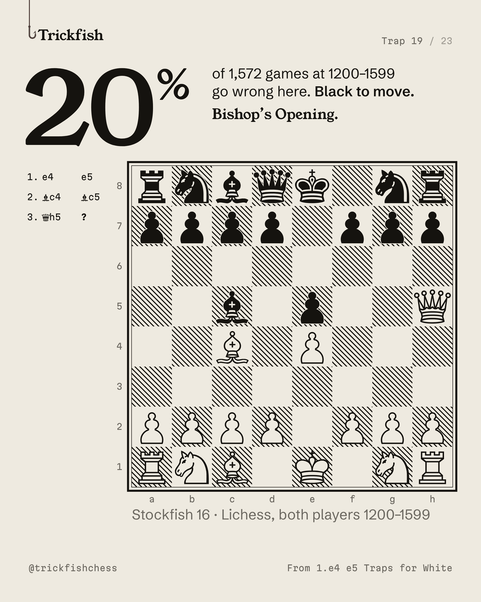

Image: `social/images/trap-19.png`

### 20:00 · evening · Reply to: *Your coach calls 3.Qh5 a beginner move. Stockfish has Black *

```text
3...g6 kicks the queen and feels right. The queen takes e5 with check instead, and the h8 rook is next.

3...Nf6?? allows 4.Qxf7# at once. That came up 33 times, and White scored 29½ points, so not everyone found mate in one.

Trap 19 of 23: https://ceemv22.gumroad.com/l/e4e5-traps-white
```

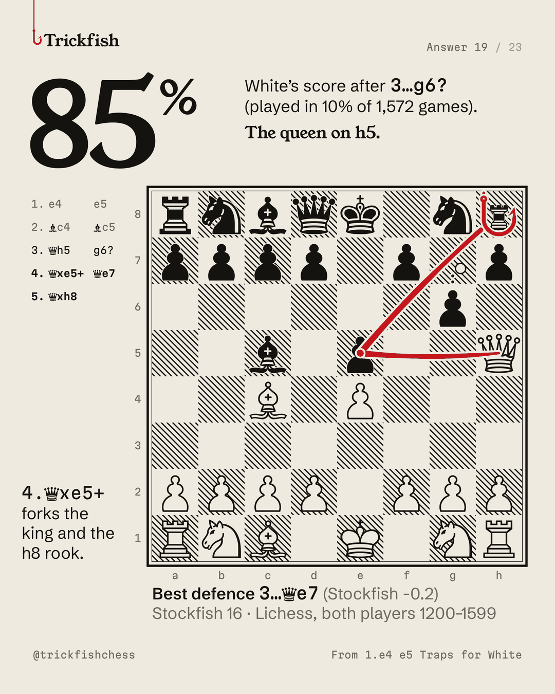

Image: `social/images/trap-19-answer.png`

---

## Day 3 · Thu 12 Nov

### 14:00 · morning · New post

```text
The Petrov is supposed to be the dull one.

5.d3 kicks the knight on e4. Where does it go?
```

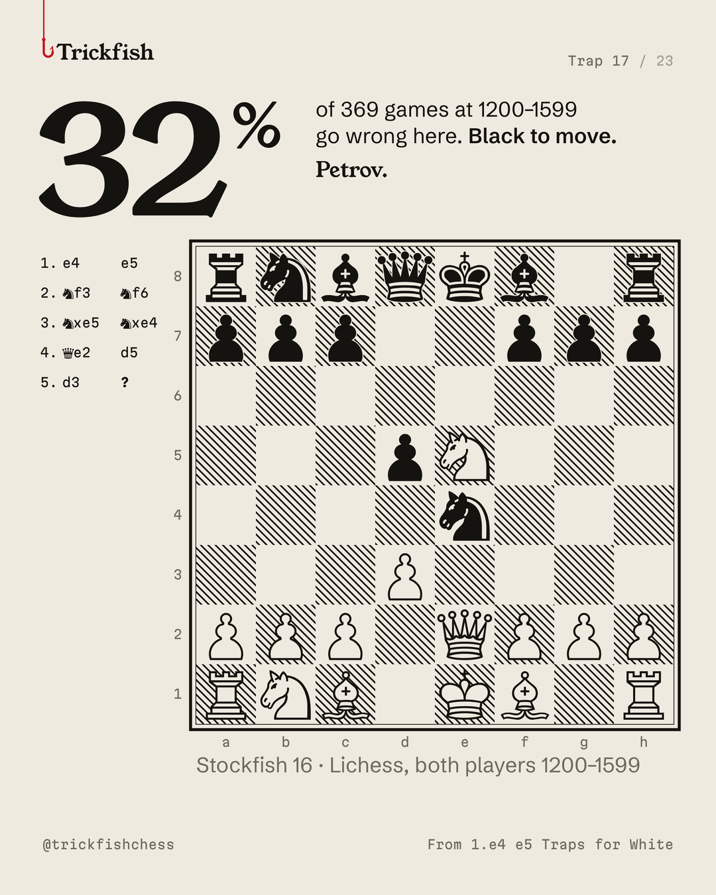

Image: `social/images/trap-17.png`

### 20:00 · evening · Reply to: *The Petrov is supposed to be the dull one.*

```text
Nowhere yet. Once it leaves e4, White's e5 knight can move with discovered check, and 6.Nc6+ also hits the queen on d8.

5...Qe7 first, then worry about the knight. A quarter of games went that way.

Trap 17 of 23: https://ceemv22.gumroad.com/l/e4e5-traps-white
```

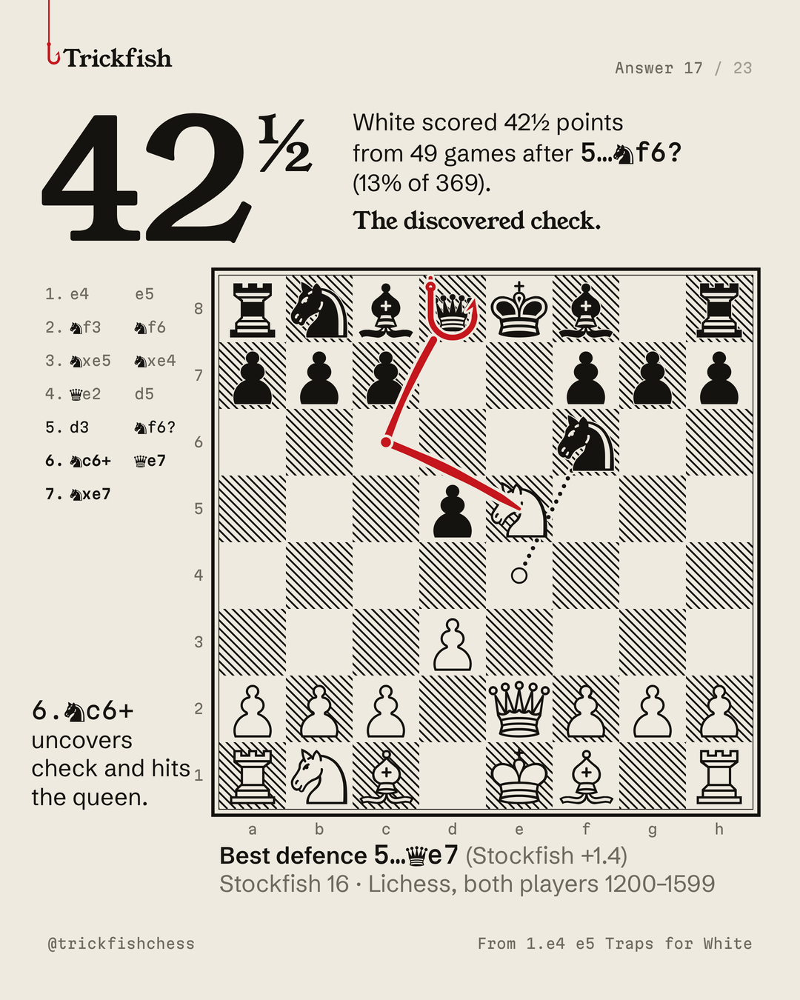

Image: `social/images/trap-17-answer.png`

---

## Day 4 · Fri 13 Nov

### 14:00 · morning · New post

```text
Ruy Lopez, White just took on e5. Black to move.

Only 100 games reached this one, so it's a small sample. Most of them went the same way.
```

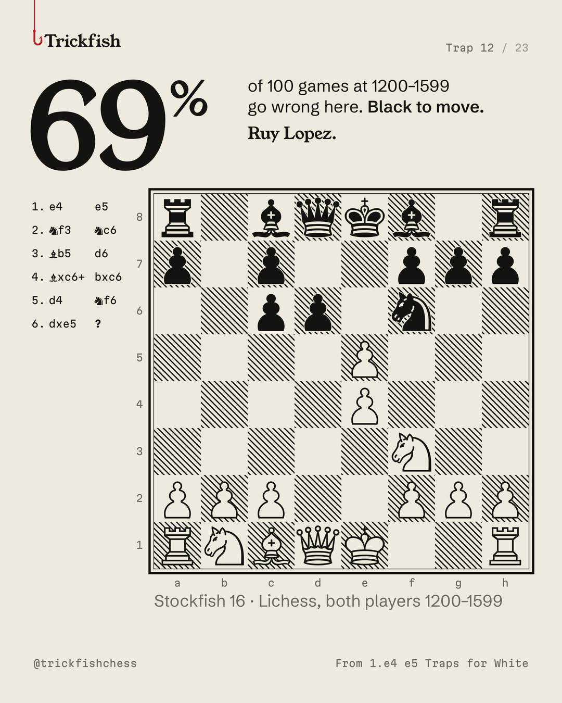

Image: `social/images/trap-12.png`

### 20:00 · evening · Reply to: *Ruy Lopez, White just took on e5. Black to move.*

```text
6...dxe5 is the recapture your hand makes on its own. It loses a pawn: 7.Qxd8+ Kxd8 8.Nxe5, and c6 is loose too.

6...Nxe4 takes a pawn back first and Black is fine. 30 of the 100 found it.

Trap 12 of 23: https://ceemv22.gumroad.com/l/e4e5-traps-white
```

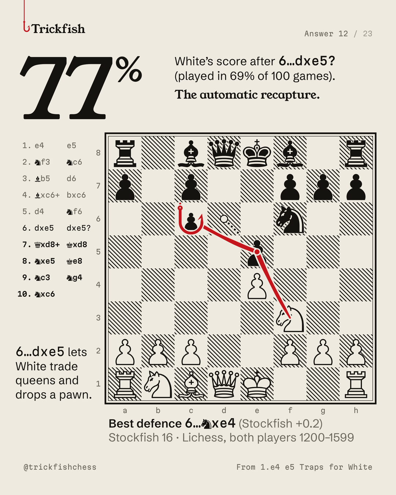

Image: `social/images/trap-12-answer.png`

---

## Day 5 · Sat 14 Nov

### 14:00 · morning · New post

```text
Vienna Gambit, 3.f4. Stockfish's top answer for Black turns up in about one game in ten. What's yours?
```

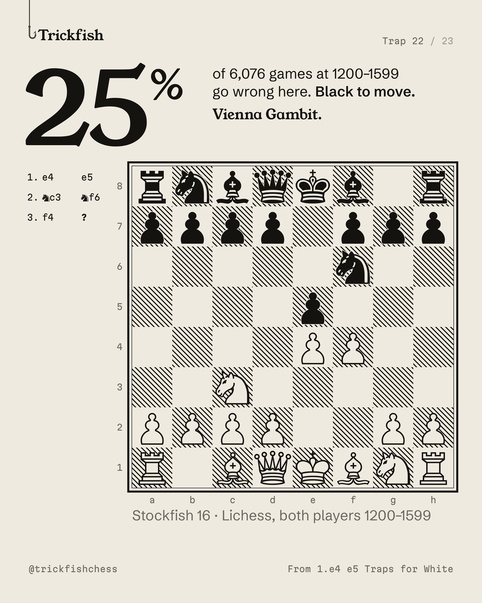

Image: `social/images/trap-22.png`

### 20:00 · evening · Reply to: *Vienna Gambit, 3.f4. Stockfish's top answer for Black turns *

```text
Stockfish wants 3...d5, hitting back in the centre. Only 10% of games went that way.

3...Nc6 looks like normal development. Then 4.fxe5 Nxe5 5.d4 Ng6 6.e5, and the f6 knight is back on g8 by move 6.

Trap 22 of 23: https://ceemv22.gumroad.com/l/e4e5-traps-white
```

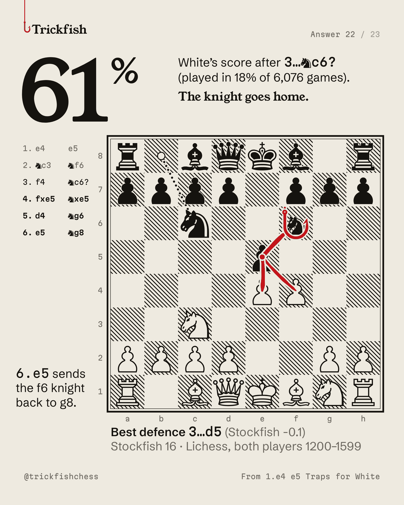

Image: `social/images/trap-22-answer.png`

---

## Day 6 · Sun 15 Nov

### 14:00 · morning · New post

```text
Three Knights, after the fork trick. White's queen is sitting on d4.

Black to move.
```

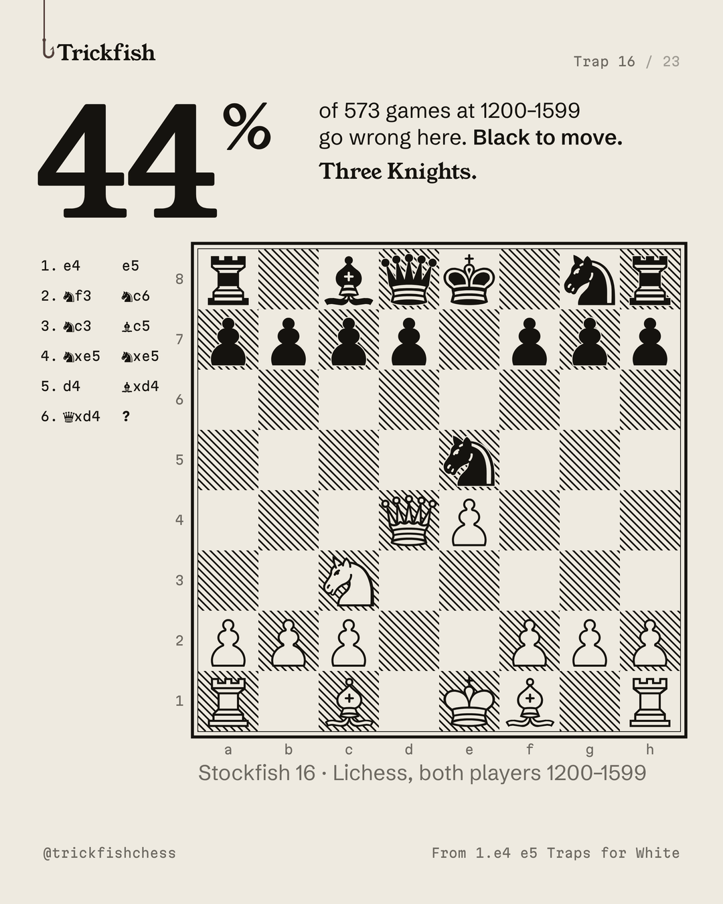

Image: `social/images/trap-16.png`

### 20:00 · evening · Reply to: *Three Knights, after the fork trick. White's queen is sittin*

```text
6...Nc6 hits the queen and gives up g7. 7.Qxg7 hits the h8 rook, and the rook has no squares.

6...d6 is dull and correct (45% of games). Even then Stockfish has White +1.8.

Trap 16 of 23: https://ceemv22.gumroad.com/l/e4e5-traps-white
```

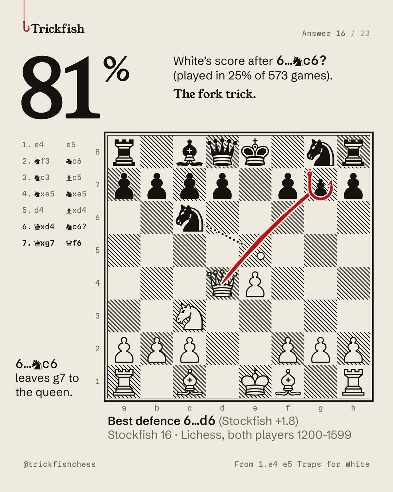

Image: `social/images/trap-16-answer.png`

---

## Day 7 · Mon 16 Nov

### 14:00 · morning · New post

```text
Traxler players, this one's yours.

White has taken your rook. You have a bishop on f2 and a lot of confidence. Black to move.
```

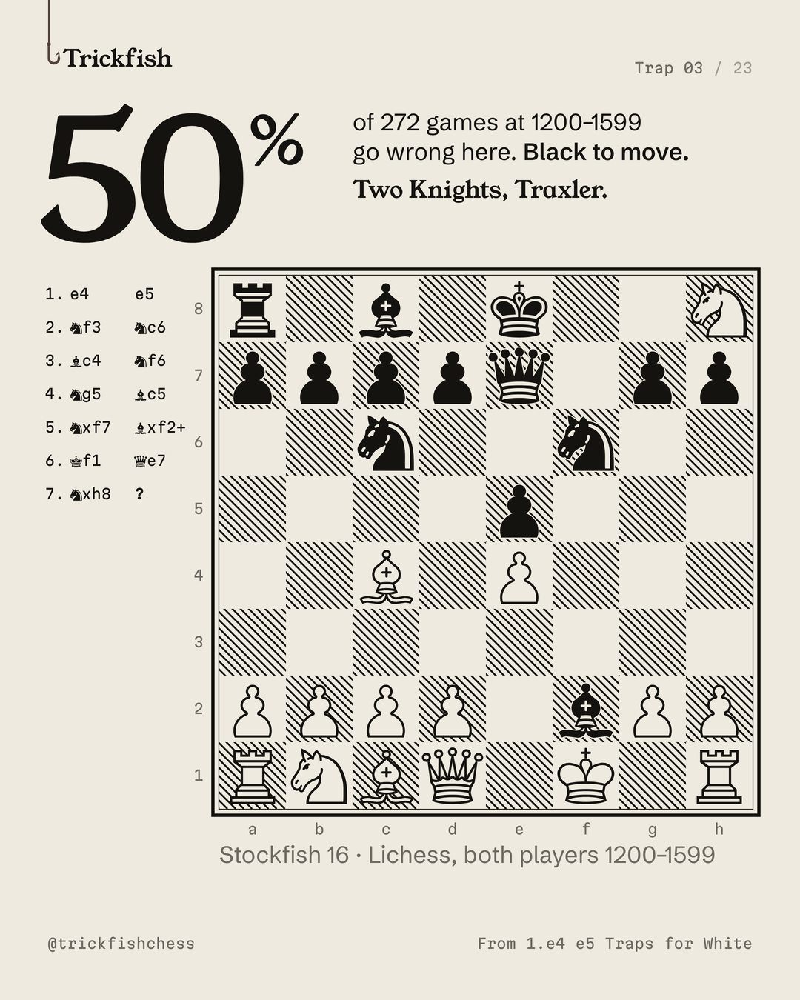

Image: `social/images/trap-03.png`

### 20:00 · evening · Reply to: *Traxler players, this one's yours.*

```text
7...Nxe4 is the Traxler player's reflex, and half of them played it. 8.Qh5+! g6 9.Nxg6 frees the stuck knight with tempo, and the queens come off soon after.

7...d5 was the other popular try. White scored 40% after that one.

Trap 3 of 23: https://ceemv22.gumroad.com/l/e4e5-traps-white
```

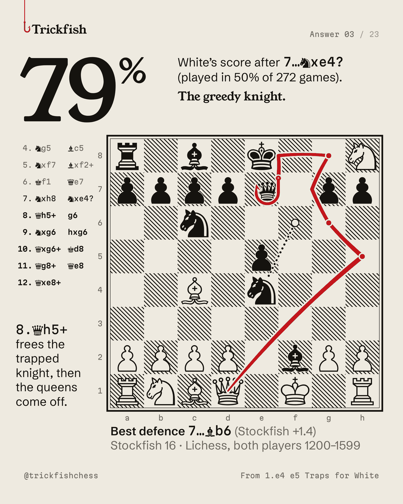

Image: `social/images/trap-03-answer.png`

---

## Day 8 · Tue 17 Nov

### 14:00 · morning · New post

```text
Scotch, 5.Be3. One of Black's most natural developing moves loses a piece here.

Black to move.
```

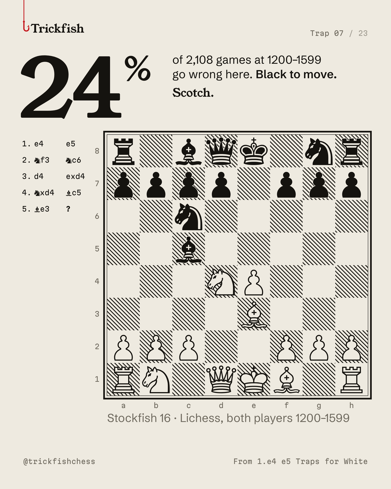

Image: `social/images/trap-07.png`

### 20:00 · evening · Reply to: *Scotch, 5.Be3. One of Black's most natural developing moves *

```text
5...Nf6. After 6.Nxc6 bxc6 7.Bxc5, White has taken a bishop nobody was guarding.

The most popular reply, 5...Qf6, is also the right one. White scored 47% against it.

Trap 7 of 23: https://ceemv22.gumroad.com/l/e4e5-traps-white
```

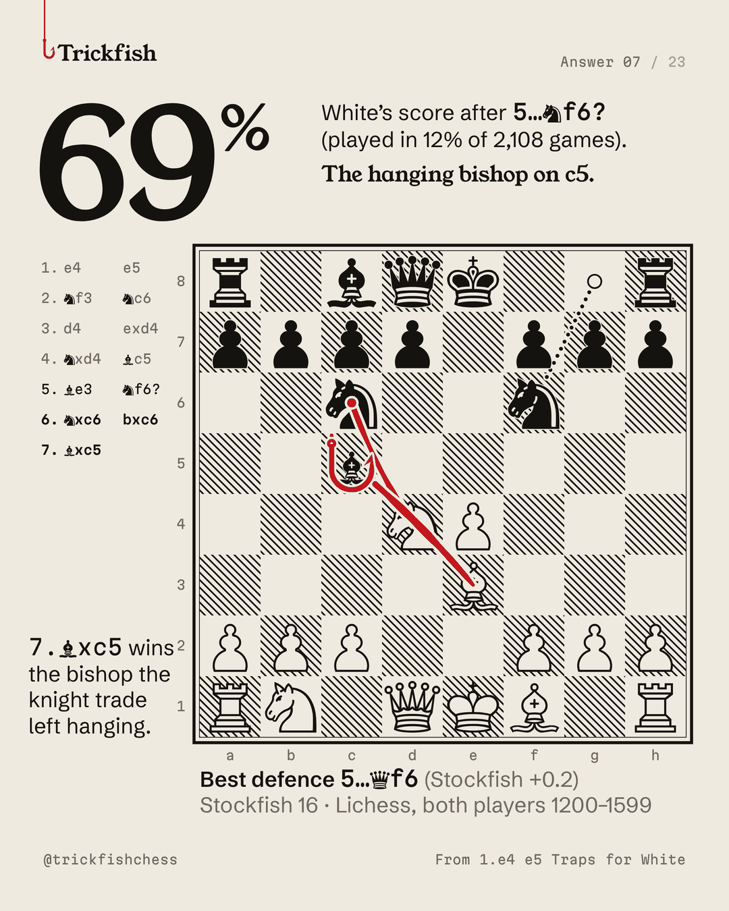

Image: `social/images/trap-07-answer.png`

---

## Day 9 · Wed 18 Nov

### 14:00 · morning · New post

```text
Ruy Lopez, 5.c3. Of Black's four most-played moves here, two lose material.

Black to move.
```

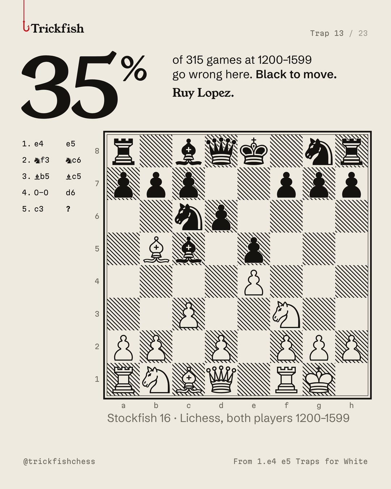

Image: `social/images/trap-13.png`

### 20:00 · evening · Reply to: *Ruy Lopez, 5.c3. Of Black's four most-played moves here, two*

```text
5...Bg4 pins the f3 knight and forgets its own pin. 6.d4 Bxf3 7.gxf3 Bb6 8.d5, and the c6 knight can't move.

5...Nf6 is worse still by Stockfish's count. 5...a6, asking the bishop first, solves it. A quarter of games went that way.

Trap 13 of 23: https://ceemv22.gumroad.com/l/e4e5-traps-white
```

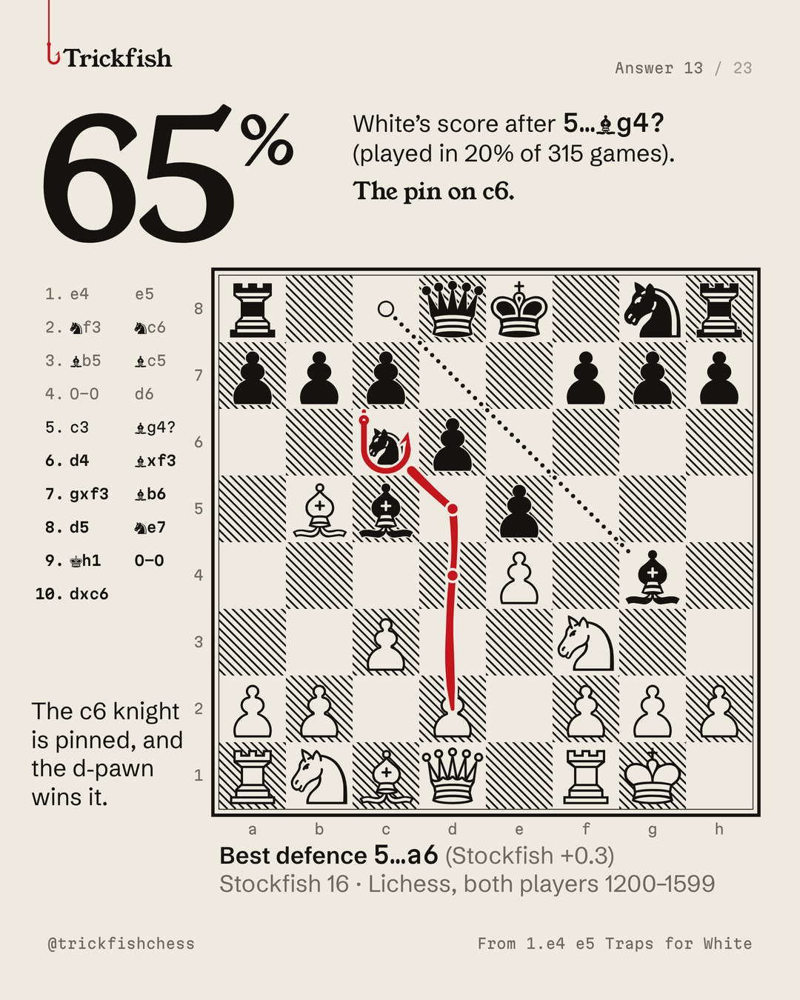

Image: `social/images/trap-13-answer.png`

---

## Day 10 · Thu 19 Nov

### 14:00 · morning · New post

```text
Back to 3.Qh5. The most common answer, 3...Qf6, holds everything.

Then 4.Nf3. Black would like that queen gone from h5. Black to move.
```

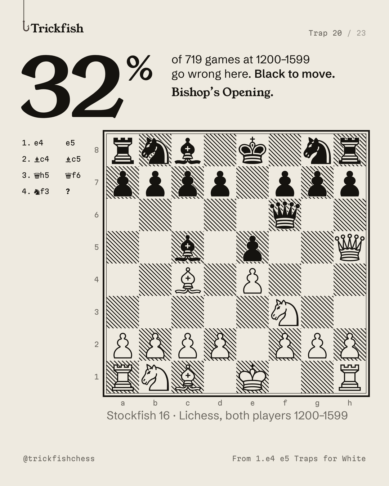

Image: `social/images/trap-20.png`

### 20:00 · evening · Reply to: *Back to 3.Qh5. The most common answer, 3...Qf6, holds everyt*

```text
4...g6 chases the queen and leaves e5 hanging. 5.Qxe5+ forces the queens off, and the knight lands on e5 aiming at f7.

4...d6 protects e5, and it was the most popular reply. As White, you set this one with 4.Nf3.

Trap 20 of 23: https://ceemv22.gumroad.com/l/e4e5-traps-white
```

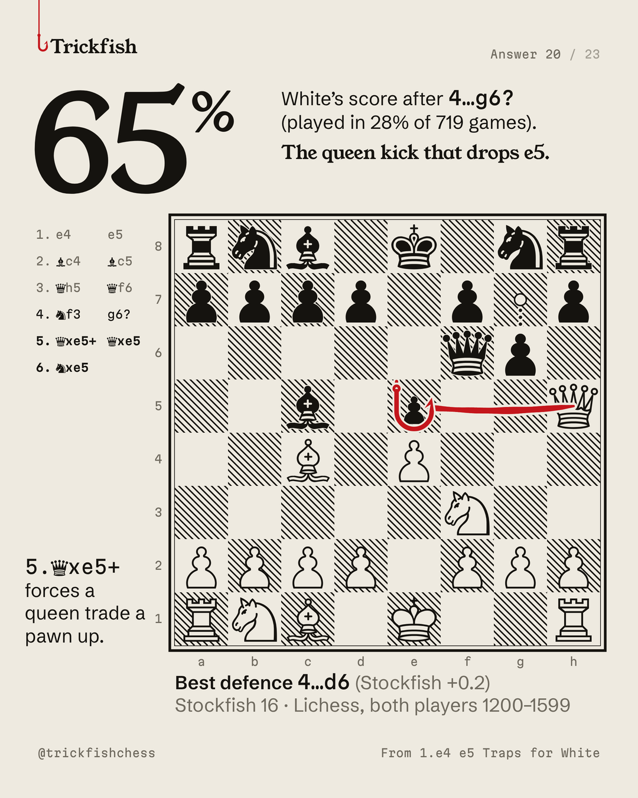

Image: `social/images/trap-20-answer.png`

---

## Day 11 · Fri 20 Nov

### 14:00 · morning · New post

```text
Scotch, 6.e5. The knight on f6 is attacked. What do you play?
```

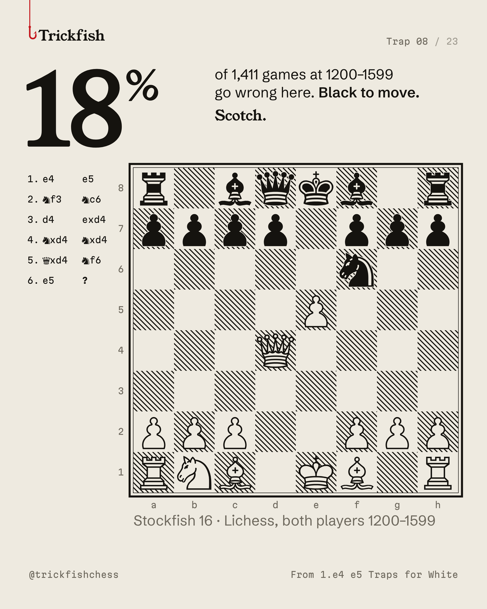

Image: `social/images/trap-08.png`

### 20:00 · evening · Reply to: *Scotch, 6.e5. The knight on f6 is attacked. What do you play*

```text
If you went 6...Nh5, 7.g4 leaves the knight no squares. Black can save it with 7...Qh4 and some contortions, but White scored 71% after 6...Nh5.

6...c5 (Stockfish's pick) or 6...Ng8 avoids all of it.

Trap 8 of 23: https://ceemv22.gumroad.com/l/e4e5-traps-white
```

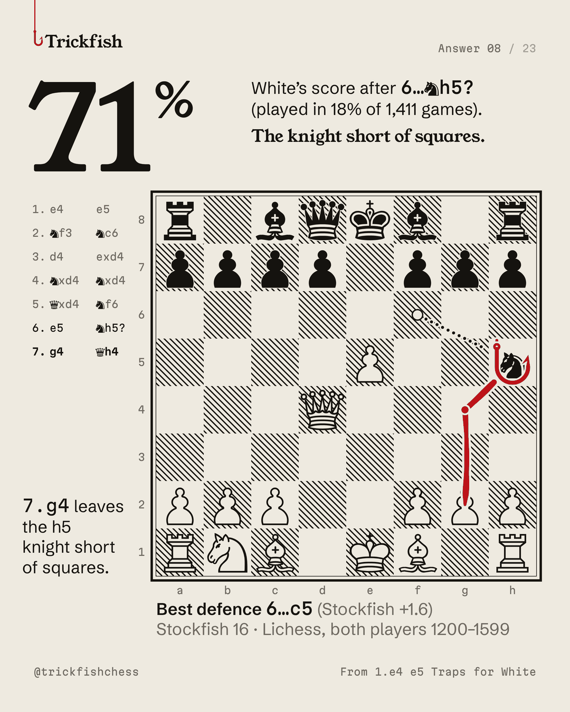

Image: `social/images/trap-08-answer.png`

---

## Day 12 · Sat 21 Nov

### 14:00 · morning · New post

```text
Vienna Gambit accepted, 4.e5. The knight on f6 is attacked, and Black has a clever-looking way to avoid retreating it.

Black to move.
```

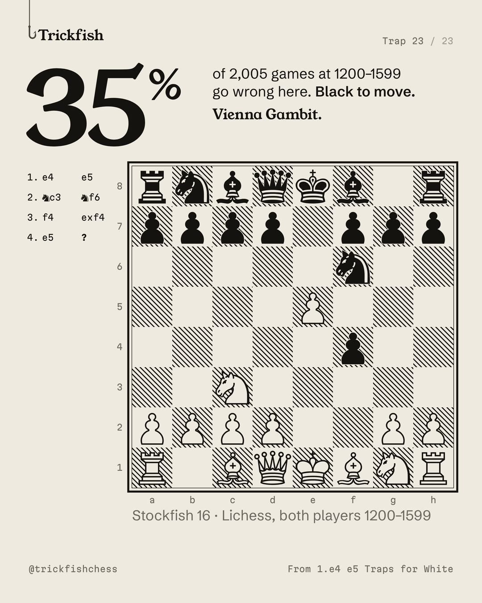

Image: `social/images/trap-23.png`

### 20:00 · evening · Reply to: *Vienna Gambit accepted, 4.e5. The knight on f6 is attacked, *

```text
4...Qe7 pins e5 so the knight can stay. 5.Qe2 breaks the pin, the knight goes to g8 anyway, and Black's queen now blocks its own bishop.

4...Ng8 straight away was the most common move, and the best.

Trap 23 of 23: https://ceemv22.gumroad.com/l/e4e5-traps-white
```

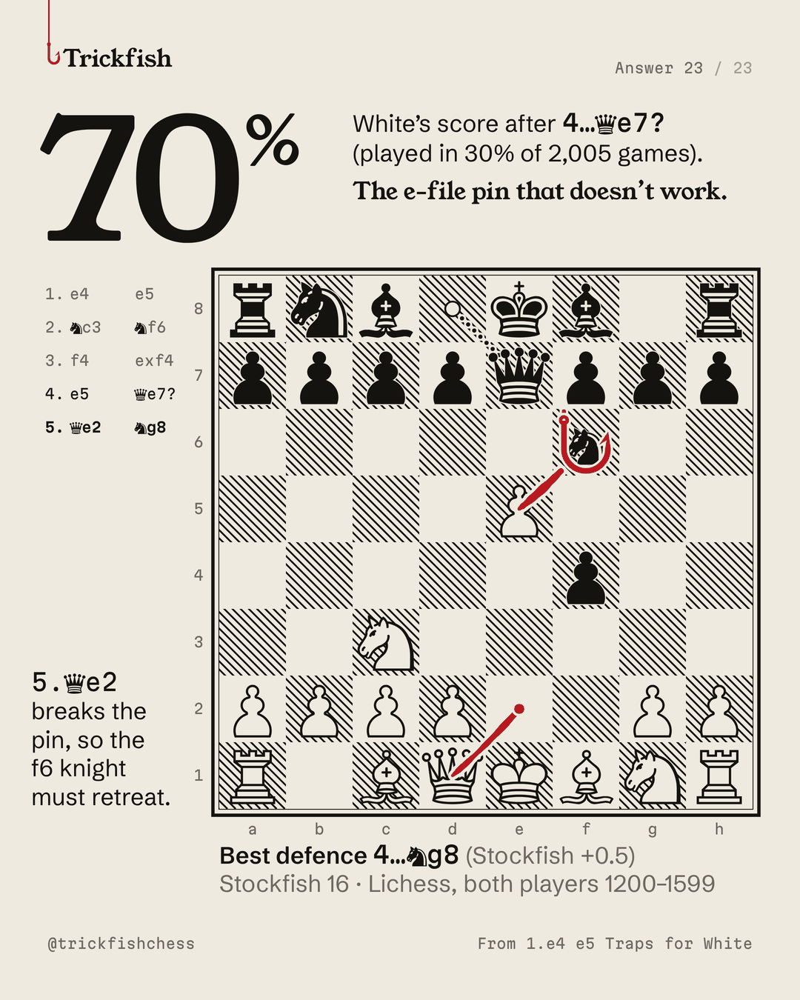

Image: `social/images/trap-23-answer.png`

---

## Day 13 · Sun 22 Nov

### 14:00 · morning · New post

```text
Giuoco Piano, after the bishop trade on d2. Black's most popular move here is a mistake.

Black to move.
```

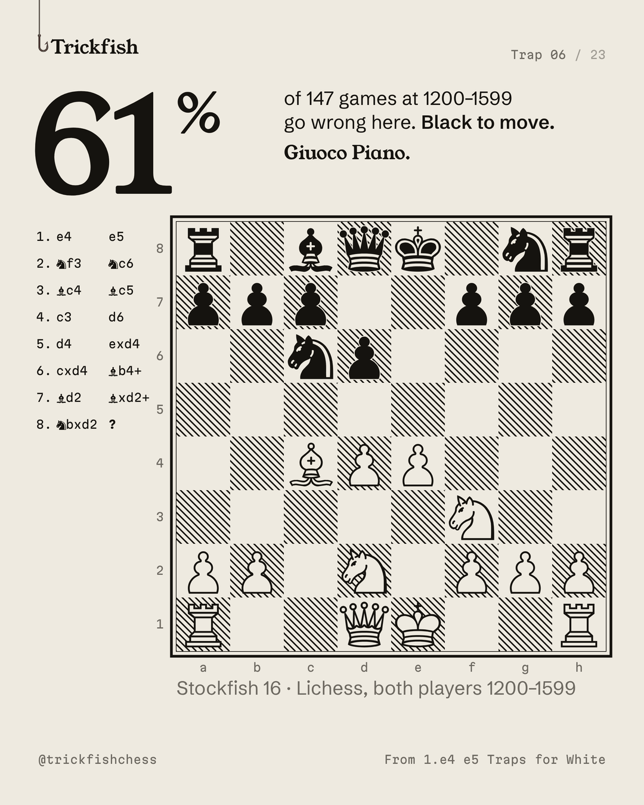

Image: `social/images/trap-06.png`

### 20:00 · evening · Reply to: *Giuoco Piano, after the bishop trade on d2. Black's most pop*

```text
The tempting one is 8...Bg4, pinning the knight. Then 9.Qb3 hits b7 and lines up with the c4 bishop against f7.

8...Nf6 was the move. 19% of games went that way.

Trap 6 of 23: https://ceemv22.gumroad.com/l/e4e5-traps-white
```

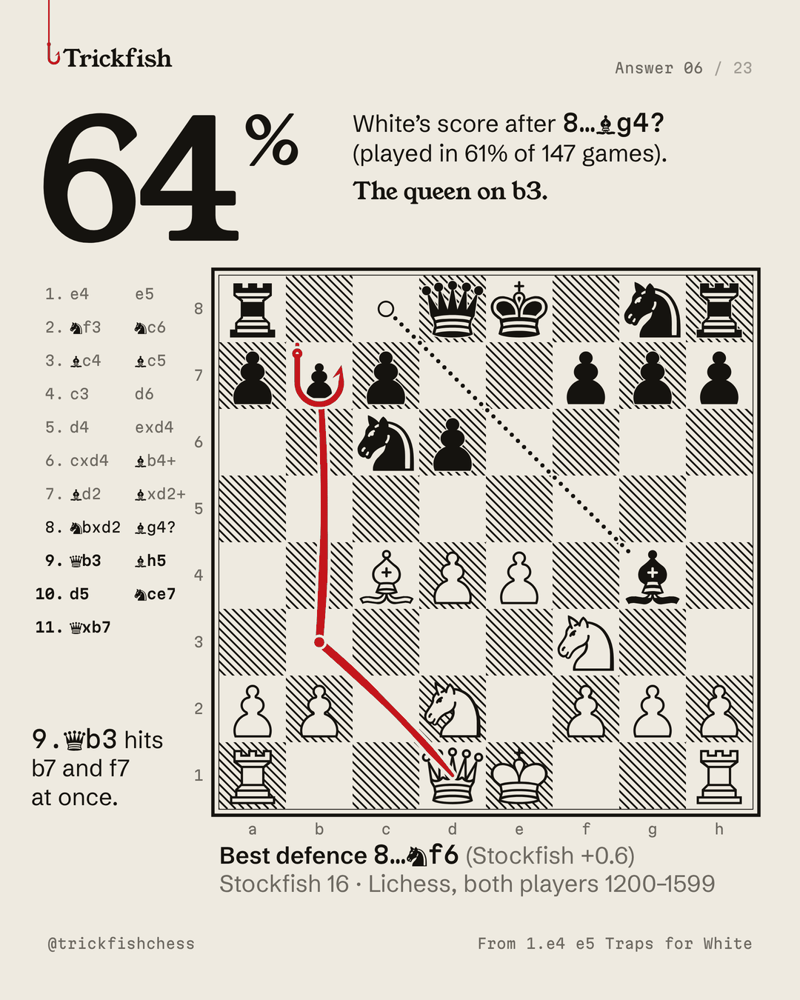

Image: `social/images/trap-06-answer.png`

---

## Day 14 · Mon 23 Nov

### 14:00 · morning · New post

```text
Ruy Lopez again, by a different road. Black to move after 5.c3.
```

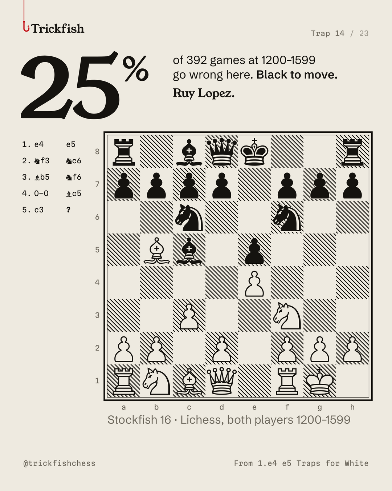

Image: `social/images/trap-14.png`

### 20:00 · evening · Reply to: *Ruy Lopez again, by a different road. Black to move after 5.*

```text
5...d6 opens the diagonal and pins its own c6 knight. 6.d4 Bb6 7.d5 wins it for a pawn. 5...O-O keeps the knight free.

Same position as Day 9 after 5...Nf6.

14 traps in 14 days. The pack has all 23, with drills and a PGN.

Trap 14 of 23: https://ceemv22.gumroad.com/l/e4e5-traps-white
```

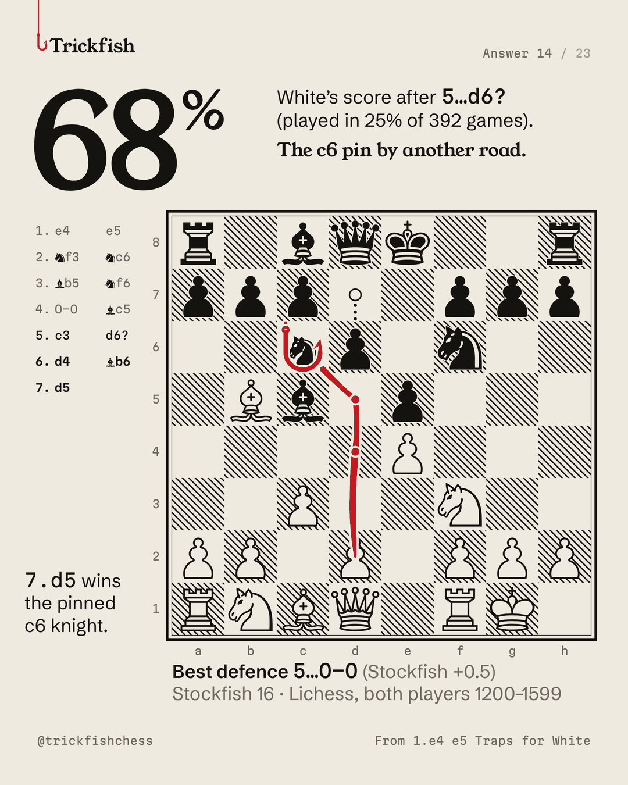

Image: `social/images/trap-14-answer.png`

---

## Day 15 · Tue 24 Nov

### 14:00 · morning · New post

```text
The busiest position in the pack is the Vienna Gambit after 3.f4. 6,076 games reached it, and in about one in four Black chose a reply that costs 1.2+ pawns.

The most common, 3...Nc6, came up 1,087 times. That's more than any other mistake in the data.
```

---

## Day 16 · Wed 25 Nov

### 14:00 · morning · New post

Poll options: **4...Nxe4 / 4...dxe5 / Something else** (5 hours)

```text
1.e4 e5 2.Nf3 Nf6 3.d4 d6 4.dxe5

Black to move. Which would you play?
```

### 20:00 · evening · Reply to: *1.e4 e5 2.Nf3 Nf6 3.d4 d6 4.dxe5*

```text
4...Nxe4. Taking the pawn back first was the move. 41% of the 164 games found it.

4...dxe5 was more popular (55%). 5.Qxd8+ Kxd8 6.Nxe5 and White is a pawn up. White scored 64% after it.
```

---

## Day 17 · Thu 26 Nov

### 14:00 · morning · New post

```text
Myth: win a pawn and the points follow.

1.e4 e5 2.Nf3 Nc6 3.d4 d6 4.dxe5 dxe5 5.Qxd8+. After 5...Nxd8? 6.Nxe5, White is a clean pawn up and scored 61%. After the correct 5...Kxd8, White also scored 61%.

1,044 games. The extra pawn changed nothing in the score.
```

---

## Day 18 · Fri 27 Nov

### 14:00 · morning · New post

```text
Is the move most people play the right one? Across the pack's 23 positions:

13 times it's Stockfish's top move.
6 times it's a mistake costing 1.2+ pawns.
4 times it's neither.

So the crowd is right a bit more than half the time.
```

---

## Day 19 · Sat 28 Nov

### 14:00 · morning · New post

```text
38 positions passed our three tests. 23 are in the pack.

We cut the ones with the smallest samples. Four of the 15 had fewer than 100 games: 85, 90, 92 and 95. We also cut positions that repeated an idea already in the pack.

Every page shows its game count.
```

---

## Day 20 · Sun 29 Nov

### 14:00 · morning · New post

```text
For anyone who just found us: 23 traps from 902,003 Lichess games at 1200–1599. A 37-page PDF with drills and an answer key, plus a PGN. $14.

https://ceemv22.gumroad.com/l/e4e5-traps-white

Trap 1 is free in the pinned thread.
```

---

## Day 21 · Mon 30 Nov

### 14:00 · morning · New post

Poll options: **5...Nd6 / 5...Nf6 / 5...d5 / 5...f5** (5 hours)

```text
1.e4 e5 2.Nf3 Nc6 3.Bb5 Nf6 4.O-O Nxe4 5.Re1

Black to move. Which would you play?
```

### 20:00 · evening · Reply to: *1.e4 e5 2.Nf3 Nc6 3.Bb5 Nf6 4.O-O Nxe4 5.Re1*

```text
5...Nd6 is Stockfish's pick (32% of 537 games). 5...Nf6 is close, a third of a pawn worse (29%).

5...d5 came up in 20% and costs 2.3 pawns. 6.d3 kicks the knight and White wins material in the centre. White scored 66%.
```

---

## Day 22 · Tue 01 Dec

### 14:00 · morning · New post

```text
We only counted games where both players were rated 1200–1599, and we left out bullet.

A 1500 beating a 1900 says less about 1500s than a 1500 playing a 1500. Blitz, rapid and classical only.
```

---

## Day 23 · Wed 02 Dec

### 14:00 · morning · New post

```text
Myth: if Stockfish says White is winning, White wins.

Vienna Gambit, 3.f4 Bb4. Stockfish has White +2.8 after it. In 251 games White scored 55%.

That's why our third test looks at White's score, not just the eval.
```

---

## Day 24 · Thu 03 Dec

### 14:00 · morning · New post

```text
7 of the 23 positions in the pack rest on fewer than 200 games. The smallest has 100. The biggest has 6,076.

Every page shows its count. A percentage from 100 games is a hint, not a law.
```

---

## Day 25 · Fri 04 Dec

### 14:00 · morning · New post

Poll options: **1.e4 c5, as White / 1.d4 d5, as White / 1.e4 e5, as Black / 1.d4, as Black** (24 hours)

```text
If we run the numbers on another opening, which one?

No promises. Just counting votes.
```

---

## Day 26 · Sat 05 Dec

### 14:00 · morning · New post

```text
When we say White scored 82%, we mean points per game. A win is 1, a draw is ½.

It isn't a win rate. After 7...Ke8 in the Fried Liver, White scored 82% across 756 games.
```

---

## Day 27 · Sun 06 Dec

### 14:00 · morning · New post

```text
Fried Liver, 7.Qf3+. Black played 7...Kg8 in 228 games.

White took 228 points from those 228 games. No draws, no losses.
```

---

## Day 28 · Mon 07 Dec

### 14:00 · morning · New post

```text
Trap 1 is in the pinned thread. The other 22 are in the pack: a 37-page PDF with a drill for each trap, plus a PGN for your Lichess study. $14, and a refund within 30 days if it's not for you.

https://ceemv22.gumroad.com/l/e4e5-traps-white
```

---

## Day 29 · Tue 08 Dec

### 14:00 · morning · New post

```text
Where the 23 traps start: 18 come after 1.e4 e5 2.Nf3, three after 2.Bc4 and two after 2.Nc3.

By page title, Scotch has the most with five. Ruy Lopez has four.
```

---

## Day 30 · Wed 09 Dec

### 14:00 · morning · New post

```text
The pack covers White after 1.e4 e5, and only 1200–1599 games. Expect stronger players to fall for these less often.

It won't promise rating points. The games already happened. Yours haven't.
```
