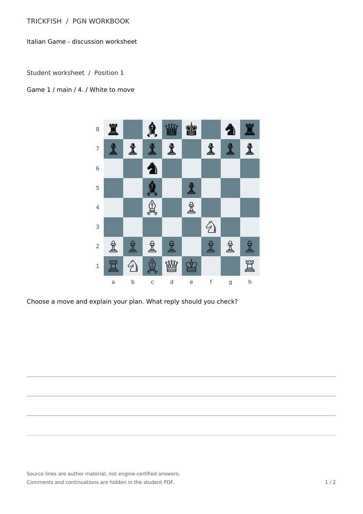
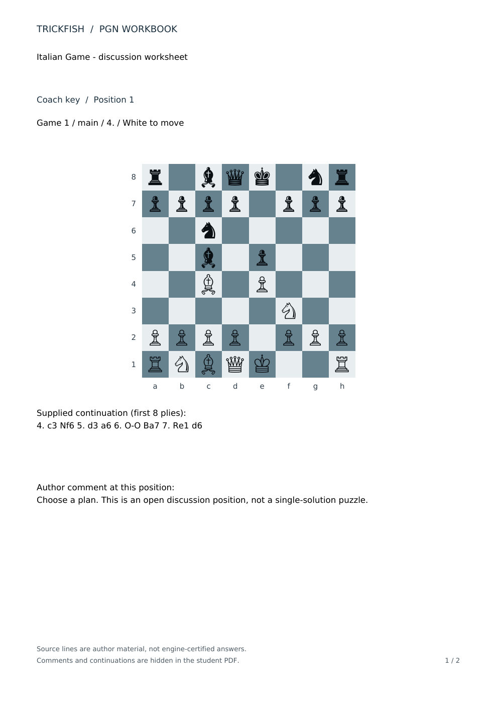

# PGN Workbook: inspect the output before buying

PGN Workbook turns supplied chess lines into student worksheets and a separate coach key. It runs locally on Windows x64. The prepared [Windows preview download is on Gumroad](https://ceemv22.gumroad.com/l/trickfish-pgn-workbook) at USD 9 before applicable checkout taxes. Workbook source is GPL-3.0-or-later; paying for the prepared binary does not restrict redistribution rights.

## Free example

No purchase is needed to inspect these files:

- [Input PGN](../examples/workbook-demo.pgn)
- [Student PDF: two pages](workbook-preview/student.pdf)
- [Coach PDF: two pages](workbook-preview/coach.pdf)

The export uses positions **1 and 3** from that PGN, with White at the bottom of both boards. The sample is a format demonstration using supplied analysis lines, not a chess course or a certified tactical exercise.

### Student output

The student sheet shows the selected board, common question and writing space. Source comments and continuations are hidden. Answers entered into the shared title or question would still be visible.

### Coach output

The separate key shows the selected node's original comment and up to eight plies of its supplied first continuation. A supplied continuation is not necessarily a best move.

## First export

1. Extract the complete application ZIP and open `TrickfishWorkbook.exe`.
2. Click **Open example**, or load your own UTF-8 PGN.
3. Select positions and set the common question.
4. Export into a new folder, then open the student and coach PDFs separately.

The app imports comments and side variations and checks legal replay. It does not run an engine, invent solutions, profile a player or offer per-position question editing. Limits are 5 MB per PGN, 2000 imported positions and 50 selected positions per workbook. This is an unsigned preview build; clean-machine compatibility is not certified. Do not disable security protections if Windows blocks it.

See [setup and limitations](pgn-workbook.md), [customer first-use instructions](workbook-customer-start.md) and [the exact license scope](../WORKBOOK-LICENSE-SCOPE.md). The logo and unrelated engine code are outside the Workbook license grant. No playing-strength gain or time saving has been demonstrated.
